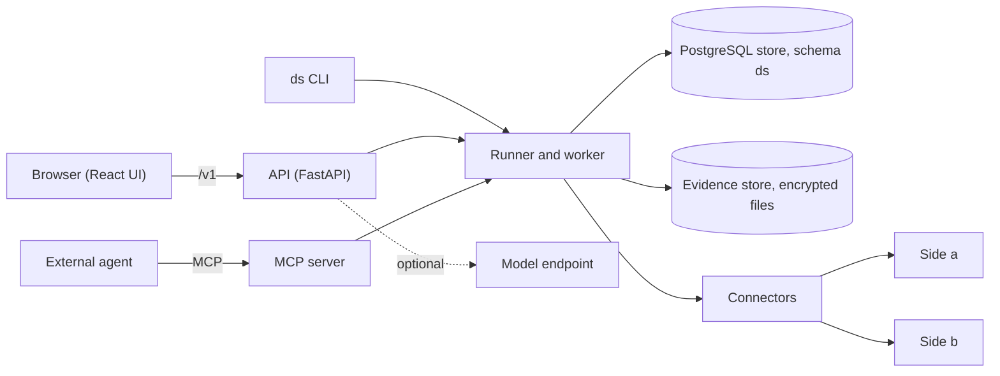

# DeltaSleuth: design and architecture

This document describes DeltaSleuth as it is built: its design, where each part lives in the code, and
where an enhancement would fit. To install and operate it, read [deployment.md](deployment.md). To use it,
read [user-guide.md](user-guide.md). The overview is the [README](../README.md); the licence is
[Apache-2.0](../LICENSE).

## 1. What DeltaSleuth is

DeltaSleuth is a self-hosted tool that compares two sources key by key and reports every difference. A
source is a REST service, a database table or view, or a directory of CSV or Parquet files. For each key it
reads both sides, maps each answer into one canonical document, finds the differences, groups them into
probable root causes and reports them with values masked. Its main use is to show that a new system returns
what the old one returns, before and during a cut-over. It is not a migration tool, a monitor of live
traffic or a test framework. It only reads. It never writes to a compared system, and it never decides
which side is right.

Design principles:

- **A deterministic engine decides.** Outcomes, findings and root causes come from code and the spec. A language model only explains them, and each answer must cite stored ids.
- **Black box.** It calls declared endpoints and reads declared tables and columns. It never depends on how a system is built.
- **Fetching is separate from comparing.** Every read is stored as evidence before it is judged. A stored observation is judged again from its evidence when a key is viewed or rechecked, and captured samples run again without a live call.
- **Every key gets a result.** A key that cannot be read is `INCONCLUSIVE`. Nothing is suppressed silently: a suppressed finding names the rule that suppressed it.
- **Personal values are tokenised.** Values are tokenised by default. People, reports and models see keyed tokens unless a spec declares a path clear.
- **Polite to targets.** Each target has one rate budget, an in-flight cap and a circuit breaker.
- **Minimal and extendable.** Extension goes through a few small seams (section 11), not through switches.

## 2. The parts

`ds serve` runs the API, the UI and the worker in one process. `ds worker` runs a worker alone. The CLI uses
the same Python code as the API and opens the store directly. Docker Compose runs two containers,
PostgreSQL 16 and the application ([deploy/docker-compose.yml](../deploy/docker-compose.yml)).

## 3. How a run works

A run compares the keys of one stored spec version. Its mode is `one_shot` (one key now), `batch` (a key
set once) or `soak` (the same comparison in repeated cycles).

1. **Create.** The spec is validated, compiled and stored as an immutable version in `ds.specs`. The run freezes what its targets declare and, for table sides, the column plan, so a later change does not alter it.
2. **Key source.** Keys come with the run or from the spec's `key.source`: an inline `list`, a `paginated_endpoint`, a key table, or a `hash_sample` of a larger population. Between two tables a scan is the key source: both sides stream each key and a row hash in key order, equal rows count as `MATCH`, and only the other keys are queued. Keys are stored masked and sealed in `ds.run_keys`.
3. **Leases and the single active worker.** One worker per database holds a PostgreSQL advisory lock; any other waits. Its slots lease due keys and renew the leases. A group's observations, results and findings are saved in one transaction, and a lost lease rolls it back. A killed worker costs only the keys in flight and never duplicates a result.
4. **Fetch both sides.** One connector per side reads under its target's gate: the rate budget (`rate_per_s`, default 20), the in-flight cap, retries with backoff and a circuit breaker. Each read, a failed one included, is stored as evidence first.
5. **Observe.** Each read is judged against the declared contract and becomes `COMPLETE`, `ABSENT`, `INCOMPLETE` or `ERROR`. A side is `ABSENT` only when the spec and the target both declare that answer an authoritative not-found.
6. **Select and map.** A service side applies `select` (JSONPath) and `map` (JSONata). A table side maps its declared columns to canonical fields. Both sides give one canonical shape.
7. **Normalise.** Per-field normaliser chains run on a copy. Arrays are matched as `ordered`, `set`, `keyed` or `multiset`. The raw tree and the normalised tree are both kept and hashed.
8. **Diff.** A structural diff compares the two documents, with `exact`, `tolerance` or `similarity` per field. A difference that a normaliser or a tolerance removed is still reported, at severity `INFO`.
9. **Classify.** Each finding gets a taxonomy code, a severity, a value class and a signature. Known-difference rules mark matching findings as suppressed. The key's outcome is `MATCH`, `MISMATCH`, `KNOWN_DIFF`, `NOT_FOUND_A`, `NOT_FOUND_B`, `DRIFT` or `INCONCLUSIVE`.
10. **Recheck.** A discrepant key is read again after `recheck.delay`, side b first. If side a changed, or side b now agrees, the outcome is `DRIFT`. If nothing changed, the first outcome is confirmed.
11. **Root-cause grouping.** When a cycle ends, discrepant findings are grouped. The same array member missing or extra under several keys is one cause. The rest group by signature: where and how a value differs, never which key or value. The groups are ranked in `ds.root_causes`.
12. **Cycle end.** Counters are computed from the stored results, stop conditions are judged, and `ds.cycles` keeps one row per ended cycle. A soak then starts its next cycle after its interval.
13. **Reports.** CSV exports and a PDF report are built from the store, masked.

Around a run: schedules start runs by cron; table pre-checks compare counts and sums before any key is
read; the schema guard pauses a run whose table changed; sign-off sampling draws a stratified sample of a
population too large to compare in full; bulk graph parity compares groups and components over two link
tables; readiness turns ended cycles into named gates per pair; the notifier sends webhook, e-mail, Slack
and Teams messages from the audit chain.

## 4. Code map

| Path | What it holds |
|---|---|
| `deltasleuth/api` | The public HTTP API v1 (FastAPI), one router per resource in `routes/`, and the UI it serves. |
| `deltasleuth/cli` | The `ds` command line (`main.py`). |
| `deltasleuth/core/spec` | Spec loading, validation and compilation, `spec.schema.json`, and the target registry. |
| `deltasleuth/core/canonical` | Observe, select and map, projection, normalisers, array rewriting, canonical encoding. |
| `deltasleuth/core/diff`, `deltasleuth/core/classify` | The structural diff; outcomes, taxonomy, value classes, signatures, known differences, root causes. |
| `deltasleuth/core/*.py` | Shared types and pure logic: exact JSON, sampling, cron, readiness, pre-checks, notification events. |
| `deltasleuth/connectors` | The connector protocol, REST calls, paging, templating, retries, the breaker, the network guard, captured samples. |
| `deltasleuth/connectors/tables`, `deltasleuth/connectors/postgres` | The engine seam, the column plan and per-key reads; PostgreSQL, MySQL, Oracle and the DuckDB file reader. |
| `deltasleuth/runner` | Runs, key sets, the worker, table scans, rechecks, stop conditions, cycle ends, sampling, purge, schedules, the notifier. |
| `deltasleuth/store` | Every SQL query (`repo.py`), the migrations (`migrations/*.sql`, applied by `db.py`) and the audit chain check. |
| `deltasleuth/evidence` | The encrypted, content-addressed evidence store. |
| `deltasleuth/reports` | CSV exports, the PDF report, evidence packs, and the measuring and adjudication sheets. |
| `deltasleuth/agent`, `deltasleuth/llm`, `deltasleuth/mcp` | The cited chat agent; the model port and its dialect adapters; the MCP server. |
| `deltasleuth/auth`, `deltasleuth/security` | Principals, roles, API tokens, sessions and OIDC; tokenisation, encryption keys and pack signing. |
| `deltasleuth/profiler` | Drafts a spec from paired samples or from two tables. |
| `deltasleuth/packs` | Domain packs. `entity_linking` is the optional example. |
| `deltasleuth/*.py` | Settings (`config.py`), the shared context, and the service modules for approvals, schedules, readiness, pre-checks, notifications, targets and licences. |
| `web/` | The React and TypeScript UI (Vite), with its tests in `web/test`. |
| `mocks/` | Two mock service pairs with known ground truth. |
| `examples/` | Runnable specs: public API pairs, table pairs for each engine, file pairs and graph parity. |
| `tools/` | Maintainer tools outside the product: the benchmark harness, the release tool and the licence tool. |
| `deploy/` | The Dockerfile, the Compose files, example settings and the secrets folder. |
| `tests/` | Unit, golden, property and end-to-end tests (section 10). |

## 5. The comparison spec

A spec is one YAML or JSON document (`apiVersion: deltasleuth/v1`, `kind: ComparisonSpec`). A stored version
is immutable and is identified by its content hash. The reference is
[spec.schema.json](../deltasleuth/core/spec/spec.schema.json). The loader rules in
[rules.py](../deltasleuth/core/spec/rules.py) add the checks a schema cannot express.

| Member | What it controls |
|---|---|
| `metadata`, `normalizerVersion` | The spec's name and version; the normaliser version it is pinned to. |
| `key` | The key's name, type, pattern, privacy class and normalisers, and `key.source` (where keys come from). |
| `sides.a`, `sides.b` | Each side. A service side has `target`, `request`, `pagination`, `select`, `map`, `notFound` and `success`. A table side has `target`, `table` (name, columns, key columns with key maps, `where`, or a `file`) and `typeMap`. |
| `compare` | `fields` (normalisers, compare mode, severity), `arrays`, `include`, `exclude`, `valueFilter`, `nullEqualsAbsent`. |
| `knownDiffs` | Rules (CEL predicates) that mark accepted differences, each with a classification and a reason. |
| `recheck` | The delay, count and jitter of rechecks. Required. |
| `execution` | Concurrency, pacing, timeouts, retries, the circuit breaker, the soak interval and the `stop` conditions. |
| `security`, `retention` | The paths to tokenise or to show clear; the retention class (`standard` or `audit`). |
| `graph`, `schemaDrift`, `domainPack` | Bulk graph parity over two link tables; the schema guard for table sides; an optional domain pack. |

The schema describes more than the engine runs, for example `noise`, `canonical.mode: graph` and a
`time.mode` other than `live`. The loader refuses such a member with the code `unsupported` or accepts it
with an `ignored` warning. Nothing a spec declares is ignored silently.

## 6. The data model

All state is in the PostgreSQL schema `ds`, created by the numbered files in
[deltasleuth/store/migrations](../deltasleuth/store/migrations). Raw response bodies are not in the
database; they are in the evidence store. Settings and targets are files, not tables.

| Table | What it holds |
|---|---|
| `specs` | Immutable spec versions: name, version, content hash and body. |
| `runs` | One row per run: spec, mode, status, parameters, current cycle, counters, retention class and hold. |
| `run_keys` | The work queue: one row per key and cycle, with its state, pass, lease and sealed raw key. |
| `observations` | The metadata of each read: side, status, latency, attempts, pages and the evidence address. |
| `results` | One row per key and cycle: the outcome, both side states, the confirmation and the observations used. |
| `findings` | One row per difference: path, change type, taxonomy code, severity, masked values, rule and root cause. |
| `root_causes` | The ranked groups of a cycle's findings, with the count of affected keys and sample keys. |
| `cycles` | One row per ended cycle, never deleted: counters, census, sample judgement, readiness measures, purge record. |
| `scans`, `graph_diffs` | A table scan's progress per cycle; the groups and components that differ in graph parity. |
| `users`, `api_tokens`, `sessions` | People from the identity provider, named API tokens (hashed) and browser sessions. |
| `audit_log`, `audit_chain` | The append-only audit log and its hash chain. |
| `approvals` | Four-eyes approvals of spec versions and sign-offs of ended cycles. |
| `adjudications`, `labellings`, `sample_draws` | Sheets that people score offline, labelled accuracy samples, and every sign-off sample draw. |
| `packs`, `pack_zips` | Issued evidence packs and their signed archives. |
| `data_keys`, `blob_gc` | Wrapped data keys; evidence blobs queued for deletion. |
| `chat_sessions`, `chat_messages`, `llm_calls` | Chat turns (sealed) with their citations, and one row per model call with usage and cost. |
| `schedules` | Cron schedules that start runs of a stored spec. |
| `prechecks`, `precheck_pairs` | Table pre-checks and the verdict of each pair of tables. |
| `notify_cursor`, `notify_deliveries`, `notify_mutes` | The notifier's position in the audit chain, its deliveries and its mutes. |
| `installation`, `licences`, `schema_version` | The installation id, licence files (unused in the open build) and the applied migrations. |

## 7. Connectors

A connector turns a key and a side into one observation. It never judges the answer.

- **REST services** ([rest.py](../deltasleuth/connectors/rest.py)): `GET` and `POST` (GraphQL included), request templates, cursor, offset, page and link-header pagination, same-origin requests only.
- **Captured samples** ([files.py](../deltasleuth/connectors/files.py)): paired responses saved as files, for a run without live calls.
- **PostgreSQL, MySQL and Oracle tables and views**: read-only sessions behind one `Engine` protocol ([engine.py](../deltasleuth/connectors/tables/engine.py)). The engines share one key order and one canonical rendering, so any two can be paired, also with a service.
- **CSV and Parquet files**: read in place by DuckDB, which runs in a child reader process ([reader.py](../deltasleuth/connectors/tables/reader.py)) limited to the declared directories. A fault in DuckDB ends that process only. The files are pinned by hash when a run is created.

To add a service-like source, implement the `Connector` protocol in
[base.py](../deltasleuth/connectors/base.py) (`fetch` and `aclose`) and select it in `connect` in
`deltasleuth/runner/compare.py`. To add a database engine, implement `Engine`, add it to the `ENGINES`
registry, add its name to the target schema in `deltasleuth/core/spec/targets.py`, and give its types a
class in `deltasleuth/connectors/tables/render.py`.

## 8. Security model

The policy for reporting a vulnerability is in [SECURITY.md](../SECURITY.md).

- **Sign-in.** The settings choose one of three modes: developer mode (loopback only), named API tokens, or OIDC sign-in (code flow with PKCE) beside tokens. A token is shown once and stored as a hash.
- **Roles.** Six ordered roles: `viewer`, `operator`, `spec_author`, `rule_approver`, `pii_reader`, `admin`. Every route and agent tool checks one. A token holds at most `spec_author`. Under OIDC, roles come from identity-provider groups at each sign-in.
- **Target allow-list and network guard.** A spec names target ids only, so the target registry is the allow-list. A target is reached on public addresses only, unless it sets `allow_private_network`. Host names are checked at every connection.
- **Credentials only by file reference.** Every secret is a `file:` reference. Credentials are never read from environment variables, and a spec cannot carry one.
- **Tokenisation and masking.** Protected values become keyed HMAC tokens, separated by value class, before they are stored for display. Raw keys, headers and chat text are sealed under a data key per run.
- **Encrypted evidence and retention.** Evidence blobs are compressed, encrypted with AES-256-GCM and named by a keyed hash. Data keys are wrapped by key-encryption keys held outside the database. Ended cycles are purged after 90 days (`standard`) or 365 days (`audit`) by default. A hold keeps a run.
- **Hash-chained audit log.** `ds.audit_log` is append-only by trigger. Each row is chained in `ds.audit_chain`, and `ds audit verify` checks the chain.
- **Four-eyes approvals and sign-off.** Under OIDC, a spec version that shows values clear, suppresses findings or filters the population runs only after a person who did not write it approves its content hash. An ended cycle is signed off by a person who neither wrote the spec, started the run nor requested the sign-off. A signed-off cycle can be issued as a signed evidence pack.

## 9. The AI layer

The AI layer is optional. Without an LLM profiles file it is off, and everything else works the same.

- **Model port** ([deltasleuth/llm](../deltasleuth/llm)). A profile names an endpoint, a dialect (`openai_chat` for OpenAI-compatible endpoints, or `anthropic_messages`), a `file:` credential, the allowed data classes, budgets and prices. An egress policy is checked before every call and fails closed. Each call is logged in `ds.llm_calls` without its payload.
- **Cited agent** ([deltasleuth/agent](../deltasleuth/agent)). A chat is bound to one run. The model may call four tools: `get_run_summary`, `get_findings`, `get_observations` and `compare_key`. The tools return masked, capped data, and the model is offered only the tools the asker's role allows.
- **Answer validator.** An answer must cite at least one id (`F-`, `O-`, `RC-` or a masked key) that a tool result of the session returned. It may state no number that no tool result holds. It gets one repair attempt; otherwise the agent abstains and says why.
- **MCP server** ([deltasleuth/mcp](../deltasleuth/mcp)). An external agent reads runs through eleven tools: ten reads and `compare_key`. It is served over HTTP (`POST /v1/mcp`) and stdio (`ds mcp`), only when the settings have an `mcp` block, with the caller's role cut to `viewer` or `operator`. It offers no run control and does not check an external agent's answers.
- Model text appears only in the chat and in a labelled annex of the PDF report.

## 10. Testing and quality

| Suite | Where | What it checks |
|---|---|---|
| Unit | `tests/unit` | Each package on its own. Tests marked `db` use a PostgreSQL container. |
| Golden | `tests/golden` | 74 YAML cases that fix the engine's findings for given inputs, and fixtures for each database engine. |
| Property | `tests/property` | Hypothesis properties of the engine and the normalisers. |
| End to end | `tests/e2e` | The API, the CLI and the worker against the mock pairs, tables, files, soak runs, kill and resume, and MCP. |
| UI | `web/test` | The UI's logic modules. |

The two mock pairs are in `mocks/`: `linker` (an entity and its linked entities, in an old and a new shape)
and `customer` (a profile service, v1 and v2). Each has a dataset with planted differences and an
`expected.json`, the ground truth that the end-to-end tests assert.

Headline measurements on one Apple M3 Max machine (16 CPUs, 68.7 GB) with Docker Desktop (17 GB). The table
rows come from the harness `tools/bench.py`: one stock PostgreSQL 16 holding both sources and the store,
synthetic narrow rows, warm medians. The service row is a single run:

| Scenario | Size | Result |
|---|---|---|
| Two tables, almost no differences | 1M rows a side | 7.0 s |
| Two tables, almost no differences | 10M rows a side | 69 s (about 145,000 rows a side per second) |
| Two tables, 1% of keys differ | 10M rows a side, 100,000 differing keys | 212 s; about 750 per-key reads per second; peak memory 1.2 GB |
| Graph parity over link facts | 10M facts a side | 144 s |
| Two REST services on loopback, measured by hand | 1,000,000 keys | 2 h 27 min; 130 to 140 keys per second |

The scan is linear in rows. Memory grows with the differing keys (about 11 kB each), not with rows. 100M
rows a side has not been measured. Against a real service, the target's rate budget usually sets the pace.

## 11. Extension points and future enhancements

Extension points that exist today:

- **Connector and engine**: the `Connector` and `Engine` protocols (section 7).
- **Model dialect**: one module in `deltasleuth/llm/adapters`, loaded by the profile's `dialect` name.
- **Domain pack**: a module in `deltasleuth/packs` that exposes a `PACK` of taxonomy codes and aliases. `entity_linking` is the example: it names differences between entities and their links, such as organisations and their members.
- **Report format**: one entry in `FORMATS` in `deltasleuth/reports/__init__.py`.

Not built. Each item is a possible enhancement with no date. The spec loader refuses those a spec can name.

- Further database engines, for example SQL Server or MariaDB: one more `Engine`.
- Graph read connectors (a graph database as a side) and graph mode for service responses (`canonical.mode: graph`): a new connector and a projection in `deltasleuth/core/canonical`.
- Files in object storage and fixed-width files: the files engine.
- SQL template sides, the `lookup` key map, session and collation settings on a table side, the key sources `csv`, `sql` and `run_keys`, and `sampling.mode: hash`.
- Noise calibration and noise masks: `deltasleuth/core/classify`. The `NOISE_ONLY` outcome is reserved for them.
- Frozen and shared-watermark time alignment (`time.mode`), and change feeds as a source.
- Clustering of long-tail findings beyond the signature groups: `deltasleuth/core/classify/rootcause.py`.
- Comparing a whole stored run again under a new spec version, without new reads: `side_state` in `deltasleuth/runner/compare.py` already judges one stored observation.
- More than one active worker per database: the worker lock and the per-target gates in `deltasleuth/runner/worker.py`.
- A schema guard for service sides (`inferredSchema`), raw-body views (`rawClear`), configurable report formats and columns (`reporting`), and table diff strategies other than the row-hash scan.
- A remote tokeniser service in place of the local key file: `deltasleuth/security/tokenise.py`.
- Run control over MCP, and a token kind limited to `/v1/mcp`.
- Notifications that open issues in an external tracker, attribute-based access control, and a Kubernetes deployment.
