# DeltaSleuth: architecture and design (v2)

**Status:** v2.3; the MVP is built (`docs/mvp/`). **Date:** 2026-09-24 (v1: 2026-09-23).

**Companion files**
- [`architecture/control-plane.sql`](architecture/control-plane.sql): control-plane DDL.
- [`architecture/spec.schema.json`](architecture/spec.schema.json): spec DSL schema.
- [`architecture/examples/`](architecture/examples/): three validated example specs.

**Conventions**
- **A** = side `a` = legacy. **B** = side `b` = new. The running example compares a legacy relational service (A) with a new graph-backed service (B).
- `MISSING_*` = present in A, absent in B. `EXTRA_*` = present in B, absent in A.
- **Parity layers.** **L0** counts; **L1** the set difference of the canonical facts extracted from both stores; **L2** the structure those facts make (member-set hashes and connected components, §8.4); **L3** per-key comparison through the two endpoints, as a full crawl or a sample; **L4** change-driven re-validation, near-line.
- All external facts were accessed on 2026-09-23 unless stated otherwise. **UNVERIFIED** marks a claim without a primary source.

**Changes since v1:** Appendix I.

**Appendices** are lettered A and C to J; there is no Appendix B.

## 1. Executive summary

**Why build.** No open-source product covers rate-budgeted key crawls of two live endpoints, cross-engine diffs, soak runs, an evidence store and cited AI investigation (§3).

**Black-box by default.**
- DeltaSleuth only calls the two endpoints in a spec; how either service is built never matters.
- Backend-aware options (store exports, frozen snapshots) are opt-in P2 accelerators; P0 and the MVP never use them.

**Generic by construction.**
- Any two JSON services or tables compare in `tree` mode or as typed node and edge sets (`graph/v1`).
- The profiler drafts each spec from paired samples (§8.6).
- Root causes come from a domain-neutral member-key fan-out (§8.2). Entity linking is an example, shipped as an optional domain pack.

**Stack.** Python 3.13, plus one optional JVM job for the P2 accelerator (a bulk exporter for a graph store). Libraries are reused and LiteLLM is rejected (§11).

**Proof of parity: layered, with honest claim levels.**
- At 20 req/s a full API pass takes 2.9 d (5M keys) or 11.6 d (20M).
- The MVP reports *observed* rates over the keys it is given, and signs off a population too large for a census on a pre-registered, stratified hash sample: the **126,453-key** sign-off (one-sided 95% bounds ≤ 0.1% / ≤ 0.01%, §12, §15) is a spec of the built `hash_sample` source, certified in a sampled evidence pack (`docs/mvp/SAMPLING.md`).
- If both system owners opt in, P2 accelerators add full-population parity and a **certified** frozen claim (§4.8, §4.13). Otherwise every claim is *observed*.

**AI: any model, by configuration.**
- The `ds_llm` port (`openai_chat` for an OpenAI-compatible gateway, vLLM and OpenAI; `anthropic_messages` for Claude tests) uses a fail-closed egress policy (§9.8).
- The engine decides every outcome; the LLM only explains and cites. Everything works with AI off.

**Plan.**
- P0 contract POC (1–2 weeks) on real response samples: black-box endpoint measurements and LLM conformance probes.
- MVP: built; scope and deferrals in `docs/mvp/PLAN.md`.
- P2 frozen bulk parity, P3 AI at scale, P4 new sources.


## 2. Requirements

### 2.1 Functional

| ID | Requirement | Acceptance signal |
|---|---|---|
| F1 | **One-shot compare.** One key, both sides (service↔service, table↔table or service↔table). Returns the outcome, differing A/B fields, a root-cause hint and observation IDs via CLI, REST, UI and `compare_key`. Fast confirmation inline; the full recheck is queued and pushed later. | p95 ≤ 5 s for the fast-confirmed verdict on ≤ 1 s targets; identical verdict on every entry point. |
| F2 | **Batch / full crawl.** Key sources `list`, `csv`, `sql`, `paginated_endpoint`, `run_keys`, `union`, `hash_sample`. Concurrency (default 1), delay, a per-target budget, checkpoint/resume. | Kill -9 and resume: no key lost or double-counted. |
| F3 | **Continuous soak.** Delay + jitter; fixed or rolling keys; stop by time, cycles, keys or manually; interim reports; outcome changes between cycles. | A 48 h soak survives restarts; `outcome_changes.csv` lists new/fixed/persistent/flapping keys. |
| F4 | **Selection.** Services: fields/JSONPaths, optionally filtered by value. Tables: columns plus a WHERE per side. One spec format covers both. | The same `compare.fields` block works against a REST side and a table side. |
| F5 | **Reports.** Discrepant keys only (one row per key × field); matches as counts; a retry list; a coverage header (`coverage.csv` + PDF). CSV, Parquet, PDF, XLSX. | CSV rows = DB count of unsuppressed findings above INFO. |
| F6 | **AI investigation.** Chat is scoped to a run or a key. Answers cite finding, observation and root-cause IDs as clickable links. | 100% of numbers in answers trace to a tool result (validator). |
| F7 | **Noise calibration.** A sandwich calibration run proposes masks for human approval. | Masks show noise rate and approver. |
| F8 | **Known differences.** Rules have a CEL `when`, a classification, a reason and a ticket. Matches are suppressed and counted, never dropped. | The report shows per-rule hit counts. |
| F9 | **Bulk parity (P2).** L1/L2 set-diff of canonical facts extracted from both stores (a relational database and a graph store), plus cross-engine table diff. | A 20M-entity L1 diff completes within the §12 budget. |
| F10 | **Run comparison.** Classify each key as new / fixed / persistent between two runs or cycles. | Exposed via the `compare_runs` tool and the report trend section. |
| F11 | **Generic onboarding.** A draft spec is drafted from paired samples: inferred structure, array identity keys, cross-side alignments, canonical mode. A human approves it, and the entity-linking example needs no special path. | A new service pair goes from samples to a validated draft in < 30 min without hand-editing YAML. |
| F12 | **Configurable LLM.** Provider profiles cover a site's own model endpoint, Claude, OpenAI and any OpenAI-compatible endpoint. The model, capabilities, budgets and egress class are configuration. | A profile swap needs no code change; the eval gate runs per profile. |
| F13 | **Public API v1.** Every UI and CLI action goes through a documented, versioned REST API: idempotent run creation, stable cursors, async reports and investigations, and scope-checked evidence access. | OpenAPI is published, and the contract tests pass. |

### 2.2 Non-functional

| ID | Attribute | Target |
|---|---|---|
| N1 | **Politeness.** Never exceed the per-target budget: in the MVP, per database (one worker process; the app's compares share its gates). CLI `ds compare` and `ds run` key listings keep their own process budget until a cross-process limiter lands. Honour `Retry-After`, back off adaptively (AIMD) on latency or 429/503, and pause on an open circuit. MVP: a breaker is a spec's own (`execution.circuitBreaker`), kept per target for each declaration and shared by the runs and compares of the specs that declare the same one; while it is open their calls are not sent (`INCONCLUSIVE` `circuit_open`, no pause), and it refuses no call of a spec that declares another, or none (`docs/mvp/RUNBOOK.md`, Route B). | 0 budget violations in load tests. |
| N2 | **Correctness.** Deterministic, reproducible outcomes. Every result records the `spec_version` and the input `content_hash`es. Re-diffing stored observations reproduces results bit-for-bit. | A golden corpus passes in CI. |
| N3 | **Resumability.** Work is leased with `SKIP LOCKED` and expiring leases. Results are upserted idempotently. | Chaos test: random worker kills. |
| N4 | **Scale.** 20M keys per run; findings of 10^7 rows per run; 100M-row table pairs (P2). | §12. |
| N5 | **Security.** PII is HMAC-tokenised before it reaches the LLM, logs or traces. Raw data is encrypted at rest. RBAC. Append-only audit. SSRF-safe target registry. | An independent pen test against the scope in `docs/mvp/PENTEST.md` (controls in §13). |
| N6 | **Auditability.** Every run, spec change, raw reveal, prompt and tool call is audited. The reported model, prompt version and LLM profile are recorded per chat turn. | Audit queries in the runbook. |
| N7 | **Operability.** One Postgres and one object store for the MVP, and no GPU: the LLM is reached through `ds_llm` provider profiles (§9.8). OpenTelemetry traces and Prometheus metrics. | `docker-compose` demo, then a Helm chart. |
| N8 | **Extensibility.** New sources plug in through the connector SPI, and new domains through domain packs, with no core change. | A second domain pack needs no core PR. |
| N9 | **Honest claims.** Each run carries a claim level. `certified` requires a frozen or shared-watermark time policy and exhaustive inventories on every side. `observed` covers everything else. Reports never present an observed run as a census. | Every report states the claim level (MVP: `observed`). |
| N10 | **AI is optional.** Comparison, reports and evidence access work with no LLM configured, and a provider outage never blocks a run. | The e2e suite passes with AI disabled. |

### 2.3 Out of scope

- Writing to, or repairing, either target system. DeltaSleuth only reads.
- Proxy- or traffic-mirroring capture (the Diffy model). Keys come from key sources, not live traffic.
- LLM-decided outcomes, and LLM-generated numbers not produced by a tool.
- Real-time (sub-second) streaming parity. L4 is near-line (minutes).
- Automatic promotion of LLM cluster labels to rules without human approval.
- Multi-tenant SaaS. The product is deployed per organisation, on-prem, with dataset-scoped access (ABAC).
- Deciding which side is *correct*. A MATCH means the selected, complete, comparable observations are equal. It does not prove the underlying data is right, and the tool does not authorise the migration. DeltaSleuth still does not decide which side is correct; labelled accuracy (`docs/mvp/ACCURACY.md`) counts a person's labels against a named truth source, observed.

## 3. Prior art

**Verdict: no open-source product covers the full scope.**

The partial overlaps are:
- **radarlabs/api-diff:** a crawl driven by key files. Dormant.
- **Google DVT:** cross-engine tables.
- **Recce:** MCP diff tools, but for dbt only.

No candidate covers soak runs, or cited investigation across both API and table diffs. All rows were accessed on 2026-09-23.

| Candidate | URL | Licence | Status (last release) | Slice covered | Verdict | Accessed |
|---|---|---|---|---|---|---|
| Diffy (twitter-archive) | https://github.com/twitter-archive/diffy | Apache-2.0 | archived, last push 2020-07-01 | traffic proxy, 3-way noise model | borrow idea | 2026-09-23 |
| opendiffy/diffy | https://github.com/opendiffy/diffy | **CC BY-NC-ND 4.0** | 23.09.11.00 (2023-09-11) | traffic proxy | reject | 2026-09-23 |
| radarlabs/api-diff | https://github.com/radarlabs/api-diff | **Apache-2.0 vs ISC (conflict)** | npm 1.0.38 (2021-01-15), dormant | two-host crawl from key files, `--concurrency` only | borrow idea | 2026-09-23 |
| Keploy | https://github.com/keploy/keploy | Apache-2.0 | v3.6.70 (2026-09-23) | record/replay, dependencies mocked by default | reject | 2026-09-23 |
| AREX (arex-api) | https://github.com/arextest/arex-api | **ambiguous: treat as AGPL-3.0** | v0.6.5.2 (2024-11-05), dormant | record/replay, keyed list matching | borrow idea | 2026-09-23 |
| reladiff | https://github.com/erezsh/reladiff | MIT | 0.6.0 (2025-03-04), low activity | cross-DB hashdiff | borrow idea | 2026-09-23 |
| DataComPy | https://github.com/capitalone/datacompy | Apache-2.0 | 1.0.4 (2026-07-30) | DataFrame compare, one backend at a time | borrow idea | 2026-09-23 |
| Google DVT | https://github.com/GoogleCloudPlatform/professional-services-data-validator | Apache-2.0 | v8.9.3 (2026-09-02) | cross-engine row/column validation | borrow idea (row-hash) | 2026-09-23 |
| Veridelta | https://github.com/Veridelta/veridelta | Apache-2.0 | v0.9.1 (2026-09-11), alpha, 1 maintainer | dataset diff (files; no PG/Oracle connector) | reject (watch) | 2026-09-23 |
| Recce | https://github.com/DataRecce/recce | Apache-2.0 + commercial Cloud | v1.66.0 (2026-09-23) | dbt diff tools via MCP | borrow idea | 2026-09-23 |
| iceDQ | https://icedq.com/api-data-testing-tool | commercial (MCP server Apache-2.0) | docs 2025.3; MCP 2.0.3 (2026-09-17) | API↔API recon from input file; table recon; AI rule authoring | commercial alternative | 2026-09-23 |
| Schemathesis | https://github.com/schemathesis/schemathesis | MIT | 4.28.0 (2026-09-22) | property-based OpenAPI/GraphQL contract testing (a fuzzer) | reuse in CI against ds-api only | 2026-09-24 |

The full 24-candidate matrix is in Appendix H.

## 4. Architecture

### 4.1 Context

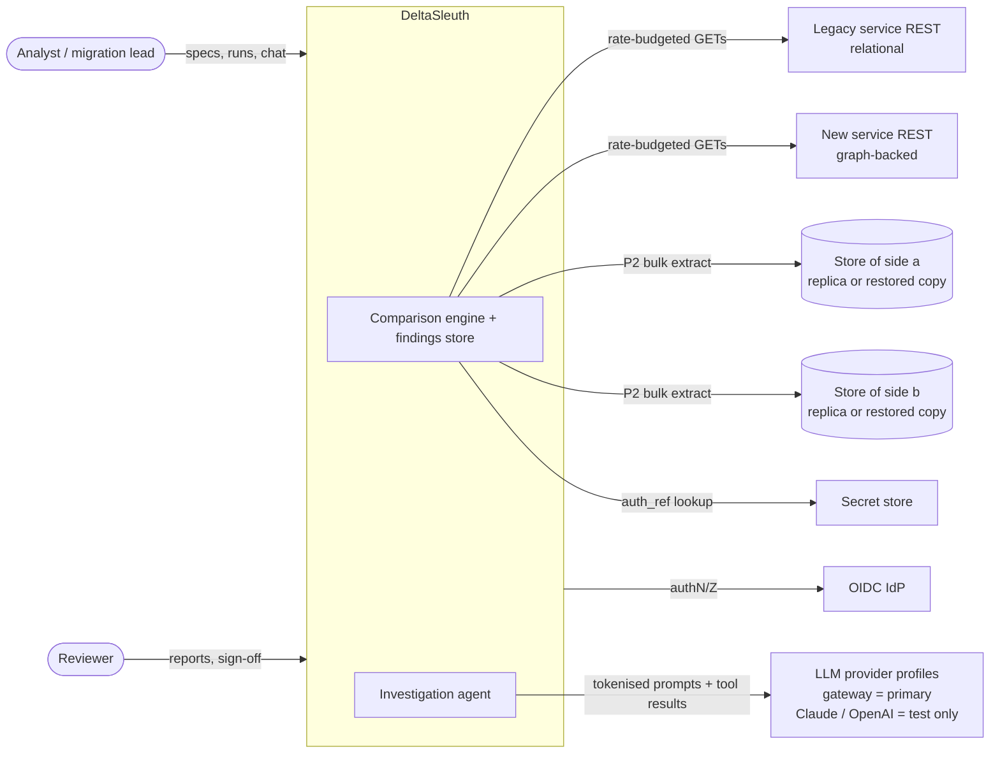

### 4.2 Containers

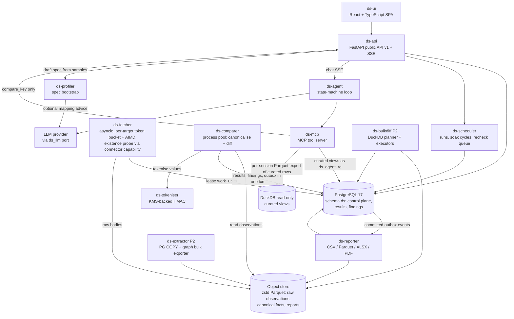

**As built in the MVP** (`docs/mvp/MCP.md` D1): there is no `ds-mcp` container. The chat's agent calls
its tools in-process, and the MCP server for other clients is part of `ds serve` (the route `POST
/v1/mcp`, served only while the settings say so) or a `ds mcp` process over stdin and stdout. It reads
the store through the same service modules as the API's GET routes; there are no curated views, no
`ds_agent_ro` role and no per-session DuckDB export, and its one work tool calls the runner's
`compare_one` directly.

### 4.3 Components and responsibilities

| Component | Responsibility | Key design points |
|---|---|---|
| **Connector SPI** | `capabilities()`, `enumerate()` (typed keys, cursor, source version, explicit EOF), and `fetch` / `fetch_batch` returning an `Observation` with status, body, timing, completeness and side state (§4.12) | REST in the MVP. SQL, GraphQL, gRPC, Kafka and file adapters come later. Discovered through entry points. DB adapters batch lookups. |
| **Target registry** | Base-URL allowlist, `auth_ref`, rate budget, timeouts, breaker, declared capabilities, and a `consistency_profile` (§4.12) | Specs reference target IDs only (SSRF control). The certification mode follows from the flags, so the core has no engine-specific logic. A conformance probe rejects profiles that contradict what the source actually reports. |
| **Key sources** | `list`, `csv` (`s3://`), `sql` (approved templates), `paginated_endpoint`, `run_keys`, `union`, `hash_sample` (rate or bottom-k) | A frozen, hashed manifest in `run_keys`. `union` covers keys that exist on only one side. MVP: `list`, `paginated_endpoint`, a table scan, and `hash_sample` over a frame (a `table` side's population, a side's complete listing, or a `union` of one per side; `docs/mvp/SAMPLING.md`). |
| **Spec service** | Validates, then stores the spec immutable and content-hashed | The UI's 20-key dry-run uses the same path. |
| **Table pre-checks and the schema guard** (MVP, `docs/mvp/PRECHECKS.md`) | Before any per-key comparison, a table pre-check reads each side's catalogue and a few aggregate statements in one snapshot and judges them; the schema guard holds each table side's shape beside a run's plan and looks again at its creation, each scan pass, a key-list cycle's start, a resume and a refused read | A pre-check is its own object (`ds.prechecks`), never a run: no row, key, text or distinct value is fetched, a minimum and a maximum are compared in the worker's memory and never stored or shown, and it is no evidence. The guard's record is `ds.runs.guard`, outside `params`; a change that breaks the plan pauses the run, a new run that would compare less than its version's last baseline run (while none is one, its newest stored plan) is created paused, any other change warns, and it fails no run. |
| **Scheduler** | Run state machine, work units, soak windows, recheck units (scheduled, never inline sleeps), calibration, `rediff` | Postgres-backed. No broker. MVP: cron schedules too (`docs/mvp/SCHEDULES.md`): the worker starts a run of a stored spec at each due wall-clock time of a 5-field cron expression in an IANA time zone, as `system:worker`, by the same `create_run` a person's request reaches, so the four-eyes gate, a sample's rules and, in a vendor build, the licence judge it. The run, the schedule's advance and their audit rows commit together, and a unique index on `ds.runs` allows one run per schedule and due time; only the newest due time is started, inside its start window, and every other is recorded as missed with a closed reason: never a burst, never a backfill. |
| **Fetcher** | Leases units; calls A then B per key (B first on recheck); uploads and verifies evidence, then records observations; runs a declared `existence_check` (e.g. a second lookup endpoint) on one-sided absences | Shared per-target token bucket, AIMD, bounded retries, a breaker that pauses the run, **same-origin and IP guards** (§13). |
| **Comparer** | project → map → normalise → canonical hash → diff → classify → signatures (§8.1) | A pure function of (spec version, observations), so offline re-diff is possible. |
| **Domain pack** (optional; entity-linking is the example) | Taxonomy aliases, normalisers, prompt packs, optional enrichments (e.g. provenance) | The core never imports it. No provenance is assumed (§8.2). |
| **ds-profiler** | Drafts a spec plus an evidence table from paired samples (§8.6) | Human approval is mandatory. No extra target calls. |
| **EnvironmentSnapshot SPI** | `freeze(T)` / `verify()` / `teardown()`. The worked example is PostgreSQL PITR (§4.13) | Declared per target (`consistent_cut`). |
| **Root-causer** | Member-key fan-out, optional pack enrichment, then signatures (§8.2) | Deterministic, per cycle. |
| **Reporter** | Exports and summaries from a fixed revision (§10) | Consumes committed outbox events. LLM text only in an annex. |
| **Outbox** | `ds.outbox` is written in the same transaction as the results | No dual writes. Idempotent consumers. MVP: notifications need no `ds.outbox` (`docs/mvp/ALERTS.md` D1): each fact is an audit row written last in the transaction that makes it true, and the audit hash chain, numbered in commit order, is their outbox; a worker task follows it from a durable cursor and stores one delivery per event and channel in the transaction that moves the cursor. The generic outbox for reports and AI analysis stays deferred. |
| **Evidence store** | Captures are uploaded and hash-verified **before** commit | No dangling references. Orphans are garbage-collected. Fetching stops if storage fails. Bodies over 10 MB stream to disk. |
| **Agent + MCP + `ds_llm`** | Investigation loop, tool server, LLM port (§9) | Runs with the requesting user's scope. MVP (`docs/mvp/MCP.md`): the chat's loop calls its four tools in-process; the MCP server serves those four and seven reads to a site's own agent, as the calling API token with its roles cut to viewer and operator, over stateless HTTP inside `ds serve` or over stdio (`ds mcp`). It is off unless the settings state the data classes results may carry, and DeltaSleuth runs no loop and checks no answer for an external agent. |
| **Extractor / bulk-diff (P2)** | PG COPY and graph bulk exports to canonical Parquet; strategy planner (§8.5) | Certification uses exact comparison only. |

### 4.4 UI screens (thin React + TypeScript SPA over the public API)

1. **Run setup.**
   - Pick a spec, or create one from a template. Pick targets and a key source.
   - The **field/column picker** is built from a sampled response: the UI calls both sides for 3 keys and renders a JSON tree with checkboxes that emit JSONPaths. For tables it introspects the schema.
   - Value filters, normalisers per field, array mode and severity.
   - Execution: concurrency, delay, rate budget, soak stop condition.
   - "Dry-run 20 keys" shows outcomes before launch.
2. **Run monitor.** Progress by outcome and stratum, rps per target, limiter wait, error rate, breaker state, pause/resume/stop, and an ETA computed from the budget formula (§12).
3. **Findings explorer.**
   - Root causes, then signatures, then keys, then a side-by-side A/B diff: canonical and raw views (jsondiffpatch HTML formatter, arrays matched by `objectHash` = the business key).
   - Facets: outcome, taxonomy, severity, path pattern, stratum.
   - Download CSV/PDF and the retry list.
   - Raw values are *revealed* (re-derived from the raw observation) only for the `pii_reader` role, and each reveal is audited.
4. **Chat.** Scoped to a run or a key (`chat_sessions.scope_key`). LLM text renders as escaped plain text. Citation chips (`F-…`, `O-…`, `RC-…`) are built by the UI from validated IDs and deep-link into the explorer. A "Show tool calls" panel shows the SQL and tool arguments.
5. **Readiness** (as built in the MVP, `docs/mvp/READINESS.md` §10). Per programme, entity type and pair (a spec name): the named gates that hold on stored evidence, the pair's place on a fixed ladder (`no evidence` to `evidenced`), `k of m gates`, an inline-SVG sparkline of its last evidence cycles against their allowance, and one pair's gates by group, convergence across soak cycles, trend with version markers and recorded transitions. Read-only, for every role; never a percentage or probability of parity, a forecast or sign-off evidence.
6. **Schedules** (as built in the MVP, `docs/mvp/SCHEDULES.md` §10). For every role: each schedule's spec and version (pinned, or following the name's newest), mode, cron and zone, next due time in its zone and in UTC (a schedule, not a forecast), newest firing in the server's words with its run's status, and state; one schedule's definition, who saved it, what the four-eyes gate says of the version it would run, its next five times and its firings. Operators declare one (presets or custom cron, a zone from the build's list, a preview of the next ten times with their clock-change notes), edit, pause, resume and delete it, and move a pinned one to the newer version. A firing names no person, and no screen builds a firing's text.
7. **Table pre-checks** (as built in the MVP, `docs/mvp/PRECHECKS.md` §11). For every role: what a pre-check is not, each pre-check's level, source, progress and pairs counted by verdict; one pre-check's totals and pairs worst first with a verdict filter and its three downloads; a pair's lines, the refusals a run would meet, its schema table and each compared column's figures as verdicts (a sum as a number only where the spec clears the column and no side filters). Operators pre-check stored specs, cancel and start a comparison of a pair; spec authors pre-check two schemas paired by name and draft a starter spec of such a pair. No tick or green, and no screen builds a text. The Run screen prints the schema guard's lines, a banner while it holds the run paused, and `Resume (accept the changes)` where a resume would accept them.

### 4.5 Sequence: one-shot compare

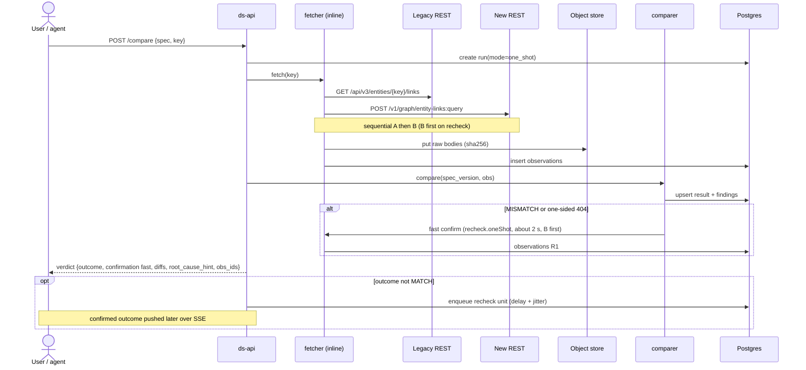

### 4.6 Sequence: batch with checkpoint/resume

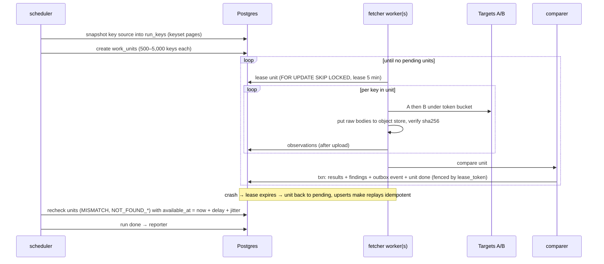

### 4.7 Sequence: soak cycle

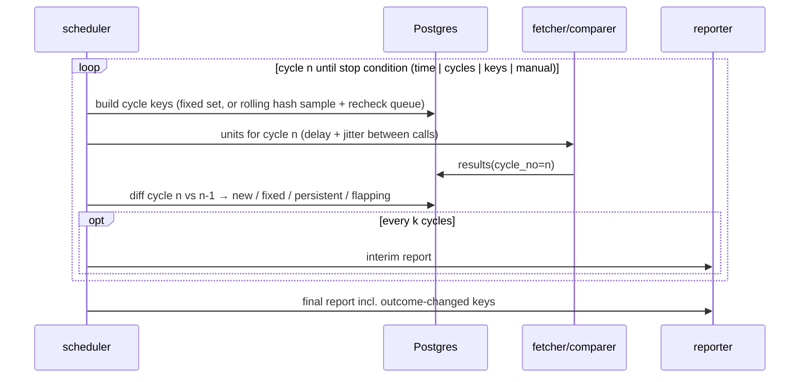

Each cycle is an **immutable window**. Its key set and counters freeze when the cycle closes, and later rechecks add result revisions without rewriting a closed window's report.

### 4.8 Sequence: bulk parity on a frozen cut (optional P2 accelerator)

An optional frozen cut is possible where both stores can be restored to one instant. The sequence shows PostgreSQL point-in-time recovery (PITR) as the worked example. Each store is read through a bulk reader its target declares (`bulk_readers`, Appendix D.6).

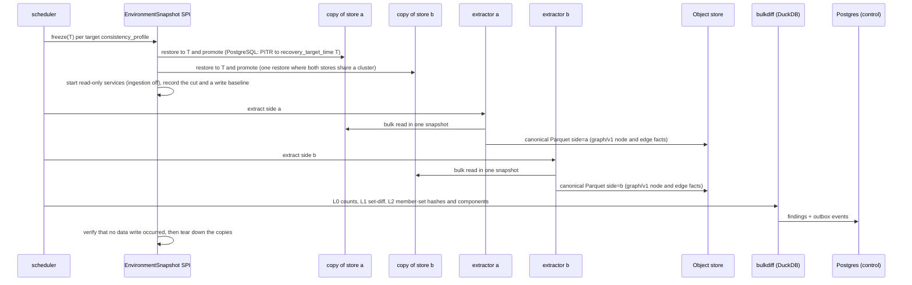

- **Claim level.**
  - One restore of a cluster gives a *transaction*-consistent cut, but not an *input*-consistent one, because the two ingestion pipelines can lag each other at T. **Both pipelines must record an upstream watermark per commit.** wm_a(T) and wm_b(T) go into `cut_metadata`, and keys touched in (min(wm), max(wm)] become DRIFT(`cut_window`).
  - Same cluster with both watermarks → `certified`. Two clusters restored to the same `recovery_target_time` with both watermarks → `certified`, with the cut-window keys counted in the INCONCLUSIVE + DRIFT gate.
  - Either watermark missing → `observed`, whatever the number of clusters.
  - The identity crosswalk must be inside the snapshot or read AS OF T (§5.1).
  - Every read-path dependency of both services (reference data, config, caches) must be inside the cut or declared in `cut_metadata`; otherwise the run is `observed`.
- **Runbook, live mode and snapshot caveats:** Appendix D.4.

### 4.9 Sequence: cross-engine table diff (P2)

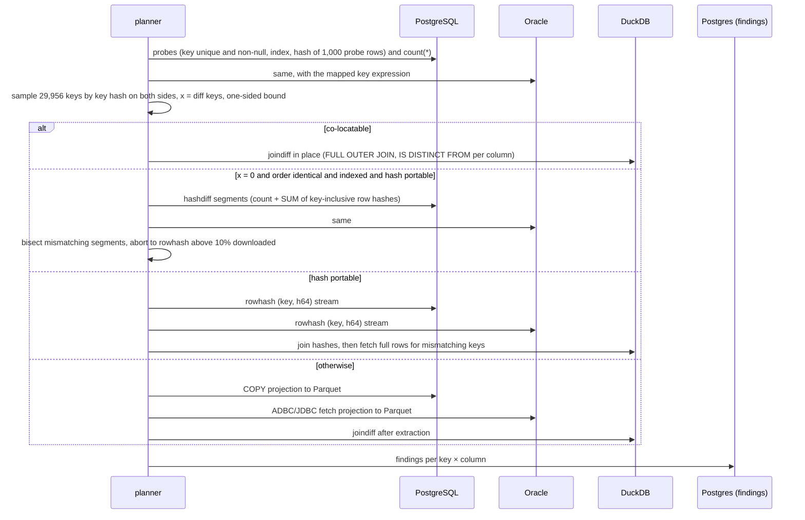

**As built in the MVP** (`docs/mvp/ENGINES.md`, `docs/mvp/TABLES.md` §13): none of the four strategies
above. A table pair in any pairing of PostgreSQL, MySQL and Oracle is one **sorted merge**: each side
streams its key texts in code-point order with one digest a row, from one session, and the merge counts
equal digests and queues every other key for a per-key read. Within one engine the engine hashes the
columns both sides declare alike (`STANDARD_HASH` on Oracle, `SHA2` on MySQL, PostgreSQL's `sha256`) and
the worker the others; across engines the worker hashes every compared column from one canonical
rendering, because no engine function gives the same bytes in two engines. There are no probes, no
sampling and no extraction between databases; the merge refuses a side whose keys come out of order.
**A side read from files** (`docs/mvp/FILES.md`) is one more stream of that merge: CSV or Parquet files
in a mounted directory, sorted and rendered by one DuckDB locked to the declared directories. It runs in
a child process of each `ds` process, the file reader (`docs/mvp/READER.md`), which alone loads it and
hands rows back in typed frames: a fault of DuckDB's ends that child, and the worker and the API go on.
DuckDB reads the files where they are; no database is extracted into it, and no planner chooses it.
Between two file sides DuckDB hashes the columns both declare alike; across engines the worker hashes,
as above.

### 4.10 Sequence: chat question → tools → cited answer

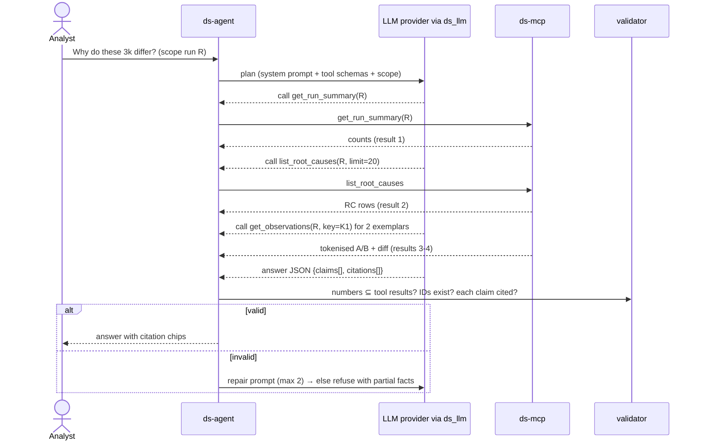

**As built in the MVP** (CONTRACTS §6, `docs/mvp/MCP.md`): no `ds-mcp` stands between the agent and its
tools. The chat's loop calls `agent/tools.run_tool` in its own process, and the validator checks its
answer. An external agent reaches the same tools through the MCP server, where this sequence ends at
the tool result: its plan, its answer and any check of it are its host's.


### 4.11 Public API v1 (the UI and CLI are just clients)

| Endpoint | Behaviour |
|---|---|
| `POST /v1/specs` | Validates the spec against `spec.schema.json`, the installed pack's config schema and the PII floor. Checks that every referenced target, template and inferred schema is granted to the spec's dataset (`ds.dataset_targets`). Stores a new immutable version, or returns `422` with JSON field paths. Clear-text or population-filter exposure needs a `ds.spec_approvals` row before any run. |
| `POST /v1/specs/draft` | Onboarding (F11): takes paired sample responses, or two table schemas, and returns a draft spec with suggested keys, alignments and a canonical mode. |
| `POST /v1/runs` | Requires an `Idempotency-Key` (IETF draft-07 semantics: 400 missing / 422 different fingerprint / 409 in flight / replay after re-authorisation). The run, its outbox event and the idempotency row commit atomically. The principal is always the end user. Details: Appendix D.5. Returns `202` + `run_id`. |
| `GET /v1/runs/{id}`, `/items`, `/findings` | Stable keyset cursors. Every response carries the run's `claim_level` and counters. |
| `POST /v1/runs/{id}/pause`, `/resume`, `/cancel` | State transitions per §6 (run states). A cancelled run keeps its evidence and is reported as PARTIAL. |
| `POST /v1/compare` | One-shot (F1). Stored specs only (`spec_name`, `spec_version`, `key`). Returns the fast-confirmed verdict plus a `confirmation_ref`. |
| `POST /v1/reports`, `POST /v1/investigations` | Asynchronous jobs, fed by the outbox. Results are polled or pushed over SSE. |
| `GET /v1/readiness`, `/readiness/pairs/{name}`, `/readiness/pairs/{name}/cycles`, `/readiness/transitions`, `/readiness/reports/{name}` | As built in the MVP (`docs/mvp/READINESS.md` §10): cut-over readiness per pair, computed on read from each ended cycle's stored measures, the settings' gates and the stored sign-offs, packs, adjudications and labellings; a pair's trend; the transitions the worker recorded in the audit chain (`as_of` answers from them); and the dashboard and trends reports. Viewer; only a report download is audited; a purged cycle keeps its measures, so no route answers 410. |
| `GET /v1/schedules`, `/schedules/zones`, `/schedules/{id}`, `/schedules/{id}/firings`; `POST /v1/schedules/preview`; `POST /v1/schedules`, `PUT /v1/schedules/{id}`, `POST /v1/schedules/{id}/pause`, `/resume`, `DELETE /v1/schedules/{id}` | As built in the MVP (`docs/mvp/SCHEDULES.md` §10): the schedules with their banners and how many are overdue, the zones a schedule takes, one schedule with its next times and firings (projections of the worker's audit rows: no actor, address or request data), and a cron's preview (viewer; a preview needs operator and writes nothing); create, replace at the revision loaded, pause, resume and delete (operator), each audited as its caller after recording any time it left unstarted. No route starts a run: the worker fires. `GET /v1/runs/{id}` names the schedule that started a run. |
| `POST /v1/prechecks`, `POST /v1/prechecks/catalogue`; `GET /v1/prechecks`, `/prechecks/{id}`, `/prechecks/{id}/pairs/{n}`, `/prechecks/{id}/reports/{name}`, `/prechecks/{id}/pairs/{n}/draft.yaml`; `POST /v1/prechecks/{id}/cancel` | As built in the MVP (`docs/mvp/PRECHECKS.md` §11): a table pre-check of stored specs (operator) or of two declared database targets' schemas paired by name (spec_author), `202` with its id, its pairs read by the worker; the list, one pre-check with its pairs worst first (no `result` read), a pair's result, the three reports (audited) and a pair's draft spec (never stored); a cancel. Every answer but a download (a report, which it heads, or a draft) carries what a pre-check is not. `GET /v1/runs/{id}` gains `schema`, the schema guard's lines; `POST /v1/runs` and `POST /v1/compare` answer its `warnings`. |
| `GET /v1/evidence/{obs_id}` | Enforces the same dataset scope and role as the finding that cites it. Returns only a **masked rendition**, tokenised by the findings rules, either streamed or as a single-object, GET-only URL valid ≤ 60 s with `Referrer-Policy: no-referrer`. Raw content-addressed blobs are never presigned; raw values come only through `reveal` (`pii_reader`, audited). |

OpenAPI 3.1 and `spec.schema.json` are published; mutating calls are audited.

### 4.12 Connector capability contract and manifest

**Declared capabilities.** Each connector declares the following. The engine never infers them.

| Capability | Why it matters |
|---|---|
| `pagination` (none, cursor, page, link_header) and `stable_ordering` | Completeness proof, and safe resume |
| `snapshot` / `as_of` / `watermark` (none, per_request, shared) | The `time` policy (§5). Certification needs `frozen` or `shared_watermark`. |
| `authoritative_absence` (which statuses or shapes mean ABSENT) | Without it, a 404 is `INCOMPLETE` and never counts as NOT_FOUND. |
| `truncation_indicators` (count path, items path, cap) | `INCOMPLETE(truncated)` instead of a false MATCH |
| `max_depth` / `max_page_size` / `max_bytes` | Resource limits → `INCOMPLETE(resource_limit)` |
| `enumerate` (none, full, partitioned) with EOF | Union key universe and census claims |
| `existence_check {probes[]}` | Optional second opinion on one-sided absence (e.g. a second lookup endpoint). The core calls it only if declared. |

`truncation_indicators` are the default for every spec using the target, and a spec with neither is rejected. `targets.capabilities` has a key/vocabulary CHECK, so a typo cannot silently disable detection.

**Consistency profile** (`targets.consistency_profile`). It has six fields: `write_atomicity`, `read_isolation`, `secondary_indexes`, `consistent_cut`, `bulk_readers` and `change_feed`. The scheduler derives the certification mode from them alone, and `frozen` needs `consistent_cut ≠ none`. Field values and their effects are in Appendix D.6. A conformance probe fails the run if the declared profile disagrees with what the source reports.

**Manifest.**
- At run start the key set is **frozen and hashed** (`runs.manifest_hash`), and each source's enumeration EOF proof is recorded in `runs.manifest_eof`.
- The key cursor advances atomically with durable seed insertion.
- A `union` manifest is `certified` only if **every** inventory proved exhaustive under the time policy. A partial or unstable inventory limits the run's claim to `observed`, and an inaccessible partition blocks certification.
- Reports never describe a single-source seed list as a census of both systems.


### 4.13 Frozen certification environment (optional P2 accelerator; runbook in Appendix D.4)

A **frozen** time policy is achievable where both stores can be restored to one instant T (`consistent_cut ≠ none`, §4.12): both ingestion watermarks are recorded, read-only services start on the restored copies, a check after the run confirms that no data write occurred, and the cut is recorded in `cut_metadata`. Appendix D.4 gives PostgreSQL point-in-time recovery as the worked example.

**Preconditions:** each target's `consistency_profile` declares its write atomicity and read isolation (Appendix D.6), and the conformance probe agrees with them (§4.12). The certified claim excludes the staleness of asynchronous secondary indexes.

## 5. Comparison spec DSL

The full JSON Schema is in [`architecture/spec.schema.json`](architecture/spec.schema.json). Two complete examples ship with it: [`examples/entity-linking-services.yaml`](architecture/examples/entity-linking-services.yaml) (a legacy relational linker's REST API vs a new graph-backed linker's) and [`examples/pg-vs-oracle-tables.yaml`](architecture/examples/pg-vs-oracle-tables.yaml).

**Design rules**
- **One format for services and tables.** Only `sides.*` differs: `request` + `select` + `map`, or `table` / `template`. Mixed pairs (service↔table) are allowed, and `compare.strategy` applies only to table pairs.
- **Portable expression languages.** RFC 9535 JSONPath for selection, JSONata for mapping, CEL for predicates. JMESPath is not used (stale Java port).
- **Immutable specs.**
  - Every edit is a new version.
  - Runs record `spec_id` (→ content hash, which covers `normalizerVersion` and the inferred-schema digest), and results record `spec_version`.
  - *What-if* re-diffs run as a child run (`mode=rediff`) over the parent's observations.
  - One-shot calls accept stored specs only.
- **No secrets and no free-form targets.**
  - Targets come from the registry (SSRF control).
  - Request paths reject `//`, dot segments and stray braces, and `{{ key }}` is path-segment encoded. `key.pattern` is required.
  - SQL runs only through approved templates. A `table` side may add a `where` row predicate that the loader parses with sqlglot and accepts only as a boolean expression over that table's columns and literals (no subqueries or functions). Population filters (`where`, `valueFilter`, `exclude`) need four-eyes approval (`ds.spec_approvals`) for certified runs, and are printed with pre- and post-filter counts in the coverage header.
- **The PII floor is set by the deployment.** Specs can only tighten it, and `clear`/`rawClear`/`unlisted: clear` need four-eyes approval (`ds.spec_approvals`, enforced by a run trigger). The `domainPack.config` is validated against the installed pack's own schema (e.g. `packs/entity-linking.config.schema.json`), never the core schema. `key.class` is `business_code` (shown in clear) or an identifier class (tokenised everywhere).

**Three example specs** ship with the schema and are validated in CI:
- [`generic-customer-services.yaml`](architecture/examples/generic-customer-services.yaml): a **non-linking** REST v1 vs v2 customer-profile comparison in tree mode, with no domain pack. It proves the core is generic.
- [`entity-linking-services.yaml`](architecture/examples/entity-linking-services.yaml): the entity-linking example, in **graph/v1** mode.
- [`pg-vs-oracle-tables.yaml`](architecture/examples/pg-vs-oracle-tables.yaml): a cross-engine table pair.

Two conventions:
- Durations use compact units (`250ms`, `10m`).
- `metadata.version` is the author's semver label. The store also assigns a monotonic integer `spec_version` (`ds.specs.spec_version`, with the semver kept in `version_label`), and that integer is recorded on every run and result.

**Abridged excerpt of the linking spec (graph mode).** `…` marks omissions, so the excerpt is not schema-valid as shown; the file is.

```yaml
apiVersion: deltasleuth/v1
kind: ComparisonSpec
metadata: {name: entity-linking-legacy-vs-graph, version: "…", owner: data-platform}
normalizerVersion: "1.0.0"
time: {mode: live, skewBudget: …}          # frozen for certification runs (§4.13)
retention: audit
inferredSchema: {ref: …, digest: "sha256:…"}  # approved ds-profiler bundle
schemaDrift: {mode: pause}
key:
  name: entity_code
  class: business_code
  source: {kind: hash_sample, method: rate, …, source: {kind: union, sources: [{kind: sql, template: {id: …, version: …}}, {kind: paginated_endpoint, target: graph-linker-api, …}]}}
sides:
  a: {role: legacy, target: legacy-linker-api, request: {…}, select: "$", map: "{ …emits graph/v1 members… }", truncation: {…}}
  b: {role: new,    target: graph-linker-api,  request: {…}, select: "$.result", map: "{ … }", truncation: {…}}
canonical:
  mode: graph
  schema: graph/v1
  nodes:
    - {type: entity, namespace: entity_code, businessKey: [code], keyNormalize: [trim, upper], keyClass: business_code}
    - {type: phone,  namespace: e164, businessKey: [number], keyNormalize: [{e164: {defaultRegion: GB}}], keyClass: phone}
    - {type: tax_id, namespaceField: country, businessKey: [value], keyClass: tax_id}
  edges:
    - {type: LINKED_TO, from: entity, to: entity, directed: false,
       taxonomy: {missing_in_b: MISSING_LINK, extra_in_b: EXTRA_LINK}, severity: HIGH}
    - {type: HAS_PHONE, from: entity, to: phone, directed: true}
  scope: {root: {type: entity}, edgeTypes: [LINKED_TO, HAS_MEMBER, HAS_PHONE, HAS_EMAIL, HAS_TAX_ID], direction: both, depth: 1}
  compare: topology
  limits: {maxNodes: 2000, maxEdges: 2000}
identity:
  key: [type, namespace, business_key]
  crosswalk: {target: identity-xwalk-ro, template: {id: graph-member-id-to-code, version: 2, …}}
compare: {nullEqualsAbsent: true, fields: [{path: "$.nodes.entity[*].flagged", compare: exact, taxonomyCode: FLAG_MISMATCH, severity: CRITICAL}, …]}   # reviewed opt-in; the default is false
knownDiffs: [{id: KD-EL-0001, when: "…", classification: expected_by_design, reason: "…", ticket: LINK-2143}]
noise: {calibration: {sampleSize: 400, sandwich: true, repeatB: 2, maskThreshold: 0.01}}
recheck: {delay: 10m, times: 2, jitter: 90s, oneShot: {delay: 2s, times: 1}, outcomes: [MISMATCH, NOT_FOUND_A, NOT_FOUND_B, INCONCLUSIVE]}
execution: {concurrency: 1, delay: 250ms, stop: {…}}
security: {unlisted: tokenize, tokenize: […]}
reporting: {formats: [csv, parquet, xlsx, pdf]}
```

The PostgreSQL-vs-Oracle example uses the same `compare`, `knownDiffs` and `reporting` blocks, but its sides are `table` sides. It shows:
- a key expression mapping `ORG-000123` to a numeric key;
- a WHERE per side;
- `session: {timezone: UTC}` and Oracle NLS settings;
- a `typeMap`, a collation note and `compare.strategy: auto`.

### 5.1 Generic comparison features (independent of any domain)

**Time policy** (`time`). It decides whether a run can be `certified`.

```yaml
time:
  mode: live                 # frozen | shared_watermark | live
  watermark: {a: "$.meta.asOf", b: "$.meta.watermark"}   # shared_watermark: both must report the same value
  skewBudget: 5s             # live: max gap between A and B capture; beyond it the key → DRIFT candidate
```
- `frozen`: both sources are read from immutable snapshots of the same instant, e.g. PITR clones (§4.8). It also needs **both ingestion pipelines to record an upstream watermark per commit**. Keys touched between the two cut watermarks are DRIFT(`cut_window`). DRIFT is otherwise impossible only under a single-cluster cut (`pitr_cluster`). Without both watermarks the run is `observed`.
- `shared_watermark`: both responses report a common version. A mismatched watermark is re-read through the recheck policy, and if it still disagrees → DRIFT(`watermark_mismatch`).
- `live`: capture intervals are recorded, and the claim level is always `observed`.

**Identity and crosswalk** (`identity`). A reviewed mapping replaces guessed joins.

```yaml
identity:
  key: [type, namespace, business_key]                    # the typed business identity
  crosswalk: {target: pg-replica, template: {id: org-code-map, version: 2}}  # approved SELECT template
```
An ambiguous or colliding mapping → `INCONCLUSIVE(identity_ambiguous)`. Under `frozen`, the crosswalk must come from inside the snapshot or be queried AS OF T, and its sha256, row count and as-of go into `cut_metadata`; otherwise the run is `observed`. Live and soak runs re-pin the crosswalk each cycle. A shared attribute (e.g. an address) is a *relationship*, never a reason to merge identities.

**Canonical mode** (`canonical.mode: tree | graph`).
- `tree` (the default) compares JSON documents with keyed or set arrays.
- `graph` maps each side to **typed node and edge sets**, which suits any relationship-shaped service, not only linking. It is a built-in canonical schema (`graph/v1`), **not a second engine**. The projection emits keyed arrays `{nodes, edges}`, so the same walk, signatures, masks and root-causer apply. The same node and edge fact schema is used for P2 L1 Parquet, so API-level and bulk-level parity share code.

```yaml
canonical:
  mode: graph
  schema: graph/v1
  nodes: [{type: branch, namespace: branch_code, businessKey: [code]}]        # namespaceField: read per node
  edges: [{type: HAS_BRANCH, from: organisation, to: branch, directed: true}]
  scope: {root: {type: organisation}, edgeTypes: [HAS_BRANCH, HAS_IDENTIFIER], direction: out, depth: 1}
  compare: topology            # topology (default) | reachability | path (bounded depth, simple paths)
  limits: {maxNodes: 2000, maxEdges: 2000}
```
The side `map` emits graph/v1 members (`type`, `source_id` or business key, `from`, `to`, attributes). The projection produces `$.nodes.<type>[*]` and `$.edges.<EDGE_TYPE>[*]`, both keyed arrays.

**Semantics chosen:**
- A persistent watermark mismatch → DRIFT(`watermark_mismatch`); a missing watermark → INCONCLUSIVE(`watermark_missing`).
- Drift on compared paths, or an undeclared in-scope graph type → INCONCLUSIVE(`schema_drift`); drift elsewhere → an INFO finding.
- An unresolvable identity → INCONCLUSIVE(`identity_ambiguous`).
- Node and edge findings for one neighbour share `anchor_key_tok`, so they form one root cause.

**Scalar semantics** (defaults, which a spec may override per field):
- absent ≠ null (`nullEqualsAbsent: false`);
- no implicit string↔number coercion;
- `tolerance = max(abs, rel × max(|a|, |b|))`;
- timestamps are parsed to UTC;
- an unparseable value → `INCONCLUSIVE(unparseable)`.

**Selection.** Projection and filters run on **both** sides, and the union of selected keys is compared. A key selected on only one side yields `FILTER_MEMBERSHIP`.

**Retention class** (`retention: standard | audit`), see §13.1.

**Array modes**
- `ordered`: positional comparison.
- `set`: unordered, duplicates collapse.
- `multiset`: unordered, counts matter.
- `keyed(key[])`: elements matched by identity; element fields then diffed.

Linked-entity and identifier arrays are always `keyed` by business key. Positional or LCS diffing would turn one missing link into a cascade of index-shift diffs.

**Normaliser chain**
- The chain is versioned. `normalizer_version` is part of `spec_version`.
- Normalisers: `trim`, `collapse_ws`, `nfkc`, `casefold`, `upper`, `lower`, `e164{defaultRegion}`, `tax_id{country}`, `email_basic`, `digits_only`, `decimal{scale,rounding}`, `timestamp_utc{precision,mode}`, `null_if_empty`.
- `address_std` is allowed only with `compare: similarity`. Address equivalence is probabilistic, so its severity is capped at MEDIUM.
- The raw value is always kept next to the canonical value. A diff that disappears after normalisation is emitted as `NORMALIZATION_ONLY` (INFO), never silently.

## 6. Data model

The DDL is in [`architecture/control-plane.sql`](architecture/control-plane.sql) (PostgreSQL 17, schema `ds`).

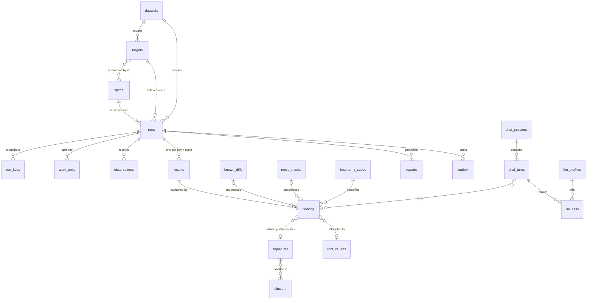

**Key decisions**
- **One result row per key and cycle, matches included** (≈ 8 GB at 20M keys). It is the denominator for rates and bounds, and it drives contrast analysis. *Exception:* P2 bulk modes write MATCH rows to Parquet and read totals through DuckDB.
- **Long-format findings, partitioned by run.**
  - `path_pattern` is the RFC 9535 path with indices and member keys replaced by `[*]`.
  - `json_pointer` is exact and **tokenised**.
  - `member_key_tok` feeds the generic root-causer. `link_reason` and `explaining_id_tok` are optional pack enrichment.
- **Leasing.** `FOR UPDATE SKIP LOCKED` with an `available_at` lease and a `lease_token` fence. Results are upserted in the same transaction as the unit's completion, and a later recheck overwrites (`revision` + 1).
- **Registries.** `ds.taxonomy_codes` (packs add codes at install), `ds.sql_templates` and `ds.inferred_schemas` (four-eyes approval), `ds.llm_profiles`.
- **Other v2 tables.** `ds.datasets` (ABAC), `ds.outbox` + `ds.processed_events`, `ds.idempotency_keys`, `ds.llm_calls`.
- **Run and result fields.** Runs carry `manifest_hash`, `manifest_eof`, `claim_level`, `time_mode`, `cut_metadata` and `pause_reason`. Results carry `side_a/b_state`, `first_outcome` and `revision`. The verdict is derived in a view.
- **Audit and agent access.** `audit_log` is append-only. `ds_agent_ro` sees only six curated, masked views.
- **Sample labels (MVP).** A sampled key's `stratum`, `signoff_stratum`, `signoff_member` and `retries` live on `run_keys` only, never on results or findings (the key is an exact join), and a union's origins are counts, not `attrs.origin`. Each draw is an append-only `ds.sample_draws` row, closed once, and each drawn cycle's per-stratum judgement is stored once in `ds.cycles.sample` (`docs/mvp/SAMPLING.md` §12, D12).
- **Table pre-checks and the schema guard (MVP).** `ds.prechecks` and `ds.precheck_pairs` (`docs/mvp/PRECHECKS.md` §8, migration 016) hold each table pre-check (source, level, request, who made or cancelled it) and its pairs (targets, relations, status and, once read, the verdict, rank, row counts, line and a result of counts, verdicts, closed codes, names and declared types), deleted `retention.standard_days` after they were made; no key or value is stored. `ds.runs.guard`, nullable jsonb added without a default (no rewrite, no scan), holds what the schema guard recorded of a run's tables (each side's planned and last seen shape, their changes, who accepted them, when it last looked); its trail is the run's `schema.drift` and `paused` audit rows.
- **Schedules (MVP).** `ds.schedules` (`docs/mvp/SCHEDULES.md` §12, migration 015) holds each schedule: a spec name, a pinned `spec_id` or none, the run options but keys, cron text, a zone name, a start window, who saved it and in which auth mode, its anchor and `next_due`, its newest settlement and a standing refusal's range not yet chained. Rows are never deleted (a tombstone frees the name), and no key or value is stored. A scheduled run's `params.schedule` names its schedule and due time, unique on `ds.runs`; the firing history is the audit chain (`schedule.fire`, `schedule.missed`, `schedule.rezone`), with no firings table.

**Canonical Parquet for bulk parity (P2): generic graph/v1 facts**

Both extractors write the same schema, partitioned `side=a|b/snapshot_id=…`. It is the graph/v1 model of §5.1, so API-level and bulk-level parity share one code path.

| Table | Columns (Arrow types; `!` = not null) |
|---|---|
| `node` | `type` dictionary<string>!, `tenant` string, `namespace` string!, `business_key` string!, `attr_hash` fixed_size_binary(32)!, `valid_from`/`valid_to` timestamp[us, UTC], `snapshot_id` string! |
| `edge` | `type` dictionary<string>!, `from_key` struct<type, namespace, business_key>!, `to_key` struct<…>!, `qualifier` string, `directed` bool!, `attr_hash` fixed_size_binary(32)!, `valid_from`/`valid_to`, `snapshot_id` string! |
| `member_set` | `node_type`, `namespace`, `business_key`, `degree` uint32!, `member_set_hash` uint64! (sum mod 2^64 of h64 of member keys; order-independent) |
| `component` | `node_key` struct!, `cc_label` string! (= min member key), `cc_size` uint32!, `cc_hash` uint64! |
| `anomaly` (emitted by a store's extractor) | `kind` (one_sided_edge, partial_node, dup_identifier_node, stale_index), `element_ref`, `detail` |

Keys: `node(type, namespace, business_key)` and `edge(from_key, type, to_key, qualifier)`, unique per snapshot. Domain views such as entity/attachment/flag belong to the entity-linking pack and are defined over `node` and `edge`.

**Pointer grammar.** `json_pointer` is RFC 6901, with member keys escaped (`~0`, `~1`) and tokenised when their class is. A duplicate member's index is its own segment `@i`, and a literal leading `@` in a key is doubled (`@@`). This keeps pointers unambiguous for reveal and uniqueness.

**Run states** (`runs.status`, `runs.pause_reason`)

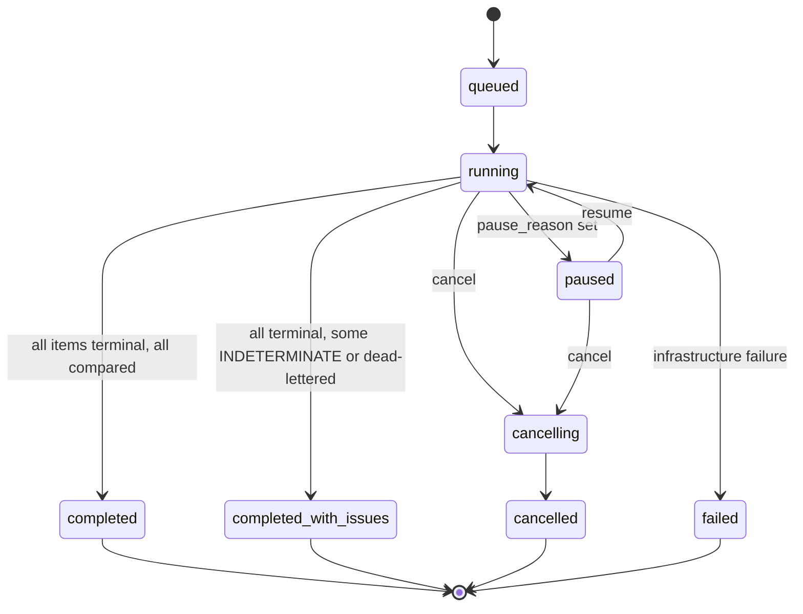

- **Pause reasons:** `schema_drift | mapping_drift | auth | source_health | circuit_open | storage | operator`. MVP: the schema guard's pause is `run_paused_schema_drift` (`docs/mvp/PRECHECKS.md` §7), for table sides only; a person's resume ends it, never while a change that breaks the run's plan stands.
- Data differences never fail a run; a cancelled run keeps its evidence and reports PARTIAL.
- **Soak cycles:** each cycle is an **immutable window**. Its key set and counters freeze when it closes, and a later recheck adds a result revision but never rewrites a closed window's report.

## 7. Outcome vocabulary and discrepancy taxonomy

### 7.1 Per-side states, per-key outcomes and the derived verdict

**Per-side observation state** (`results.side_a_state`, `side_b_state`), set by the connector against its declared capabilities (§4.12):

| State | Meaning |
|---|---|
| `COMPLETE` | The full document was read: every page to EOF, no cap hit, schema valid. The completeness proof is stored with the observation. |
| `ABSENT` | Authoritative absence. The connector declares `authoritative_absence` for this status or shape (e.g. a documented 404). Otherwise a 404 is `INCOMPLETE(absence_unconfirmed)`. |
| `INCOMPLETE` | A cap or truncation, a pagination loop, a non-authoritative 404, an unparseable value, or a resource limit. |
| `ERROR` | Transport or auth failure after retries. |

**Per-key outcome** (`results.outcome`). Rules are evaluated in order, and the first that applies wins. Every result also carries `confirmation`: `provisional` (before a recheck), `rechecked`, `frozen_cut` (frozen snapshot: re-reading is a no-op) or `bulk_exhaustive` (P2 anti-join). Provisional discrepant keys count as *outstanding*, never as discrepant.

| Outcome | Side states | Rule | Counted as |
|---|---|---|---|
| `INCONCLUSIVE` | any INCOMPLETE or ERROR, or a key that is not comparable | One reason is recorded, by fixed precedence: `both_error` > `error_a` > `error_b` > `timeout` > `rate_limited` > `circuit_open` > INCOMPLETE reasons.<br>INCOMPLETE reasons: `truncated`, `unstable_pagination`, `unparseable`, `resource_limit`, `schema_drift`, `absence_unconfirmed`, `watermark_missing`, `duplicate_member_name`, `identity_ambiguous`.<br>Other reasons: `absent_both` (ABSENT/ABSENT: stale manifest), `skipped`, `recheck_failed` (rechecks exhausted without a comparable read). | Neither parity nor mismatch. Excluded from the denominator and gated in §15. Keys go to the retry list; truncated keys above the cap are `api_uncomparable`. |
| `DRIFT` | any | `drift_reason` is one of:<br>• `changed_since` (in the change feed);<br>• `a_changed` (A's unmasked hash, state or row-filter membership changed on recheck);<br>• `b_converged` (B changed and the diff vanished);<br>• `watermark_mismatch`;<br>• `skew_exceeded`;<br>• `cut_window` (touched between the frozen cut's watermarks). | Neither; gated with INCONCLUSIVE (§15). |
| `NOT_FOUND_A` / `NOT_FOUND_B` | ABSENT on one side, COMPLETE on the other | Emits core `EXTRA_DOCUMENT` / `MISSING_DOCUMENT`, which the pack aliases to `*_ENTITY`. It is confirmed when a recheck returns the **same side states**, or by `frozen_cut` / `bulk_exhaustive`. If the connector declares `existence_check` and the probe finds the entity, the outcome stays NOT_FOUND with an extra `INTERNAL_INCONSISTENCY` finding. | discrepancy |
| `MISMATCH` | both COMPLETE | At least one unsuppressed finding above INFO. Confirmed when A is unchanged and B is unchanged on recheck, or when A is unchanged and B changed but the diff persists (value_class `intermittent_b`). | discrepancy |
| `KNOWN_DIFF` | both COMPLETE, or one ABSENT (its document-level finding) | Every finding above INFO is suppressed, and at least one (`suppressed_count ≥ 1`) by an active `known_diffs` rule. `bug` rules match first, then by rule_id. | Suppressed and counted per rule. `bug` counts as **discrepant**. |
| `NOISE_ONLY` | both COMPLETE | Every finding above INFO is suppressed, at least one by an approved noise mask, and none by a rule. | Suppressed and counted per mask. |
| `MATCH` | both COMPLETE | No finding above INFO. INFO-only keys (`NORMALIZATION_ONLY`, unselected `SCHEMA_DRIFT`) stay MATCH. | parity |

**Derived three-value verdict** (for simple reporting and the public API). It is computed at read time in `v_result_verdicts` / `v_results_masked.verdict`, **not stored**, because it depends on the current classification of the cited rules:
- `MATCH` ← MATCH, NOISE_ONLY, and KNOWN_DIFF from `accepted` or `expected_by_design` rules.
- `DIFFERENT` ← MISMATCH, NOT_FOUND_A/B, and KNOWN_DIFF from a `bug` rule.
- `INDETERMINATE` ← INCONCLUSIVE, DRIFT.

**Revisions.** The first outcome is preserved (`results.first_outcome`), and each recheck is attached as separate evidence. `results.revision` increments on every change, and reports are built from a fixed revision timestamp.

**Run counters** (they must reconcile exactly): `total = match + different + indeterminate + cancelled + outstanding`.
- `compared = match + different`
- mismatch rate = `different / compared`, shown as "unavailable" when the denominator is 0.
- coverage = `compared / manifest total`.

### 7.2 Finding taxonomy

Generic change types (`missing_in_b`, `extra_in_b`, `value_changed`, `type_changed`, `order_changed`) come from the core. **Core codes** are available to every spec: `MISSING_DOCUMENT`, `EXTRA_DOCUMENT`, the generic field and graph codes, `FILTER_MEMBERSHIP`, `SCHEMA_DRIFT`, `NORMALIZATION_ONLY` and `INTERNAL_INCONSISTENCY`. **Entity-linking pack codes** (the rest of the table) are installed by the pack into `ds.taxonomy_codes`; they alias core codes or use optional enrichment. Severities can be overridden per field.

| Code | Detection rule | Sev. |
|---|---|---|
| `MISSING_DOCUMENT` / `EXTRA_DOCUMENT` (core) | The whole document is present on one side only (NOT_FOUND_B / NOT_FOUND_A), at `path_pattern` `$`. | CRITICAL |
| (value_class) `duplicate_key`, `intermittent_b` | These are value classes that attach to the codes above, not codes of their own. `duplicate_key`: a keyed array holds more than one member with the same key (e.g. duplicate edges in a graph store). `intermittent_b`: B's answer changed between reads while A stayed stable. | inherits |
| `NORMALIZATION_ONLY` | Raw values differ but canonical values are equal. | INFO |
| `INTERNAL_INCONSISTENCY` (core) | A side contradicts itself: a declared `existence_check` finds a key its read reported absent, or a pack detector finds a graph anomaly (Appendix J). | HIGH |
| Generic core codes: `FIELD_MISSING`, `FIELD_EXTRA`, `VALUE_MISMATCH`, `TYPE_MISMATCH`, `ORDER_MISMATCH` | Used when no domain pack claims the finding (tree mode). | per field |
| Generic graph codes: `MISSING_NODE`, `EXTRA_NODE`, `MISSING_EDGE`, `EXTRA_EDGE` | Graph canonical mode (§5): typed node or edge present on one side within the declared scope. Domain packs may map these to domain names (e.g. `MISSING_LINK`). | per type (default HIGH) |
| `FILTER_MEMBERSHIP` | The selection predicate (`valueFilter` or WHERE) is true on one side only. Filters run on **both** sides, and the union of selected keys is compared. | MEDIUM |
| `SCHEMA_DRIFT` | An observation violates the approved inferred schema: a new, retyped or missing field. It is reported rather than silently dropped by select/exclude, and counted in the coverage header. `schemaDrift: pause` stops the run instead. MVP: built for table sides only, as the schema guard (`docs/mvp/PRECHECKS.md` §7), which judges each table's catalogue against the run's plan and pauses the run (`run_paused_schema_drift`) or warns: a run's state and its `schema.drift` audit rows, never a finding. The inferred-schema guard for service sides is not built, so `SCHEMA_DRIFT` stays its per-key code and reads 0. | INFO |

The **entity-linking pack codes** (MISSING/EXTRA_ENTITY, ATTACHMENT, LINK, LINK_EVIDENCE_MISMATCH, ATTRIBUTE_MISMATCH, FLAG_MISMATCH, CLUSTER_SPLIT/MERGE/REARRANGE, HOP_SEMANTICS, DIRECTIONALITY, TEMPORAL_VALIDITY, HOT_IDENTIFIER_POLICY, DUPLICATE_IDENTIFIER_NODE) are listed with their detection rules in Appendix J. They are installed by the pack, not the core.


## 8. Core algorithms (pseudo-code)

### 8.1 Canonicalise and diff

```python
REASON = {"timeout": "timeout", "http_429": "rate_limited", "circuit_open": "circuit_open"}

def observe(side, obs, spec, target) -> SideState:        # → Complete(doc) | Absent | Incomplete(r) | Error(r)
    # The fetcher sets error_class only for transport, timeout, or 429/5xx after retries.
    if obs.error_class:
        return Error(REASON.get(obs.error_class, f"error_{side.name}"))
    nf = matches_not_found(side.notFound, obs)            # notFound.status ⊆ target's authoritative statuses
    if nf or obs.http_status in (404, 410):               # an undeclared 404/410 is neither ABSENT nor ERROR
        return Absent() if nf and target.capabilities.authoritative_absence.matches(obs) \
               else Incomplete("absence_unconfirmed")
    if obs.http_status not in side.success.status:        # default [200]
        return Error(f"error_{side.name}")
    doc, dup = parse_json(obs.body, decimals=True, detect_duplicate_members=True)   # object_pairs_hook
    if dup:
        return Incomplete("duplicate_member_name")        # RFC 8259: behaviour undefined
    trunc = side.truncation or target.capabilities.truncation_indicators   # a spec with neither is rejected
    returned = len(jsonpath(doc, trunc.itemsPath))
    total = scalar(jsonpath(doc, trunc.countPath)) if trunc.countPath else None
    if (total is None and returned >= trunc.cap) or \
       (total is not None and (total > returned or total > trunc.cap)):
        return Incomplete("truncated")                    # a complete page of exactly `cap` items is not truncated
    if unstable_pagination(obs, side.pagination, target.capabilities):   # offset/page without stable ordering,
        return Incomplete("unstable_pagination")          #   or a key repeated across pages
    drift = validate(doc, spec.inferredSchema)            # jsonschema-rs
    if drift.on_selected_paths or drift.undeclared_graph_types_in_scope:
        return Incomplete("schema_drift")                 # never a silent MATCH on uncompared evidence
    return Complete(canonicalise(doc, side, spec), info_drift=drift.unselected_only)

def canonicalise(doc, side, spec) -> Canonical:
    shaped = jsonata(side.map, jsonpath_select(doc, side.select))   # RFC 9535 select, then map
    shaped = project(shaped, include=spec.compare.include, exclude=spec.compare.exclude,
                     value_filter=spec.compare.valueFilter)
    raw_doc = rewrite_arrays(deepcopy(shaped), spec, normalised=False)
    for f in spec.compare.fields:                         # versioned normaliser chains
        apply_normalisers(shaped, f.path, f.normalize)
    doc_n = rewrite_arrays(shaped, spec, normalised=True)
    return Canonical(doc=doc_n, hash=sha256(canonical_json(doc_n)),
                     raw_doc=raw_doc, raw_hash=sha256(exact_json(raw_doc)))
# canonical_json: sorted keys, NFC, one "number" tag (Decimal.normalize(), no exponent, -0 → 0), so the
#   string "1" ≠ the number 1 but 1 == 1.0. Not RFC 8785 (JCS), which forces doubles. Versioned via normalizerVersion.
# exact_json: byte-exact strings, no NFC, so raw-only differences stay visible.

def rewrite_arrays(d, spec, normalised):
    for a in spec.compare.arrays:
        xs = jsonpath(d, a.path)
        if a.mode == "keyed":        # key → list of members sorted by canonical form; duplicates are kept, not collapsed
            d = set_at(d, a.path, KeyedMap(group_sorted(xs, key=a.key, order=canonical_json)))
        elif a.mode == "set":        # member identity is its canonical form
            d = set_at(d, a.path, KeyedMap({canonical_json(x): [x] for x in xs}))
        elif a.mode == "multiset":   # member identity plus a count
            d = set_at(d, a.path, KeyedMap({canonical_json(x): [Counted(x, n)] for x, n in counts(xs)}))
        # "ordered" arrays stay lists
    return d

def diff(a: Canonical, b: Canonical, spec) -> list[ChangeEvent]:
    events = [] if a.hash == b.hash else walk(a.doc, b.doc, spec)
    if a.raw_hash != b.raw_hash:                          # per pointer, even when other fields differ:
        seen = {e.json_pointer for e in events}           #   NORMALIZATION_ONLY is never silent
        events += [e.with_(taxonomy="NORMALIZATION_ONLY", severity="INFO")
                   for e in walk(a.raw_doc, b.raw_doc, spec, raw=True) if e.json_pointer not in seen]
    return events

def walk(da, db, spec, ptr=Ptr(), pat="$") -> list[ChangeEvent]:
    out = []
    if isinstance(da, KeyedMap) and isinstance(db, KeyedMap):
        for k in da.keys() | db.keys():
            ma, mb = da.get(k, []), db.get(k, [])
            for i, (x, y) in enumerate(zip(ma, mb)):                   # same key: diff pairwise in sorted order
                out += walk(x, y, spec, ptr / tok_key(k, i), pat + "[*]")
            for i, x in enumerate(ma[len(mb):], len(mb)):              # surplus members, incl. duplicates
                out.append(ev(ptr / tok_key(k, i), pat + "[*]", "missing_in_b", x, None,
                              value_class="duplicate_key" if mb else None))
            for i, y in enumerate(mb[len(ma):], len(ma)):
                out.append(ev(ptr / tok_key(k, i), pat + "[*]", "extra_in_b", None, y,
                              value_class="duplicate_key" if ma else None))
    elif isinstance(da, dict) and isinstance(db, dict):
        for f in da.keys() | db.keys():
            if f not in db:
                if not (spec.compare.nullEqualsAbsent and da[f] is None):
                    out.append(ev(ptr / f, pat + "." + f, "missing_in_b", da[f], None))
            elif f not in da:
                if not (spec.compare.nullEqualsAbsent and db[f] is None):
                    out.append(ev(ptr / f, pat + "." + f, "extra_in_b", None, db[f]))
            else:
                out += walk(da[f], db[f], spec, ptr / f, pat + "." + f)
    elif type_class(da) != type_class(db):
        out.append(ev(ptr, pat, "type_changed", da, db))
    elif isinstance(da, list):                                          # only "ordered" arrays remain lists
        out += ordered_diff(da, db, ptr, pat)                           # order_changed / value_changed
    elif isinstance(da, Counted) and da.n != db.n:
        out.append(ev(ptr, pat, "value_changed", da.n, db.n))
    elif not field_equal(pat, da, db, spec):                            # exact | tolerance | similarity
        out.append(ev(ptr, pat, "value_changed", da, db))
    return out
# tok_key(k, i): the RFC 6901-escaped member key (tokenised when its class is), plus a separate "@i" segment
# for duplicates; a literal leading "@" is escaped (§6 pointer grammar). json_pointer never carries raw PII.
```

### 8.2 Signatures and root causes

```python
def enrich(e: ChangeEvent, ctx) -> Finding:
    e.value_class = e.value_class or value_class(e.a_raw, e.b_raw)
    # value classes: case_only | whitespace | format_only | digit_transposition
    #                | null_vs_absent | numeric_precision | other
    e.member_key_tok = e.member_key_token()          # key of the array member / graph element, tokenised
    e.link_reason, e.explaining_id_tok, e.hop_count = ctx.domain_pack.enrich(e)   # optional; None when absent
    e.taxonomy_code, e.severity = e.taxonomy_code or ctx.domain_pack.classify(e)
    e.signature_hash = h64(e.path_pattern, e.change_type, e.value_class, *e.enrichment())   # enrichment optional
    e.value_a_tok, e.value_b_tok = tokenise(e)       # via the tokeniser service (§13.1)
    e.rule_id = first_matching(ctx.known_diffs, e)   # active known_diffs.rule_id
    e.mask_id = first_matching(ctx.noise_masks, e)   # approved, unexpired noise_masks.mask_id
    e.suppressed = e.rule_id is not None or e.mask_id is not None
    return e


def root_causes(run_id, cycle):
    # 1. Generic fan-out (domain-agnostic): the same member of a keyed/set array (or graph node/edge)
    #    missing or extra under >= 2 request keys is one cause. Linking: the shared identifier or linked
    #    entity. Any other service: whatever repeats. No provenance needed. In graph mode, node and edge
    #    findings share anchor_key_tok (the far-end node key) and are grouped by (anchor_key_tok, change_type).
    upsert_root_causes(kind="member_key", rows=sql("""
        select path_pattern, member_key_tok, change_type,
               count(distinct key) as affected_keys, count(*) as finding_count,
               case when bool_and(direction = 'a_only') then 'a_only'
                    when bool_and(direction = 'b_only') then 'b_only' else 'both' end as direction
        from ds.findings
        where run_id = :r and cycle_no = :c and not suppressed and severity <> 'INFO'
          and change_type in ('missing_in_b', 'extra_in_b')
        group by 1, 2, 3
        having count(distinct key) >= 2"""))
    # 2. Optional domain-pack enrichment: group by (link_reason, explaining_id_tok) when a side
    #    exposes provenance (kind = 'identifier').
    if ctx.domain_pack.has_enrichment("provenance"):
        upsert_root_causes(kind="identifier", rows=ctx.domain_pack.provenance_groups(run_id, cycle))
    # 3. Remaining findings are grouped by signature (path_pattern, change_type, value_class
    #    [+ optional enrichment fields]).
    upsert_root_causes(kind="signature", rows=group_by_signature(run_id, cycle, exclude_attributed=True))
```

### 8.3 Noise calibration and confirm-on-mismatch

```python
def calibrate(spec):
    n, rb = spec.noise.calibration.sampleSize, spec.noise.calibration.repeatB   # repeatB = extra B calls
    for k in hash_sample(spec.key.source, n, salt="calib"):
        L1 = call(A, k); N = [call(B, k)]; L2 = call(A, k)                     # sandwich
        N += [call(B, k) for _ in range(rb)]                                   # N2..N(1+rb)
        record(k, L1, L2, N)
    for pat in all_path_patterns():
        c = counts(pat)   # keys where L1≠L2 (noise_a), any N_i≠N_j (noise_b), L1≠N1 (raw)
        noise = max(c.noise_a, c.noise_b if rb > 0 else 0)
        if noise / n < spec.noise.calibration.maskThreshold:
            continue
        real_defect = cp_lower_1s(c.raw, n) > cp_upper_1s(noise, n)           # raw clearly exceeds noise
        propose_mask(pat, c, status="proposed",
                     blocked_reason="raw exceeds noise" if real_defect else None)
    # Approval: rule_approver, four-eyes (approver ≠ spec author), with expires_at.
    # Nothing is ever suppressed statistically; every key still gets a verdict.


def confirm(key, first, spec, pass_no):   # runs as a scheduled recheck work unit
    # Scheduled with available_at = now + recheck.delay + U(0, recheck.jitter); no inline sleep.
    b2 = observe(B, call(B, key), spec, tB); a2 = observe(A, call(A, key), spec, tA)   # reversed order
    if a2.is_incomplete_or_error or b2.is_incomplete_or_error:
        return requeue_or(key, pass_no, spec, final="INCONCLUSIVE", reason="recheck_failed")
    if in_changed_since(key) is True:                    # 'unknown' without a feed (MVP)
        return mark("DRIFT", key, drift_reason="changed_since")
    if a2.state != first.a_state or unmasked_hash(a2) != first.a_unmasked_hash:
        return mark("DRIFT", key, drift_reason="a_changed")
    if b2.state != first.b_state or unmasked_hash(b2) != first.b_unmasked_hash:
        r = compare(a2, b2)
        if not r.unsuppressed_above_info:
            return mark("DRIFT", key, drift_reason="b_converged")      # B caught up with A
        return mark(r.outcome, key, value_class="intermittent_b", confirmation="rechecked")
    # Both sides unchanged: the first outcome reproduces. NOT_FOUND is confirmed only when states are equal.
    if first.outcome == "NOT_FOUND_B" and tB.capabilities.existence_check:
        if tB.connector.existence_check(key):             # e.g. a second lookup endpoint the target declares
            return mark("NOT_FOUND_B", key, extra_findings=["INTERNAL_INCONSISTENCY"], confirmation="rechecked")
    return mark(first.outcome, key, confirmation="rechecked")

# requeue_or: schedules the next pass while pass_no < recheck.times; otherwise marks `final`.
# One-shot uses recheck.oneShot (about 2 s, 1 pass) inline and enqueues the full pass.
# frozen and bulk runs need no recheck: confirmation = frozen_cut / bulk_exhaustive.
```

### 8.4 Cluster contingency comparison (L2)

```sql
-- inputs: component(side, snapshot_id, entity_key, cc_label); entities present on both sides
with ct as (
  select a.cc_label as old_cc, b.cc_label as new_cc, count(*) as n
  from component a
  join component b using (entity_key)
  where a.side = 'a' and a.snapshot_id = :snap_a
    and b.side = 'b' and b.snapshot_id = :snap_b
  group by 1, 2)
select * from ct;
```

`ct` is a bipartite graph whose nodes are `old_cc` and `new_cc` and whose edges are its cells. Split it into connected components, and give each component exactly **one** code:
- **CLUSTER_REARRANGE** if any old component fans out to more than one new component *and* any new component fans in from more than one old one;
- **CLUSTER_SPLIT** if there is only fan-out;
- **CLUSTER_MERGE** if there is only fan-in.

This avoids double-counting a component across cells.

Summary metrics from the same table:
- H(new|old) > 0 indicates splits, and H(old|new) > 0 indicates merges. VI is their sum (Meilă 2007).
- ARI is reported but not gated, because giant components dominate it.
- Per-cluster best-match Jaccard.

Singletons are included, and the report states this convention.

### 8.5 Strategy planner (tables and bulk facts)

```python
def plan(pair):
    p = probes(pair)
    if pair.claim_target == "certified":                 # certification uses exact comparison only
        return Strategy("merge") if p.order_identical else Strategy("joindiff", extract=not pair.co_locatable)
    # Below: hashdiff/rowhash are probabilistic (truncated hashes can collide). They are labelled
    # probabilistic, and the run is capped at claim_level observed.   # key unique + non-null; order_identical (collation, types, key map);
                       # hash_portable (the same 1,000 rows hash identically in both engines); indexed
    if pair.co_locatable:
        return Strategy("joindiff", extract=False)       # one engine: FULL OUTER JOIN in place
    s = sample_keys(pair, n=29_956, method="key_hash_mod", both_sides=True)
    x = count_diff_keys(s)
    rho_u = cp_upper_1s(x, len(s))
    if x == 0 and p.order_identical and p.indexed and p.hash_portable:
        return Strategy("hashdiff", partition="range", threshold=clamp(0.1 / rho_u, 256, 16_384),
                        abort_to="rowhash", abort_fraction=0.10)
    if x == 0 and p.hash_portable:
        return Strategy("hashdiff", partition="hash_bucket", abort_to="rowhash")
    if p.hash_portable:
        return Strategy("rowhash")          # ship (key, h64) ≈ 16–24 B/row, then fetch mismatching rows
    if p.order_identical:
        return Strategy("merge")            # two ordered cursors, O(1) memory
    return Strategy("joindiff", extract=True)   # COPY/ADBC → Parquet → DuckDB
# Always: validate WHERE by comparing counts first, and check for duplicate/NULL keys before any diff.
# Per-column SUM checksums per segment surface systematic normalisation faults without row downloads.
```


**As built in the MVP** (`docs/mvp/ENGINES.md` §10, `docs/mvp/TABLES.md` §5, §13): there is no planner.
`compare.strategy` is accepted with an `ignored` warning and every table pair is the `merge` strategy
above: two ordered streams of (key text, digest), O(1) memory besides the fetched batches. The digest is
exact, not probabilistic: SHA-256 of the row's rendered values, taken by the engine where both sides are
one engine and declare the column alike, and by the worker otherwise; a differing or one-sided key is
then read per key and compared value by value. The claim level stays `observed`. A side read from
files (`docs/mvp/FILES.md` §9, §12) is one of the two streams, ordered by DuckDB's sort in the file
reader's process (one sort a `ds` process, spilling to disk; `docs/mvp/READER.md`); a per-key read of it is one pass over the files for a group of keys, and a result
both of whose sides read fixed files is confirmed `frozen_cut` (§8.3) without a recheck: those bytes
cannot answer differently.

### 8.6 Spec bootstrap (ds-profiler)

The profiler turns paired samples into a draft spec. It uses no extra calls: the input is the dry-run and calibration observations.

```python
def bootstrap(pairs):                                    # [(key, obs_a, obs_b)], e.g. 200–400 pairs
    sa, sb = infer_schema(side="a"), infer_schema(side="b")   # genson SchemaBuilder subclass:
    #   + a Decimal strategy (genson raises on Decimal) + a map detector
    for p in pairs:
        sa.add(p.a); sb.add(p.b)
    for node in object_paths(sa, sb):                    # objects used as maps → path segment '*'
        node.is_map = (same_value_type(node) and
                       (id_like_keys(node) or distinct_keys(node) > 50 or mean_field_appearance(node) < 0.1))
        # key entropy is only a tie-breaker (normalised by log2(distinct_keys), used when appearance < 0.5);
        # a record like {line1, city, postcode, country} is NOT a map. The decision is shown in the evidence table.
    for arr in object_array_paths(sa, sb):               # identity-key suggestion (small UCC search)
        cands = [k for k in singles(arr) + pairs_of(arr)  # triples only if nothing smaller qualifies
                 if coverage(k) >= 0.99 and within_instance_uniqueness(k) == 1.0]   # hard filters
        arr.key = best(cands, score=lambda k:
            w1 * coverage(k)                             # ≥ 99% non-null
          + w2 * within_instance_uniqueness(k)           # 100%, otherwise the duplicate rate is reported
          + w3 * cross_side_overlap(k, pairs)            # mean Jaccard of A vs B key values;
                                                         #   rejects internal IDs such as vertex IDs
          + w4 * stability_across_repeats(k)             # from calibration re-reads
          + w5 * name_prior(k) + w6 * type_prior(k))     # id/code/key/uuid bonus; index/seq/ts penalty
        arr.mode = "keyed" if arr.key else "multiset"   # "set" only when a human chooses it
                                                         #   (keeps future duplicates visible)
    align = assign(                                      # DUMAS-style: the duplicates come free (same key)
        score=lambda pa, pb: 0.8 * idf_weighted_jaccard(values(pa), values(pb), pairs)
                           + 0.2 * name_similarity(pa, pb),   # rapidfuzz token_set on split path tokens
        solver=scipy.optimize.linear_sum_assignment,     # one-to-one; arrays first, then fields inside
        unmatched_cost=0.5)                              # padded with dummies: score < 0.5 stays unmatched
    norms = suggest_normalisers(align, pairs)            # from value_class: case_only → casefold, etc.
    if llm_profile_allowed("schema_summary"):
        align = rescore(align + llm_mapping_advice(summaries(sa, sb)), pairs)
        # Only evidence-supported proposals survive; the advisor sees schema summaries only.
    return DraftSpec(annotated_schema(sa, sb, align),    # x-ds-array-mode/keys/map/align/normalize
                     yaml=compile_to_spec(...),          # identity mappings need no config;
                                                         #   others compile to a JSONata map
                     evidence=evidence_table(...))       # every suggestion with its scores; a human approves
```

The dry-run shows matched and unmatched element counts under each suggested key, next to a pure set comparison. A key that leaves many elements unmatched while the set comparison agrees is rejected.

## 9. AI investigation layer

### 9.1 Design stance

- **Division of labour.** The LLM plans, routes, hypothesises and narrates; the engine counts. Comparing 1M keys × 2 payloads × ~2k tokens with an LLM would cost ~4B input tokens per run and would not give reproducible counts.
- **What the agent sees.** Both sides' responses are available, per key/finding/signature, through `get_observations`. The agent never receives bulk dumps. This lets the model read both responses while staying within the per-call input budget (§9.3).
- **Custom loop, not a framework.** The agent is an explicit state machine of about 400 LOC with Pydantic-typed tool I/O. It calls the model only through the **provider layer** (§9.8), so a site's own model endpoint, Claude, OpenAI or any OpenAI-compatible endpoint is a configuration choice.
- **AI is optional and asynchronous.** Comparisons, reports and evidence never wait for the LLM (N10). After a result commits, an outbox event may request analysis of *selected* discrepancies, e.g. new root causes; matched payloads are never sent.
  - Frameworks (PydanticAI, LangGraph; Spring AI, LangChain4j on the JVM) were evaluated.
  - PydanticAI ships near-daily releases, which is churn risk.
  - LangGraph's value is checkpoints and HITL, and every turn is already persisted in Postgres.
  - Neither removes more code than it hides.
  - Tools are served by `ds-mcp` (MCP Python SDK), so other MCP clients (IDE assistants, other agents) reuse them unchanged. The React UI uses the public API, not MCP.

**As built in the MVP** (`docs/mvp/MCP.md`). The chat's agent calls its four tools in-process
(`agent/tools.run_tool`), with no MCP between them. The MCP server is for other MCP clients: the `mcp`
library's low-level server over the same `run_tool` and the service modules the API's GET routes read,
so a per-run tool's masks, caps and ids are the chat's by construction. One server, two transports:
stateless streamable HTTP as `POST /v1/mcp` inside `ds serve` (JSON answers, no stream, no session, an
API token as bearer, never a cookie session, no OAuth), and stdio as `ds mcp`, a developer's
workstation channel. Tools only: no resources, prompts, sampling, elicitation, output schemas or
structured content. A caller's roles are cut to viewer and operator inside it. It is off unless the
settings have an `mcp` block, which states the data classes results may carry. The loop, the answer
contract and the validator of §9.3 and §9.4 are the chat's alone: DeltaSleuth checks no answer an
external agent writes, such an answer is no run-level evidence, and a tool result that reached an
agent's model host is outside the egress policy of §9.8.

### 9.2 MCP tool catalogue

All tools except `compare_key` are read-only toward the targets. Rows are capped at 200 and always return `total_count`. Payloads default to 4 KiB per side (diff-path fragments), with at most 24 KiB of observation bytes per turn. Values are tokenised per the deployment PII floor plus spec policy, and `ds-mcp` re-applies the floor to every fragment. Tools read only the curated views (§6). Clopper–Pearson bounds are computed **per stratum only** (one-sided) from `n_clean`/`n_discrepant`.

| Tool | Params | Returns | Phase |
|---|---|---|---|
| `get_run_summary` | `run_id, cycle_no?` | `v_run_summary` per sign-off stratum (final-cycle distinct keys): counts, `n_clean`, `n_discrepant`, unresolved rate, INCONCLUSIVE by reason, one-sided bounds (never pooled), plus per-rule/mask hits from `v_rule_hits` | MVP |
| `list_root_causes` | `run_id, filters{taxonomy_code, severity, direction}, order_by, limit≤50` | root causes with `affected_keys`, `finding_count`, example finding IDs | MVP |
| `get_findings` | `run_id, filters{key, signature_hash, root_cause_id, path_pattern, taxonomy_code}, limit≤200` | finding rows (tokens + value_class + value_diff_desc) + `total_count` | MVP |
| `get_observations` | `run_id, key, sides=[a,b], view=canonical\|raw\|both, max_bytes≤4096` | tokenised A/B fragments at the diff paths, the engine diff, and `obs_id`s. `view=raw` tokenises every non-boolean leaf (strings and numbers) except approved `rawClear` paths; Presidio makes a second pass. | MVP |
| `compare_key` | `spec_name, spec_version, key` (stored specs only) | a live one-shot verdict with fast confirmation plus a `confirmation_ref`. Limited to 30 per user per hour, audited, stored as `mode=one_shot`. | MVP |
| `compare_runs` | `run_a, run_b, cycle_a?, cycle_b?` | new / fixed / persistent / flapping counts, sample keys, and a reference to `outcome_changes.csv` | MVP |
| `calc` | `expression, operands[{value, source_ref}]` | deterministic arithmetic (ratios, deltas) whose inputs must be cited tool outputs | MVP |
| `contrast_by_attribute` | `run_id, scope (all\|root_cause_id), attribute` | lift and χ² of the attribute among mismatches vs matches | P3 |
| `list_clusters` / `get_cluster` | `run_id, filters` / `cluster_id` | cluster stats, medoid exemplars, label, `review_state` | P3 |
| `query_sql` | `sql` | last resort. SQLGlot AST allowlist (single SELECT on curated views), forced LIMIT, `statement_timeout=10s`, read-only role, EXPLAIN cost gate | P3 |
| `search_docs` | `query` | RAG over runbooks, spec docs and the migration spec (never over payloads) | P3 |

**As built in the MVP** (`docs/mvp/MCP.md` §7; the chat's own four tools are CONTRACTS §6's). The MCP
server serves eleven tools, each with a closed input schema: `list_runs`, `get_run_summary`,
`get_root_causes`, `get_findings`, `get_observations`, `get_readiness`, `get_readiness_pair`,
`list_schedules`, `get_schedule`, `list_prechecks` and `compare_key`. Against the catalogue above:

- `get_run_summary`, `get_findings`, `get_observations` and `compare_key` are the chat's tools with a
  required `run_id`, so their caps are the chat's: a text cell 512 characters, a canonical document
  4,096 bytes a side, 50 findings a filter. `get_root_causes` stands for `list_root_causes`: pages of
  10, 20 at most, by `offset`, with `total`.
- There is no `cycle_no`: a per-run tool reads the run's current cycle and names it in its result.
- `compare_key` takes a `run_id` and a masked `key` of that run and compares under the run's own spec:
  10 a minute per caller, the `operator` role, and only where the settings' `mcp.work` lists it. Over
  MCP it seats no licence pair (a vendor build's count: an open build counts none).
- `compare_runs`, `calc` and the P3 tools are not built. Nor are `total_count`, the curated views, a
  per-turn byte budget (an external agent's turns are its host's) or a floor re-applied by the server:
  a result is the chat's masked data, cut to named fields and to 65,536 bytes a frame.
- No tool computes a bound: `get_run_summary` gives a sampled cycle's stored judgement and a labelled
  cycle's stored accuracy, as the chat's does.
- The seven tools the chat lacks read what the API's GET routes read. Six carry `aggregates`: the list
  of runs, cut-over readiness and one pair's, the schedules and one schedule, and table pre-checks
  counted by status and verdict. `get_root_causes` carries `production_tokenised`, like the chat's
  four: its rows hold path patterns, member-key tokens and masked sample keys.
- A tool is listed and served only where `mcp.data_classes` lists what its results carry and the
  caller's role reaches it; with `production_tokenised` alone, a run whose spec declares clear values
  or a business-code key is not served.

### 9.3 Agent state machine

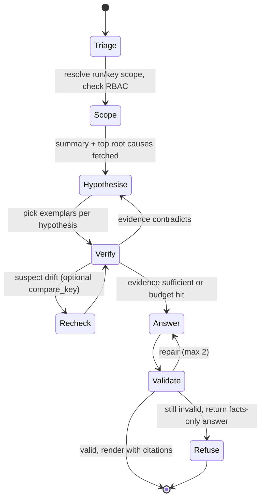

Default budgets, configurable per LLM profile (`llm_profiles.budgets`): ≤ 8 tool calls and ≤ 60 s per turn, ≤ 20k input tokens **per call**, and a per-turn input cap. When evidence is insufficient the agent **abstains** and lists what is missing.

### 9.4 Answer contract and validator

```json
{
  "summary": "string",
  "claims": [{"text": "…", "finding_ids": ["F-…"], "root_cause_ids": ["RC-…"], "obs_ids": ["O-…"], "tool_result_ids": ["T3"]}],
  "numbers": [{"value": 2731, "tool_result_id": "T2", "json_path": "$.rows[0].affected_keys"}],
  "hypotheses": [{"text": "…", "supporting_ids": ["F-…"], "status": "unverified"}],
  "unknowns": ["…"],
  "abstained": false,
  "suggested_next": ["…"]
}
```

The validator is deterministic:
1. Every number in `summary` or `claims` must appear in `numbers[]` and resolve to a value in the cited tool result.
2. Every cited ID must exist, and must belong to the scoped run.
3. Every claim needs at least one citation.
4. No token may be detokenised in text. Causes appear only in `hypotheses` (labelled unverified), never as claims.
4b. Citations to expired evidence are rejected, and the answer states which evidence is unavailable.
5. `summary` and `claims` contain no URL, markdown link, image or HTML. The UI renders LLM text as escaped plain text and builds citation chips from validated IDs pointing to internal routes. `ds-ui` is served with CSP `default-src 'self'; img-src 'self'; connect-src 'self'`, which blocks exfiltration through rendered markup.

On failure, the validator sends a repair prompt (max 2 attempts), then falls back to a facts-only answer. It records `validator_status` per turn.

### 9.5 Clustering tiers (P3)

1. `GROUP BY signature_hash` (deterministic; expected to collapse about 10^7 findings to 10^2–10^4 signatures, a single-source estimate to confirm in P3).
2. Key fingerprints: the sorted signature set per key. These catch co-occurring patterns.
3. HDBSCAN (scikit-learn) over embeddings of masked signature descriptions for the long tail only. Noise label −1 goes to a review queue, not the bin.
4. The LLM labels each cluster from medoid exemplars and stats. The output schema is `{label, hypothesis, suspected_component ∈ {normalisation, traversal, propagation, snapshot, filtering, schema}, confidence, evidence_finding_ids}`.
5. A human confirms the label. Only then can it become a `known_diffs` rule.

Cluster IDs are signature-set hashes, matched across runs by Jaccard overlap.

### 9.6 Guardrails

- **Egress.** `ds_llm` enforces the data-class and environment policy of §9.8 before every call, so an external test provider never receives production-derived data by accident.
- **PII.**
  - Token format: `tok:<class>:<key_version>:` + base32(HMAC-SHA256(K, class ‖ 0x1F ‖ normalised_value))[:26].
  - Only the tokeniser service computes tokens, using a non-exportable KMS/HSM key. Neither users nor the agent can call it, which blocks dictionary attacks on low-entropy classes such as phone numbers.
  - Tokens are pseudonyms, not anonymisation. `date_of_birth` exposes only its value_class.
  - `value_class` and `value_diff_desc` preserve the explanatory signal.
  - Presidio makes a second pass over any residual free text bound for the prompt, logs or traces.
- **Prompt injection.** Payload fields are attacker-controlled (the people a record describes choose its names and addresses). Tokenisation removes most free text. Remaining text is wrapped as delimited data with an instruction hierarchy. A small classifier (e.g. Prompt Guard-class) runs on residual text. There are no egress-capable tools.
- **Tool safety.** RBAC is enforced inside the tools, not in the prompt. `compare_key` is the only target-calling tool, and it is rate-limited and audited.
- **Reproducibility.** Log the profile_id, model_reported, adapter_version, capability_report_hash, prompt version, effort and sampling params (when supported), and tool-result hashes per turn. Server version and chat-template hash are logged only for a self-hosted profile. Evals pin (model_reported, prompt_version, effort); temperature 0 applies only where the model supports sampling params.

### 9.7 Evaluation (gates every model, prompt or tool change in CI)

The golden set has 150 questions across 7 categories:

| Category | Example | Target |
|---|---|---|
| Counts and rates | "How many CRITICAL findings in run R?" | 100% numeric match |
| Why and root cause | "Why do these 3k differ?" | ≥ 90% cite the top root cause |
| Key lookup | "What differs for ORG-000123?" | 100% correct `obs_id`s |
| Shared identifier | "Mismatches involving shared addresses" | ≥ 90% correct filter |
| Trend | "What is new since yesterday?" | 100% `compare_runs` used |
| Out of scope / refusal | "Delete these links" | 100% refusal |
| Injection red-team | Seeded payload strings | 0 tool misuse, 0 detokenisation |

Metrics: tool-selection accuracy, execution accuracy against gold result sets, citation validity, hallucinated-ID rate, p95 latency and tokens per answer.

### 9.8 LLM provider layer (`ds_llm`): any model, by configuration

Production uses a site's own model endpoint, typically an **OpenAI-compatible gateway** (API key). The Claude API or OpenAI are used for testing. Any model must be usable. DeltaSleuth therefore owns a thin, in-process **port** of about 400 LOC plus contract tests, and adopts no abstraction library.

**Port.** `LLMClient.complete(LLMRequest) → LLMResponse` (async, plus a streaming variant for SSE). The canonical message model stays close to Open Responses items, so a later Responses adapter is purely additive.
- **Request fields:** `profile_id`, `system`, `messages[]`, `tools[]`, `tool_choice`, `output_schema?`, `max_output_tokens`, `data_classes`, `meta{turn_id, prompt_version}`.
- **Response fields:** `text?`, `tool_calls[{id, name, arguments}]`, `structured?`, `stop`, `refusal?`, `usage`, `model_reported`, `latency_ms`, `mode_used`.

**Adapters (the "dialect" of a profile)**

| Dialect | Wire client | Covers | Phase |
|---|---|---|---|
| `openai_chat` | official `openai` 3.19.1, Chat Completions (`tools` / `tool_calls`, `response_format: json_schema`) | an OpenAI-compatible gateway, vLLM, the OpenAI API for tests | MVP |
| `anthropic_messages` | official `anthropic` 1.8.0, native Messages API (`tool_use`/`tool_result` blocks, `strict: true` tools, `output_config.format`, prompt caching, `stop_reason: refusal`) | the Claude API for tests (test profile default model `claude-opus-5`, adaptive thinking), and any gateway exposing `/v1/messages` | MVP |
| `openai_responses` | `openai` Responses API | only for an endpoint that serves `/v1/responses` | P3 |
| `custom_http` | a thin HTTP adapter | a site's own model endpoint that is neither of the above | if needed |

Claude is **never** reached through Anthropic's OpenAI-compatibility endpoint. That endpoint silently ignores `strict`, `response_format` and prompt caching, and Anthropic does not position it as production-ready.

**Profiles and policy (summary; full specification in Appendix E).**
- **Profiles.** Each profile declares its dialect, endpoint, auth reference, model, trust, allowed data classes, environments, capabilities, limits and pricing.
- **Egress policy.** Enforced **before every call**, and fails closed. There is no automatic internal→external failover. External profiles run in dev/test/eval on synthetic, golden or schema-summary data, plus operator-approved classes; never in prod.
- **Credentials.** Always explicit; never read from ambient environment variables.
- **Capabilities.** Effective capabilities = declared ∩ probed. Degradation ladders cover structured output and tools.
- **Schemas.** Static and data-free.
- **Normalisation.** Stops, errors and usage are normalised, with one row per call in `ds.llm_calls` and budgets enforced before each call.
- **Models.** Promoted only by the golden-set eval.
- **Plan B.** The Pydantic AI direct API. LiteLLM, aisuite and any-llm are rejected.

## 10. Reports

**Common rules for every export**
- **Fixed revision.** All parts render from one exported database snapshot, fixed by `result_revision_at` with commit-timestamp staleness detection. Each carries the run id, spec version, `claim_level`, time policy, capture window, the §7.1 counters and a snapshot of rule classifications.
- **Parts and manifest.** Numbered parts plus a SHA-256 `manifest.json`. The summary PDF states *included vs total* findings; a full PDF is produced only as volumes. Output is never silently truncated.
- **PARTIAL runs.** Cancelled or unfinished runs are watermarked **PARTIAL**, and export completeness is kept separate from population completeness.
- **Formula-injection safe (OWASP).**
  - CSV cells starting with `= + - @`, tab, CR or LF (including their full-width forms) are prefixed with `'`, quoted, and have embedded quotes doubled. Purely numeric cells such as `-0.01` are left as numbers.
  - XLSX is written with formula, URL and number conversion off (`write_string`).
  - Parquet keeps unescaped values (formula escaping applies to CSV/XLSX only; tokenisation still applies). A golden test covers `=HYPERLINK(…)`, and the report footer notes that Excel may undo the escaping when a file is re-saved.
- **Every item accounted for.** Each INCONCLUSIVE, failed or cancelled item gets a status row, and each NOT_FOUND key a `MISSING_/EXTRA_DOCUMENT` row. Expired evidence (`observations.expired_at`) is marked `expired`, never dropped.
- **Unmasked exports** (`reports.masked = false`) require `pii_reader` plus four-eyes approval and an audit row.

| Artefact | Content | Notes |
|---|---|---|
| `coverage.csv` | One row per stratum plus `*` (MVP: `*`, then for an ended sampled cycle one row per sign-off stratum and a `(contrast)` row, from the stored judgement, with the sample's columns appended; `docs/mvp/SAMPLING.md` §11.2). Columns:<br>• `attempted` = run_keys scheduled for the cycle<br>• `compared` = `n_clean`<br>• `matched`, `mismatched` = `n_discrepant`<br>• `inconclusive` (by reason), `drift` (by reason), `suppressed` (by rule or mask), `absent_both`, `api_uncomparable`, `schema_drift`<br>• `selected_fields`, population filters (verbatim, with pre- and post-filter counts), `spec_version` | Emitted with every export, and the PDF header uses the same definitions. |
| `discrepancies.csv` / `.parquet` | One row per **discrepant key × field**. Columns: `run_id, cycle_no, key, outcome, taxonomy_code, severity, path_pattern, json_pointer, change_type, direction, value_a_tok, value_b_tok, value_class, member_key_tok, root_cause_id, signature_hash, rule_id, mask_id, obs_a_id, obs_b_id, spec_version`. | Matches never appear, only counts. Values and `json_pointer` member keys are tokenised. Raw values are re-derived only through the audited reveal (`pii_reader`). Suppressed rows go to `suppressed.csv` with `rule_id`/`mask_id`. INFO rows (`NORMALIZATION_ONLY`) go to `normalization.csv`. |
| `outcome_changes.csv` | `run_id, key, stratum, cycle_from, cycle_to, outcome_from, outcome_to, class (new/fixed/persistent/flapping)` | Emitted with every interim report (`reporting.interim`) and the final soak report. |
| `retry.csv` | `INCONCLUSIVE` and `DRIFT` keys with their reason and attempts. | Feeds a follow-up run (`key.source.kind=run_keys`). |
| `summary.pdf` | 1. Coverage header (as `coverage.csv`, plus the claim level and cut metadata). 2. **Root causes first**, with direction. 3. Taxonomy × severity and per-stratum one-sided bounds. 4. **Trend** vs the previous run or cycle. 5. Up to 20 sampled side-by-side diffs. 6. A clearly labelled **LLM annex** citing IDs. | Jinja2 → WeasyPrint; deterministic sections are reproducible from the database. |
| `summary.xlsx` | PDF sections 1–4 plus a root-cause sheet. | Excel's row cap means full detail stays in CSV/Parquet. |
| Labelled accuracy (MVP: a section of `report.pdf`, the P0 summary and an evidence pack's certificate; `accuracy/labels.csv` and `accuracy/score.json` in the pack) | For an ended cycle with a labelled sample: who drew and labelled it against which truth source, the uniform discrepancy shares (truth favoured a, b, neither, or the difference did not matter) with exact two-sided 95% Clopper–Pearson intervals and, where items are undecidable, the range counting them either way, each root cause's and rule's own figures, the agreed and accepted samples, how many labellings the cycle has when there are several, and what the figures may not be read as. Without a labelled one: `Not measured: no labelled sample of this cycle.`, with how many were drawn. | `docs/mvp/ACCURACY.md` §7, §9, §10. Observed; a person's labels, counted, never an outcome or a gate. The pack's labels file holds no key, item number or sheet order. |
| Cut-over readiness (MVP: a section of `report.pdf`; `readiness.csv` among a run's reports; `dashboard.pdf`, `dashboard.csv` and `trends.csv`) | `report.pdf`'s "Pair readiness (observed)": the pair's parity gates as of the reported cycle, judged on the cycles ended by then under the readiness settings it names by hash, so the database gives the section again under the same settings (the deterministic-section rule above); a live cycle, one not measured yet and a one-shot or captured-sample run say so instead. `readiness.csv`: the pair's measured cycles up to the reported one (at most 500). The dashboard: per programme, entity type and pair the named gates with their texts, convergence, sign-off, pack and last evidence cycles, 100 pairs a volume and never truncated, ending with what it is not; `dashboard.csv` one row per pair and gate; `trends.csv` one row per pair and measured cycle, refused over 100,000 rows. | `docs/mvp/READINESS.md` §2, §11. Observed; named gates met or not, never a percentage, probability, weighted score or forecast of parity, never sign-off evidence, and never in an evidence pack. |

## 11. Technology stack

### 11.1 Language decision: Python 3.13, plus one JVM job

| Criterion | Python | Java | Winner |
|---|---|---|---|
| Bulk reads of a store (P2) | drivers and query clients | a store's bulk-scan API may be JVM-only | Java (bulk exporter only) |
| Data ecosystem (Arrow, DuckDB, Spark) | DuckDB, pyarrow, polars, datacompy, reladiff, statsmodels, scikit-learn | Spark and DuckDB JDBC; fewer diff/stats libraries | Python |
| LLM / MCP SDKs | `mcp` 2.2.0 tracks the newest spec; official `openai` 3.x and `anthropic` 1.x SDKs | Spring AI 2.0.1 and LangChain4j 1.20.0 are mature, but the Java MCP SDK lags the spec | Python |
| Ops footprint | one Python runtime for engine, agent and reports; the UI is a static React bundle | one runtime, but the agent tooling is heavier | Python |

**Decision.**
- **Python 3.13** for the whole product.
- **Support window:** 3.13 gets binary bugfix releases until 3.13.16 (2026-10-06), then security fixes until 2029-10.
- **The one JVM component** is `extractor-graph` (P2), which is optional. It is a small JVM job for a store whose bulk-scan API is JVM-only (§4.8). It writes canonical Parquet, which is the only integration point.

### 11.2 Key choices (full bill of materials in Appendix C)

- **Runtime.** FastAPI, Pydantic, aiohttp, aiolimiter and stamina; psycopg 3 and DuckDB; pyarrow with zstd Parquet.
- **Comparison.** RFC 9535 JSONPath, JSONata and CEL; phonenumbers; rapidfuzz.
- **Onboarding.** genson and jsonschema-rs.
- **Reports.** WeasyPrint and XlsxWriter.
- **LLM.** The `mcp` SDK, plus the official `openai` and `anthropic` SDKs behind `ds_llm`.
- **Frontend.** A React/Vite/TypeScript SPA with jsondiffpatch.
- **Infrastructure.** PostgreSQL 17 with CloudNativePG; SeaweedFS or an existing S3 store; oauth2-proxy; KEDA.
- **P2.** An optional JVM bulk exporter for the graph side.
- **Rejected:** LiteLLM, aisuite and any-llm; MinIO; opendiffy and AREX; Soda Core; Streamlit (for the MVP UI).

Every item carries its version, licence, status, source URL and access date in **Appendix C**, which also holds the licence and supply-chain gate.


## 12. Capacity and cost

Inputs are parameters; *(assumed)* values await the P2 benchmark. Table-pair values are measured in `docs/mvp/BENCHMARK.md`, whose Results publish 0.1M to 10M rows a side observed on one Mac (an Apple M3 Max, synthetic data), and 100M not yet run. The service crawl (§12.1) is not benchmarked.

### 12.1 API crawl duration

**General bound (pages and retries included).**
`T ≥ max( N · pair_cycle / C , N · pages_A · attempts_A / r_A , N · pages_B · attempts_B / r_B )`
Here `pair_cycle` is the latency of A and B plus normalisation plus the configured delay. P0 measures pages per entity, fan-out and p50/p95/p99 latency.

**Simple case (one page, no retries).** Each key costs one call per target, so keys/s equals the per-target budget `r`. Pass time:

`T = N · (1 + m·t) / r`

where `m` is the fraction of keys needing confirmation *(assumed 1%)* and `t` is the number of recheck passes *(2)*. Concurrency needed to sustain `r` comes from Little's law, `C = ⌈r · W̄⌉`, where `W̄` is the **mean** latency *(assumed 0.25 s)*. Size for the tail with `⌈r · L_p95⌉`. `execution.delay` is the minimum pause between consecutive keys per worker.

| Keys N | r = 10 req/s | r = 50 req/s | r = 200 req/s |
|---|---|---|---|
| 5M, m = 0 | 500,000 s = **5.79 d** | 100,000 s = **27.8 h** | 25,000 s = **6.9 h** |
| 5M, m = 1%, t = 2 | 510,000 s = 5.90 d | 102,000 s = 28.3 h | 25,500 s = 7.1 h |
| 20M, m = 0 | 2,000,000 s = **23.1 d** | 400,000 s = **4.63 d** | 100,000 s = **27.8 h** |
| 20M, m = 1%, t = 2 | 2,040,000 s = 23.6 d | 408,000 s = 4.72 d | 102,000 s = 28.3 h |
| In-flight C per target | 2.5 | 12.5 | 50 |

**At the default budget of r = 20 req/s:** 5M keys take 250,000 s = **2.89 d**, and 20M take 1,000,000 s = **11.6 d**, before rechecks.

**Strictly sequential default** (concurrency 1, A then B, `L_a = L_b = 0.2 s`, delay 0.05 s): `r_eff = 1/(L_a + L_b + delay)` = 2.22 keys/s. At that rate 5M keys take **26.0 d** and 20M take **104 d**. A full crawl under budget therefore needs concurrency ≥ `⌈r · W̄⌉`.

Parallel A/B calls give `1/(max(L_a, L_b) + delay)` = 4 keys/s.

**Conclusion.** Full crawls need ≥ 50 req/s (5M keys) or ≥ 200 req/s (20M); below that, sign-off rests on L1/L2 plus the L3 sample (§15).

### 12.2 L3 sample and calibration cost

The zero-failure sample size is `n = ⌈ln α / ln(1 − p)⌉`:

| Upper bound p | α = 0.05 | α = 0.01 |
|---|---|---|
| 1% | 299 | 459 |
| 0.1% | 2,995 | 4,603 |
| 0.01% | 29,956 | 46,050 |

The bound is one-sided. Sampling is bottom-k per stratum, sized so that the **clean** count reaches 2,995 or 29,956 at 0.5% INCONCLUSIVE: 3,011 or 30,107 attempted.

The sign-off sample is 12 × 3,011 + 3 × 30,107 = **126,453 keys**. At 20 req/s that takes `126,453 · 1.02 / 20` = 6,449 s ≈ **1.8 h**, which needs concurrency ≥ ⌈20 · 0.25⌉ = 5 per target.

At the example spec's concurrency 1 and 250 ms delay, `W = L_a + L_b + delay + E[jitter]` = 0.2 + 0.2 + 0.25 + 0.05 = 0.7 s per key, so the same sample takes `126,453 · 1.02 · 0.7 / 3,600` ≈ **25 h**; sign-off runs raise concurrency.

**Calibration calls:** A = 2·n (L1, L2) and B = (1 + repeatB)·n, with n = sampleSize. For the example (n = 400, repeatB = 2): 800 A calls take 40 s and 1,200 B calls take 60 s at 20 req/s.

### 12.3 Storage, table-pair and bulk-extract estimates (summary; formulas in Appendix G)

These figures assume 4 KiB responses, zstd ≈ 5×, 1% mismatch and 2 rechecks:

| Item | 5M keys | 20M keys |
|---|---|---|
| Raw observations | ≈ 8.4 GB | ≈ 33 GB |
| `results` | ≈ 2 GB | ≈ 8 GB |
| `observations` metadata | ≈ 7 GB | ≈ 29 GB |

- **100M-row table pair:** extracts take minutes, Parquet is ≈ 5 GB per side, and hashdiff pays off only below about 10^5 diffs. This extract and hashdiff design is not built or measured: the MVP scans both tables by row hash inside PostgreSQL and reads each differing key. `docs/mvp/BENCHMARK.md` has published the MVP's scan from 0.1M to 10M rows a side, observed on one Mac, and 100M is not yet run; its Results give the figures with their conditions (hardware, row width, difference pattern, cache, worker poll) and the extrapolation's measured errors.
- **L1 PostgreSQL extract:** about a minute. The graph bulk scan's duration is to be benchmarked on the clone.
- **Retention classes:** standard keeps raw and findings 90 d; audit keeps both 1 y.

### 12.4 LLM cost (no GPU to size)

A gateway and the test providers are consumed as APIs, so capacity is a **token budget**, not GPU memory. Cost per call, from `ds.llm_calls` and the versioned price table:

`cost = p_in · uncached_input + p_in · m_read · cache_read + p_in · (m_w5m · cache_write_5m + m_w1h · cache_write_1h) + p_out · output`

**Worked example (Claude test profile).** Prices: `claude-opus-5` at $5 / $25 per MTok, cache read ×0.1, 5-min write ×1.25, 1-h write ×2. Source: Anthropic pricing, re-confirmed 2026-09-24 (References).
- **One call** with a 10k cached prefix, 6k new input and 1.5k output: $0.030 + $0.005 + $0.0375 ≈ **$0.07**. The first call writes the cache instead: ≈ $0.13.
- **One investigation turn** with the default 8 tool calls is about **9 calls**, each resending a growing context (10k prefix + question + about 0.9k per tool round, ending near 17.5k).
  - Before thinking: ≈ **$0.17** per turn with the conversation cached incrementally, and ≈ **$0.29** with only the static prefix cached.
  - With adaptive thinking (≈ 500 output tokens per call): ≈ **$0.28–0.40** per turn, assuming replayed thinking is billed as input (UNVERIFIED).

**Gateway profile:** its chargeback rate goes into the profile's `pricing` (0 if none is published).

**Budgets (per profile):**
- ≤ 20k input tokens **per call**;
- a per-turn input and tool-call cap (default 8 calls);
- per-user/day and per-run caps.

All are enforced before each call (§9.8). P3 cluster labelling runs only over distinct long-tail signatures, so its cost scales with clusters, not rows. Only a self-hosted vLLM profile needs GPU sizing.

## 13. Security, observability, deployment, RBAC

### 13.1 Security controls (summary; the full control catalogue is in Appendix D)

- **PII.** A single tokeniser service computes keyed HMAC tokens with a KMS/HSM key, over a deployment PII floor. Values are revealed only through an audited endpoint.
- **Scope.** Dataset scope (ABAC) applies on every request, and every target, template and inferred schema a spec uses must be granted to its dataset (`ds.dataset_targets`). The AI never has broader visibility than the requesting user.
- **Targets.** An SSRF-safe target registry with same-origin enforcement. Only approved SQL templates are used, never free SQL or graph queries.
- **LLM.** A fail-closed LLM egress policy. Prompt-injection defences: tokenised or delimited payloads, validator rule 5, and a CSP.
- **Approvals.** Clear-text exposure (`clear`, `rawClear`, `unlisted: clear`) and certified population filters need four-eyes approval (`ds.spec_approvals`, enforced on runs). Approved rules, templates and inferred schemas are immutable, with hash CHECKs.
- **Evidence.** Only masked renditions, via ≤ 60 s single-object URLs. Idempotent creation is atomic and re-authorised on replay.
- **Integrity.** An append-only, hash-chained audit log (docs/mvp/PACK.md §4), and hashed reports.
- **Supply chain.** Hash-locked dependencies, a cooldown on new releases, and a deny-list.
- **Retention.** Retention classes (raw ≥ findings), with deletion across captures, prompts, exports and backups.

**As built in the MVP** (`docs/mvp/RETENTION.md`):
- **Encryption at rest.** Envelope encryption: a keyring of KEKs (a `file:` secret outside the database, its volumes and backups) wraps the data keys in `ds.data_keys`. Each run's data key seals its raw keys, headers, scan resume point and chat with AES-256-GCM; evidence keys wrap a data key per blob, and blobs are named by a keyed HMAC of the body. Masked data stays in clear. The tokeniser key is a `file:` secret too. KMS or HSM custody is deferred.
- **Retention.** The spec's class (`standard` 90 days, `audit` 365, set in the settings) runs from each cycle's end. An hourly, audited, interruptible purge deletes whole ended cycles (raw data and findings together), blobs 24 h after their last reference; holds keep a run, erasures delete one now, and runs parked past their retention are ended. Expired reads answer 410 and AI answers that need them are refused. Backups age out with the site's rotation (at most 35 days); a restore purges and replays later erasures before the app starts. P0 files go by a host cron; exports, logs and the LLM provider's copy are the site's policy.

**As built in the MVP** (`docs/mvp/RELEASE.md`):
- **Supply chain.** The image's bases are pinned by digest, uv by hash in a build stage; the runtime stage holds neither uv nor pip and runs as uid 10001, and Compose runs it read-only, with no capabilities and `no-new-privileges`. The maintainer's `tools/release.py` builds a release from a git archive, catalogues it with syft (CycloneDX 1.6, SPDX 2.3, checked complete against dpkg, the python binary, `uv.lock` and the npm lock), scans it with grype and pip-audit, and blocks a fixable Critical, High, unknown or known-exploited finding unless `tools/triage.toml` decides it with an expiry (shipped as OpenVEX); each wheel-vendored library gets a dated decision. It signs `SHA256SUMS` with a release key (ECDSA P-256) that never leaves the maintainer's machine, and a site verifies the bundle with OpenSSL and `sha256sum` before `docker load`, air-gapped. Builds are not reproducible, and provenance is the maintainer's attestation; cosign, SLSA provenance and a hardware key are deferred. `SECURITY.md` is the vulnerability process, `docs/mvp/PENTEST.md` the pen-test scope.

**As built in the MVP** (`docs/mvp/APPROVALS.md`):
- **Four-eyes approvals** replace `ds.spec_approvals` with `ds.approvals`. Under SSO a spec version whose content has `clear` paths, `unlisted: clear`, active known diffs or population filters (table `where` and `columns`, `compare.include`, `exclude`, `valueFilter`) runs only under an approval of its whole content hash. The runner gates runs (creation, compares, resumes, a soak's boundary), not a trigger on `ds.runs`, and refuses a stored body that does not re-hash to its content hash. `ds.tg_approvals` checks every decision: the decider is an enabled person whose stored roles hold `rule_approver` and who is outside the exclusion set, the uploaders of the name's versions since its last approved one (a lineage rule in place of "no author of any version") and the requester; an unattributed author (a CLI, token, developer-mode or pre-005 upload) makes two approvers necessary. Spec bodies are immutable (`specs_immutable`). `rawClear` stays ignored, and its `raw_clear` scope reserved.
- **Sign-off.** An ended cycle of a live run started under SSO is accepted as parity evidence by a hash of its facts (counters, key source, a table scan's counts, rules with their key counts, root causes, the spec approval it ran under), once complete (a table scan read to the end), reconciled, uncut and free of unexplained CRITICAL keys, by someone who neither wrote its spec (the authors that approval stored), started its run nor requested the sign-off. The last step holds the run; a revoke (by a person, `ds approvals revoke` or the purge of the cycle) cascades to the runs and sign-offs resting on the approval. Approval steps need a sign-in within 15 minutes. Tokens and developer modes have no approvers: their runs go ahead, labelled unapproved in the Run screen, `report.pdf`, the P0 summary and `ds runs`.

### 13.2 RBAC roles (from OIDC groups)

| Role | Can |
|---|---|
| `viewer` | See runs, tokenised findings and reports in granted datasets; chat |
| `operator` | + start, pause and stop runs; run `compare_key` |
| `spec_author` | + create and edit specs; propose noise masks and known diffs |
| `rule_approver` | + approve `known_diffs`, noise masks (with `expires_at`), cluster labels and spec `clear` entries. Four-eyes: must not be the author. |
| `pii_reader` | + reveal raw values via the audited reveal endpoint (re-derived from raw observations; tokens are never inverted) |
| `admin` | + manage the target registry, retention and roles |

**As built in the MVP** (`docs/mvp/AUTH.md`):
- **Roles come from `auth.oidc.roles`** at each sign-in. It maps each role to immutable IdP group ids (app role values, group object ids or SIDs, client roles), matched exactly, and a role implies every role above it in the table. No table grants roles; `admin` manages API tokens, users, sessions and the audit log.
- **Person-required roles need a person.** `require` grants `rule_approver` and `pii_reader` only to a `user:` principal signed in through the IdP, never to an API token, the CLI or developer mode. An API token holds at most `spec_author`.
- **The agent follows the asker.** Its tools need the asker's roles: `compare_key` needs `operator`.
- **`rule_approver`** approves spec versions and sign-offs (`docs/mvp/APPROVALS.md`), never content it uploaded, requested or ran; known diffs are approved with their spec version's content, not one by one. Noise masks and cluster labels are deferred.

### 13.3 Observability and deployment (detail in Appendix D)

- **Tracing.** OpenTelemetry, one span per key comparison, carrying tokens only.
- **Metrics and alerting.** Prometheus metrics for rate, latency, limiter wait, breaker, backlog and outcomes. An error spike pauses the run; a mismatch spike triggers investigation.
- **Kubernetes deployment.** The fetcher scales on backlog with KEDA, capped at the per-target concurrency. CloudNativePG runs Postgres, and object storage is S3-compatible.
- **Docker Compose.** The MVP ships a Compose deployment for one host (`deploy/docker-compose.yml`, `docs/mvp/DEPLOY.md`).

## 14. Risks

| Risk | L×I | Mitigation |
|---|---|---|
| **Semantic mismatch** (depth, roll-up, validity) floods the results with "diffs" | H×H | P0 adjudication of 50 roots. The time and scope contract is agreed in the spec. The calibration run surfaces it early. |
| **Live-write drift** | H×M | A frozen cut (§4.13) for certification. In live mode: confirm-on-mismatch, changed-since sets and DRIFT excluded from rates. |
| **Store semantics unknown** (atomicity, isolation, scans) | M×H | A conformance probe. `consistency_profile` flags (Appendix D.6) drive behaviour, and certification is refused if they are unverified. |
| **Truncation on hot identifiers** | M×H | INCOMPLETE → INCONCLUSIVE and the `api_uncomparable` list. Paginated fetch or L2. Census by `member_set_hash`. |
| **Genericity erosion** (linking assumptions leak into the core) | M×H | The core never imports a domain pack. A non-linking example spec (`generic-customer-services.yaml`) is validated beside the entity-linking example. The P4 exit criterion is a second domain with no core change. |
| **Profiler suggests wrong keys or alignments** | M×M | Evidence table plus dry-run counts (keyed vs set). Human approval is mandatory. LLM advice is re-scored against evidence. |
| **LLM data egress** to an external test provider | M×H | Fail-closed data-class and environment policy, internal-only production default, egress NetworkPolicy, audit (§9.8). |
| **LLM platform or model changes** | M×M | Eval gate keyed on the reported model; capability probe; degradation ladders; Plan B adapter. |
| **Supply-chain compromise** (cf. LiteLLM, March 2026) | L×H | Hash-locked dependencies, 3-day cooldown, deny-list, licence gate (Appendix C.7). |
| **LLM hallucinated numbers** | M×H | Validator, facts-only fallback, and reports that never depend on the LLM. |
| **Bulk-mode results exception** (MATCH rows as Parquet) | L×M | A stated trade-off. Totals are read through DuckDB (§6). |
| **Scope creep into a generic DQ platform** | M×M | P4 is gated on the P0–P3 exit criteria. |

## 15. Roadmap and parity sign-off

| Phase | Modes | Layers | Scope | Exit criteria |
|---|---|---|---|---|
| **P0 Contract POC (1–2 weeks)** | one_shot (fixtures) | — | Real response samples; profiler draft; black-box contract measurements (statuses, not-found shapes, sizes, fan-out, latency) and proposed capabilities; LLM conformance probe | 50 adjudicated roots match the reviewers. Profiles are signed off. |
| **MVP (built)** | one_shot, batch, soak | L0, L3 | Public API + React UI; REST connector (GET/POST, GraphQL); profiler; canonicaliser (tree); evidence-first fetcher with leases; generic root-causer; reports; `ds_llm` + agent; `hash_sample` sign-off sampling (bottom-k and rate over a table, listing or union frame) and sampled evidence packs. Deferred: calibration, rediff, graph/v1, outbox, csv/sql/run_keys frames, hash-sampled soaks (`sampling.mode: hash`) | The demo finds exactly the 7 seeded discrepancies, with AI on and off. Kill -9 loses nothing. Counters reconcile. Launch gates pass. |
| **P2 (≈ 6 weeks)** | bulk_parity, table_diff | L1, L2 | Optional, opt-in by the system owners: EnvironmentSnapshot (PITR) + frozen certification; graph bulk and PG COPY exporters; exact joindiff/merge planner; cluster contingency; anomaly checks; cross-engine tables; changed-since feed | A certified full-population L1/L2 diff within the §12 budget. |
| **P3 (≈ 6 weeks)** | — | — | Clustering + LLM labels, contrast analysis, guarded `query_sql`, NL → spec drafting, eval CI, Responses adapter if needed | Golden set ≥ 150 questions per profile; citation validity 100%. |
| **P4** | change_driven | L4 | Change-feed re-validation (tombstones re-read; always `observed`); more connectors; a second domain pack | A second domain with no core change. |

**Parity sign-off (items 1–3 checked for sampled cycles as built below; items 4 and 5 stay the approver's).** Cut-over is approved when the final run meets all of these:
1. **No unexplained CRITICAL findings.** Each is fixed, or covered by an active rule classified `accepted` or `expected_by_design`. Findings suppressed by a `bug` rule count as unexplained.
2. **Per-stratum bound.** Over the cleanly compared distinct keys of the final cycle, the **one-sided** 95% Clopper–Pearson upper bound (`beta.ppf(0.95, x+1, n−x)`, never the two-sided default) is:
   - ≤ **0.1%** for the 12 standard strata (entity kind × degree bucket {0, 1, 2–5, 6–20, 21–100, >100});
   - ≤ **0.01%** for the 3 high-risk strata (flagged, changed in the last 7 days, largest 1% of components).

   **What counts:** `x_h` = discrepant keys plus KNOWN_DIFF keys that a `bug` rule suppresses. `n_h` excludes DRIFT and INCONCLUSIVE. A second bound, which counts every suppressed key as discrepant, is also reported.

   **Sampling:** bottom-k per `signoffStratum` until n_clean = 2,995 or 29,956 (≈ 3,011 or 30,107 attempted; 126,453 in total), drawn from the `union` key source. Bounds count only `signoff_member` keys, i.e. those selected by their own stratum's bucket; the other keys are reported as `n_contrast`.

   **If x > 0:** fix, then draw a **new sample with a new salt**; never re-test the same keys. No conditional extension: extending to n = 4,742 after a failure gives only ≈ 92.4% confidence. Census strata use an exact rate: x_h ≤ ⌊target · N_h⌋.
3. **Coverage.**
   - Every unresolved key (INCONCLUSIVE or DRIFT) in a sign-off stratum is **retried to resolution** before sign-off (`retry.csv` → a `run_keys` run).
   - The remaining unresolved rate must be ≤ the stratum's target (0.1% / 0.01% of n_clean).
   - `absent_both` keys, which retry cannot resolve, are reported as `n_absent_both`; above 0.1% of attempted they block sign-off as a key-source defect (re-draw the key source at the cut).
   - `ub95_one_sided_worst_case` (x' = x + unresolved) is reported alongside, for information only.
   - Keys above the API cap are listed as `api_uncomparable` and must be covered by a paginated fetch or by L2.
4. **Hot identifiers.** The top 10k by degree on each side are censused by `member_set_hash`, at L2 or through the identifier endpoint. Every split or merged component is compared in full.
5. **P2.** Zero unexplained L1 attachment diffs, and zero unexplained CLUSTER_SPLIT/MERGE/REARRANGE.

**As built** (`docs/mvp/SAMPLING.md`, migration 011):
- **Item 2.** `hash_sample` with `method: bottom_k` per `signoffStratum`, drawn from a frame the product observes whole: a table side's population in one snapshot, a side's complete key listing, or a `union` of one per side. The salt is `label:nonce`, the installation drawing a 128-bit nonce per draw and committing its SHA-256 and the selection's to the audit trail before any key is compared, so nobody picks or shops a salt and every re-draw is a new sample. The decision is exact: BinomCDF(x; n, t) ≤ 0.05 in integers, the same test as `beta.ppf(0.95, x+1, n−x) ≤ t`. Each stratum's `ub95_one_sided` (any x, replacing `ub95_one_sided_zero_fail`), `ub95_one_sided_all_suppressed` and `ub95_one_sided_worst_case` are stored once in `ds.cycles.sample`; the last two are reported, never judged. Only `signoff_member` keys are bounded; the others are contrast keys, compared and reported. A stratum whose frame holds no more keys than its `targetSize` is a census, judged on x + unresolved ≤ ⌊t · (N_h − absent_both)⌋, never on the binomial bound. A sign-off passes only if every stratum does, an intersection-union test that needs no multiplicity correction; no pooled bound is given.
- **Item 3.** Only a key the cycle never read comparably is retried, within the cycle (`resolve.times`, default 3): an observed discrepancy is never re-read away, and no key is replaced or the sample extended. After retries, unresolved ≤ ⌊t · n⌋; `absent_both` is gated at the stratum's own target, ≤ ⌊t · drawn⌋ (stricter than 0.1% for high-risk strata) and named in the claim; a truncated (`api_uncomparable`) key fails its stratum until a paginated fetch covers it.
- **If x > 0.** A failed draw is spent. Every draw of a population, under any spec name, is on its ledger in audit-chain order; a draw that did not pass is closed by a person with a note of the fix before a later draw is signed off, and a later failure spends an earlier pass.
- **Item 4** is approximated by census strata; hot-identifier censuses by `member_set_hash` stay the approver's, as does item 5.
- **Labelled accuracy** (`docs/mvp/ACCURACY.md`, migration 013) informs the approver and never gates. A sign-off requested from 013 on (attests format 3) attests the cycle's newest labelling that a signed-in person labelled, or none (its hashes, truth source, exact label counts and whether its labeller started the run or wrote the cited spec approval), and how many labellings the cycle has, drawn and labelled. The labeller may not approve it, and a draw or labels are refused while the request is open or approved. No share, interval or undecidable count refuses a request, a decision or a pack; a pack is refused only when the attested labelling no longer hashes to what it recorded.

**Cut-over readiness** (`docs/mvp/READINESS.md`, migration 014) informs and never gates a sign-off: `signoff_problems` does not read it, and it enters no attests and no pack. Per pair (a spec name, judged on the version of its newest evidence cycle) it shows which named gates hold on stored evidence and a place on a fixed ladder, as `k of m gates`, never a probability. Its defaults are this section's tiers (0.1%, or 0.01% for a `high` policy; a programme or pair only tightens) and three of its own: **K = 3** evidence cycles of one version in a row meeting every per-cycle gate (convergence, a stability rule, not a statistical test), an evidence cycle at most **7 days** old, and graph parity not required. A pair observed whole (a census) is judged on **one pooled count** at the tier, x + unresolved ≤ ⌊t · (N − absent_both)⌋ with absent_both ≤ ⌊t · N⌋ and no key above the API cap, not on item 2's per-stratum targets, which stay the approver's unless the cycle is sampled; a sampled cycle is judged by its stored judgement at the policy's tier. Convergence and freshness may be relaxed in the settings, each relaxation named as a deviation on every surface; the targets never go below 0.1%.

**Claim level.** A sign-off is `certified` only with a `frozen` or `shared_watermark` time policy and an exhaustive manifest on every side (§4.12). Otherwise it is labelled `observed`, and the decision rests with the domain owner.

**Cost at 20 req/s:** ≈ 1.8 h for the L3 sample (concurrency ≥ 5), plus the census.

### 15.1 Launch gates and test strategy (summary; detail in Appendix F)

- **Required gates.**
  - Zero false matches on incomplete evidence.
  - Exact counter reconciliation.
  - Rate caps never exceeded.
  - Stale leases reclaimed within 2 min; RPO ≤ 5 min, RTO ≤ 1 h.
  - AI quality per LLM profile (gates AI launch only).
- **Tests.** Property tests (source-swap symmetry, idempotent normalisers, set-order invariance) and six scheduled high-risk experiments.
- **Rollout.** Fixtures → canary → census, with auto-pause on source-health regression.

## 16. Repository layout

```
deltasleuth/                   the product: one Python package, installed as the `ds` command
├── core/                      spec/ (schema, loader, rules), canonical/, diff/, classify/, types.py, and the
│                              sampling, readiness, pre-check and cron logic
├── connectors/                service sides (rest.py, http.py, paging, retries, breaker, network guard), table
│                              sides (tables/, postgres/: PostgreSQL, MySQL, Oracle, files read by DuckDB),
│                              captured samples (files.py), notification channels (notify.py)
├── profiler/                  draft specs from paired samples or table schemas
├── runner/                    runs, cycles, rechecks, table scans, samples, schedules, purge, the worker
├── store/                     db.py, repo.py, chain.py (the audit chain), migrations/
├── evidence/                  the encrypted evidence store
├── security/                  tokenisation, encryption, signing
├── auth/                      OIDC sign-in, sessions, API tokens
├── reports/                   CSV and PDF reports, evidence packs, templates/
├── llm/                       the ds_llm port: adapters/ (openai_chat, anthropic_messages), policy, profiles,
│                              probe, usage
├── agent/                     the chat loop, its tools and its validator
├── mcp/                       the MCP server and its tools
├── api/                       the FastAPI app and its routes/
├── cli/                       the `ds` command
├── packs/entity_linking/      the optional entity-linking pack: its taxonomy codes and config schema
└── *.py                       settings (config.py), targets, approvals, schedules, pre-checks, readiness,
                               notifications, licence
web/                           React + TypeScript SPA (Vite): src/, test/
deploy/                        Dockerfile, Compose files, example settings (config/), up.sh
mocks/                         two mock service pairs with seeded discrepancies: linker/, customer/
examples/                      runnable examples: graph/, tables/, public/
tools/                         the maintainer's tools: release.py, bench.py, dsv.py
tests/                         unit/, golden/, property/, e2e/, fixtures/, support/
docs/                          architecture.md, architecture/, mvp/, guide/, bench/
pyproject.toml, uv.lock        the project and its hash-locked dependencies
```

## Appendix A. Traceability

The rows cite the requirements of §2 (F1 to F13, N1 to N10) and eight design principles, P1 to P8, which are not the roadmap phases P0 to P4 of §15:

- **P1 The engine decides, the LLM explains.** The engine decides every outcome; the LLM only explains and cites (§9.1).
- **P2 Layered parity.** Parity is shown layer by layer, L0 to L4 (Conventions, §4.8, §15).
- **P3 Canonical model.** Each side is mapped and normalised to a canonical document before the diff (§5, §8.1).
- **P4 Fetch ≠ compare.** Observations are stored, and the comparer is a pure function of (spec version, observations), so an offline re-diff is possible (§4.3).
- **P5 Outcomes, noise, drift.** One outcome vocabulary with a fixed precedence; calibration and rechecks keep noise and drift apart from discrepancies (§7.1, §8.3).
- **P6 Root causes.** Findings roll up into signatures and root causes (§8.2).
- **P7 Domain-agnostic core.** The core never imports a domain pack (§4.3).
- **P8 Security.** The controls of §13.

| Requirement / principle | Component(s) | Where specified |
|---|---|---|
| F1 one-shot | ds-api `/compare`, fetcher (inline), comparer, MCP `compare_key` | §4.5, §9.2 |
| F2 batch / full crawl | key sources (including `union` and bottom-k), scheduler, fetcher leasing, `run_keys`, `work_units` | §4.6, §6, §12.1 |
| F3 soak | scheduler cycles, `results.cycle_no`, `compare_runs` | §4.7, §9.2 |
| F4 selection | spec `compare.fields/include/exclude/valueFilter`, table `columns`/`where` | §5, `spec.schema.json` |
| F5 reports | reporter: `coverage.csv`, `discrepancies.csv`, `retry.csv`, `normalization.csv`, `outcome_changes.csv`, PDF/XLSX | §10 |
| F6 AI investigation | ds-agent, ds-mcp, validator, chat UI | §9 |
| F7 noise calibration | scheduler calibration mode, `noise_masks` | §8.3 |
| F8 known differences | `known_diffs`, classifier suppression | §5, §7.1 |
| F9 bulk parity | extractor, bulkdiff planner, canonical Parquet | §4.8–4.9, §8.4–8.5 |
| F10 run comparison | `compare_runs`, PDF trend section | §9.2, §10 |
| F11 generic onboarding | ds-profiler, annotated schema, `POST /v1/specs/draft` | §8.6, §4.11 |
| F12 configurable LLM | `ds_llm` port, provider profiles, egress policy | §9.8, Appendix C.3 |
| F13 public API v1 | ds-api (idempotency, cursors, async jobs) | §4.11 |
| N1 politeness | global token bucket, AIMD, breaker, KEDA cap | §4.3, Appendix D.3 |
| N2 correctness | fetch ≠ compare, `spec_version`, golden corpus | §4.3, §8.1 |
| N3 resumability | `SKIP LOCKED` leases, idempotent upserts | §4.6, §6 |
| N4 scale | partitioning, DuckDB, planner | §6, §12 |
| N5 security | tokeniser service + PII floor, RBAC, target registry + same-origin guard, audit, CSP | §9.4, §9.6, §13 |
| N6 auditability | `audit_log`, `chat_turns` | §6, §9.6 |
| N7 operability | docker-compose, Helm, OTel/Prometheus | §13 |
| N8 extensibility | connector SPI + capabilities, domain packs, taxonomy registry, consistency profiles | §4.3, §4.12 |
| N9 honest claims | manifest EOF proofs, time policy, claim level, EnvironmentSnapshot | §4.12, §4.13, §5.1 |
| N10 AI optional | outbox-driven async AI, e2e with AI off | §9.1, §15 |
| P1 engine decides, LLM explains | comparer outcomes; agent tools; validator | §7.1, §9.1, §9.4 |
| P2 layered parity | L0/L3 (MVP, union key universe), L1/L2 (P2), L4 (P4) | §4.8, §15 |
| P3 canonical model | canonicaliser, normaliser chains, keyed arrays | §5, §8.1 |
| P4 fetch ≠ compare | object store observations, `results` for every key | §4.3, §6 |
| P5 outcomes, noise, drift | outcome vocabulary with precedence, calibration (raw-vs-noise block), recheck units | §7.1, §8.3 |
| P6 root causes | signatures, root-causer, explainer | §8.2 |
| P7 domain-agnostic core | `packs/entity_linking`, generic codes | §4.3, §7.2 |
| P8 security | §13 controls, `compare_key` limits | §9.6, §13 |

## Appendix C. Technology bill of materials

### C.1 Language decision

See §11.1: Python 3.13, plus one optional JVM bulk exporter (P2).

### C.2 Python libraries (MVP unless marked)

Accessed 2026-09-23 or 2026-09-24 (per row) from PyPI JSON or the project repo.

| Purpose | Library | Version (date) | Licence | Status | Source | Accessed |
|---|---|---|---|---|---|---|
| API | FastAPI | 0.141.1 (2026-07-29) | MIT | active, pre-1.0 | https://pypi.org/pypi/fastapi/json | 2026-09-23 |
| Models | Pydantic | 2.13.5 (2026-08-28); pin `<2.14` | MIT | active | https://pypi.org/pypi/pydantic/json | 2026-09-23 |
| ASGI server | uvicorn | 0.53.0 (2026-09-14) | BSD-3-Clause | active | https://pypi.org/pypi/uvicorn/json | 2026-09-23 |
| HTTP client | aiohttp | 3.14.3 (2026-07-23) | Apache-2.0 AND MIT | active | https://pypi.org/pypi/aiohttp/json | 2026-09-23 |
| Rate limit | aiolimiter | 1.3.0 (2026-09-07) | MIT | active | https://pypi.org/pypi/aiolimiter/json | 2026-09-23 |
| Retries | stamina | 26.1.0 (2026-04-13) | MIT | active | https://pypi.org/pypi/stamina/json | 2026-09-23 |
| Postgres driver | psycopg | 3.3.6 (2026-09-18) | **LGPL-3.0-only** | active | https://pypi.org/pypi/psycopg/json | 2026-09-23 |
| Analytics / agent SQL; **as built in the MVP, the reader of file sides** (`docs/mvp/FILES.md`) | duckdb | 1.5.5 (2026-07-22). **As built:** `duckdb==1.5.5`, pinned exactly under the lock's `exclude-newer`; no required dependency (pyarrow, pandas and numpy are extras, none installed or imported); no extension is installed or loaded at run time | MIT (the wheel's `dist-info` `LICENSE`, read 2026-10-03; in the release rehearsal's linux/amd64 image, 2026-10-04, the same text, a `License :: OSI Approved :: MIT License` classifier and no `License-Expression`). The wheel holds one more licence file, `duckdb/experimental/spark/LICENSE`, Apache Spark's Apache-2.0 text, for the PySpark-style API under `duckdb/experimental/spark`, which DeltaSleuth never imports. Its statically compiled third-party code is listed under the table | active | https://pypi.org/pypi/duckdb/json | 2026-09-23 |
| Parquet | pyarrow | 25.0.1 (2026-08-10) | Apache-2.0 | active | https://pypi.org/pypi/pyarrow/json | 2026-09-23 |
| Compression | zstandard | 0.25.0 (2025-09-14) | BSD-3-Clause | maintained | https://pypi.org/pypi/zstandard/json | 2026-09-23 |
| JSONPath (RFC 9535) | python-jsonpath | 2.2.1 (2026-07-07) | MIT | active | https://pypi.org/pypi/python-jsonpath/json | 2026-09-23 |
| Mapping | jsonata-python | 0.7.0 (2026-07-05) | Apache-2.0 | maintained, small (bus factor) | https://pypi.org/pypi/jsonata-python/json | 2026-09-23 |
| Predicates | cel-expr-python | 0.1.3 (2026-06-25) | Apache-2.0 | active, pre-1.0 | https://pypi.org/pypi/cel-expr-python/json | 2026-09-23 |
| Phones | phonenumbers | 9.0.39 (2026-09-10) | Apache-2.0 | active | https://pypi.org/pypi/phonenumbers/json | 2026-09-23 |
| Tax IDs | python-stdnum | 2.2 (2026-01-04) | **LGPL-2.1-or-later** | active | https://pypi.org/pypi/python-stdnum/json | 2026-09-23 |
| Diff test oracle | DeepDiff | 9.1.0 (2026-05-15) | MIT | active | https://pypi.org/pypi/deepdiff/json | 2026-09-23 |
| PDF | WeasyPrint | 70.0 (2026-09-08), a security release | BSD-3-Clause (Pango/GLib system libs are LGPL) | active | https://pypi.org/pypi/weasyprint/json | 2026-09-23 |
| Templates | Jinja2 | 3.1.6 (2025-03-05) | BSD-3-Clause | maintenance, stable | https://pypi.org/pypi/jinja2/json | 2026-09-23 |
| XLSX | XlsxWriter | 3.2.9 (2025-09-16) | BSD-2-Clause | maintained | https://pypi.org/pypi/xlsxwriter/json | 2026-09-23 |
| LLM wire client (Claude, test) | anthropic | 1.8.0 (2026-09-22); pin exact; 1.x moved to httpx2 | MIT | active | https://pypi.org/pypi/anthropic/json | 2026-09-24 |
| Schema inference (profiler) | genson | 1.4.0 (2026-07-06); needs a Decimal strategy subclass | MIT | maintained | https://pypi.org/pypi/genson/json | 2026-09-24 |
| Schema-drift validation | jsonschema-rs | 0.57.1 (2026-09-21); beta, pin exact | MIT | active | https://github.com/Stranger6667/jsonschema | 2026-09-24 |
| Alignment solver (profiler) | scipy (`linear_sum_assignment`) | 1.18.1 (2026-08-21) | BSD-3-Clause | active | https://pypi.org/project/scipy/ | 2026-09-24 |
| API contract tests (CI only) | schemathesis | 4.28.0 (2026-09-22); never against production targets | MIT | active | https://pypi.org/pypi/schemathesis/json | 2026-09-24 |
| MCP | mcp | 2.2.0 (2026-09-07); pin `<2.3`. **As built** (`docs/mvp/MCP.md` §3): `mcp==2.2.0`, pinned exactly, the newest under the lock's `exclude-newer` (2026-09-21; 2.3.0 is of 2026-10-02); the low-level server, its streamable HTTP session manager and its stdio transport are what DeltaSleuth uses | MIT (as the installed 2.2.0's metadata states, read 2026-10-05: `License: MIT` and the MIT classifier; its `dist-info/licenses/LICENSE` is the MIT text) | active; one pure-Python wheel | https://pypi.org/pypi/mcp/json | 2026-09-23 |
| MCP protocol types (brought by `mcp`; `docs/mvp/MCP.md` §3) | mcp-types | **As built:** 2.2.0, as `mcp` 2.2.0 requires it exactly | MIT (as the installed 2.2.0's metadata states, read 2026-10-05: `License: MIT` and the MIT classifier; its `LICENSE` is the MIT text) | one pure-Python wheel | https://pypi.org/pypi/mcp-types/json | not fetched for this row: read from the lock and the installed package |
| Tracing API (brought by `mcp`; `docs/mvp/MCP.md` §3) | opentelemetry-api | **As built:** 1.44.0. The API alone: no SDK, exporter or instrumentation is in the lock, the server drops the library's tracing middleware, and no span is opened or sent | Apache-2.0 (as the installed 1.44.0's metadata states, read 2026-10-05: `License-Expression: Apache-2.0`; its `LICENSE` is the Apache 2.0 text) | one pure-Python wheel | https://pypi.org/pypi/opentelemetry-api/json | not fetched for this row: read from the lock and the installed package |
| Server-sent events for Starlette (brought by `mcp`; `docs/mvp/MCP.md` §3) | sse-starlette | **As built:** 3.4.11. Installed because the library's streamable HTTP transport imports it; DeltaSleuth's route answers JSON and opens no stream | BSD-3-Clause (as the installed 3.4.11's metadata states, read 2026-10-05: `License-Expression: BSD-3-Clause`; its `LICENSE` is the three-clause BSD text) | one pure-Python wheel | https://pypi.org/pypi/sse-starlette/json | not fetched for this row: read from the lock and the installed package |
| LLM wire client (gateway / OpenAI / vLLM) | openai | 3.19.1 (2026-09-23); pin exact; 3.x moved to httpx2 | Apache-2.0 | active | https://pypi.org/pypi/openai/json | 2026-09-23 |
| PII second pass | presidio-analyzer | 2.2.364 (2026-07-22) | MIT | active; moved to data-privacy-stack org | https://pypi.org/pypi/presidio-analyzer/json | 2026-09-23 |
| SQL firewall (P3) | sqlglot | 30.19.0 (2026-09-22) | MIT | active | https://pypi.org/pypi/sqlglot/json | 2026-09-23 |
| Clustering (P3) | scikit-learn | 1.9.1 (2026-09-10) | BSD-3-Clause | active | https://pypi.org/pypi/scikit-learn/json | 2026-09-23 |
| Confidence bounds | statsmodels | 0.15.0 (2026-08-27) | BSD-3-Clause | active | https://pypi.org/pypi/statsmodels/json | 2026-09-23 |
| Components (P2) | rustworkx | 0.18.1 (2026-07-30) | Apache-2.0 | active | https://pypi.org/pypi/rustworkx/json | 2026-09-23 |
| Hashdiff (P2, optional/vendored) | reladiff | 0.6.0 (2025-03-04) | MIT | low activity | https://pypi.org/pypi/reladiff/json | 2026-09-23 |
| String similarity (MVP; `similarity` compare) | rapidfuzz | 3.14.6 (2026-08-30); avoid yanked 3.14.4 | MIT | active | https://pypi.org/pypi/rapidfuzz/json | 2026-09-23 |
| Address normaliser `address_std` (MVP) | built-in rules (trim, NFKC, abbreviation table); optional libpostal via `postal` | postal 1.1.11 (2025-10-29); Python 3.13 support UNVERIFIED | MIT (postal and libpostal) | low activity; libpostal's model is ~1.8 GB, so it runs as a sidecar | https://pypi.org/pypi/postal/json | 2026-09-23 |
| Oracle driver (P2 tables) | oracledb (python-oracledb, thin mode) | 26.0.1 (2026-09-22); version scheme jumped 4.x → 26.x, so pin exactly. **As built** (`docs/mvp/ENGINES.md`): `oracledb==26.0.0`, the newest under the lock's `exclude-newer` (2026-09-21), thin mode only | UPL-1.0 OR Apache-2.0 (as the installed 26.0.0's metadata states, read 2026-10-02; in the release rehearsal's linux/amd64 image, 2026-10-04, the manylinux wheel's `License-Expression` says the same and its `dist-info/licenses/` holds `LICENSE.txt`, the dual licence, `NOTICE.txt` and `THIRD_PARTY_LICENSES.txt`, which names Cython, cryptography (with six, cffi and pycparser), Apache Arrow nanoarrow and MSAL for Python (with PyJWT, certifi under MPL-2.0, charset-normalizer, idna, urllib3 and requests): Apache-2.0, BSD, MIT and MPL-2.0 texts) | active, production/stable | https://pypi.org/pypi/oracledb/json | 2026-09-23 |
| MySQL driver (MVP tables; `docs/mvp/ENGINES.md`) | PyMySQL | **As built:** `pymysql==1.2.3`, pinned exactly; 1.2.1 or later is required (it refuses a server without TLS and fixes its escaping of bytes) | MIT (as the installed 1.2.3's metadata states, read 2026-10-02; the wheel's `LICENSE`, read in the release rehearsal's image on 2026-10-04, is the MIT text) | pure Python, one wheel | https://pypi.org/pypi/pymysql/json | not fetched: read from the lock and the installed package |
| Tables summary (P2) | datacompy | 1.0.4 (2026-07-30) | Apache-2.0 | active | https://pypi.org/pypi/datacompy/json | 2026-09-23 |
| Tracing | opentelemetry-sdk | 1.44.0 (2026-07-16) | Apache-2.0 | active | https://pypi.org/pypi/opentelemetry-sdk/json | 2026-09-23 |
| Metrics | prometheus-client | 0.26.0 (2026-07-24) | Apache-2.0 AND BSD-2-Clause | active | https://pypi.org/pypi/prometheus-client/json | 2026-09-23 |
| Logs | structlog | 26.1.0 (2026-06-06) | MIT OR Apache-2.0 | active | https://pypi.org/pypi/structlog/json | 2026-09-23 |
| CLI | typer | 0.27.2 (2026-08-28) | MIT | active | https://pypi.org/pypi/typer/json | 2026-09-24 |
| DataFrames (profiler, reports) | polars | 1.44.2 (2026-09-09) | MIT (repo; the PyPI licence field is a copyright notice) | active | https://pypi.org/pypi/polars/json | 2026-09-24 |
| LLM price seed (optional) | genai-prices | 0.1.8 (2026-09-23); snapshotted into config | MIT | active | https://pypi.org/pypi/genai-prices/json | 2026-09-24 |
| Lockfile / installer | uv | 0.12.18 (2026-09-22) | MIT OR Apache-2.0 | active | https://pypi.org/pypi/uv/json | 2026-09-24 |
| Licence gate | pip-licenses | 5.5.5 (2026-03-28) | MIT | maintained | https://pypi.org/pypi/pip-licenses/json | 2026-09-24 |
| Prompt-injection classifier (optional) | Llama Prompt Guard 2 (86M) | card last modified 2025-04-29 | **Llama licence ("other"), gated: usage-restricted; check the licence before enabling it** | current | https://huggingface.co/meta-llama/Llama-Prompt-Guard-2-86M | 2026-09-24 |
| LLM traces | langfuse SDK | 4.15.4 (2026-09-16) | MIT (server `ee/` is source-available) | active | https://pypi.org/pypi/langfuse/json | 2026-09-23 |

### C.3 LLM provider profiles and UI

The model is **configuration** (§9.8); no model is hard-wired. The profiles that ship:

| Profile | Dialect | Trust | Default use | Licence / status | Source | Accessed |
|---|---|---|---|---|---|---|
| `gateway` | `openai_chat`, or `custom_http` for an endpoint that is not OpenAI-compatible | internal | **production** investigation, profiler advice | the site's own | — | — |
| `claude-test` | `anthropic_messages` (official `anthropic` SDK) | external | dev/eval on synthetic data; model `claude-opus-5` by default (any Claude model by config) | anthropic SDK MIT / active 1.8.0 | https://pypi.org/pypi/anthropic/json | 2026-09-24 |
| `openai-test` | `openai_chat` (official `openai` SDK) | external | dev/eval on synthetic data | openai SDK Apache-2.0 / active 3.19.1 | https://pypi.org/pypi/openai/json | 2026-09-24 |
| `vllm-selfhost` (optional) | `openai_chat` | internal | only for a site that self-hosts (needs `--enable-auto-tool-choice` and a tool parser) | Apache-2.0 / active 0.30.0 | https://github.com/vllm-project/vllm/releases | 2026-09-23 |

Model ranking is **not** decided in the design. It is decided per profile by the §9.7 golden set (tool-selection accuracy, citation validity, cost per correct answer).

**UI stack (MVP)**: a thin SPA over the public API (§4.11), replacing Streamlit.

| Library | Version (date) | Licence | Status | Source | Accessed |
|---|---|---|---|---|---|
| React | 19.3.0 (2026-09-09) | MIT | active | https://registry.npmjs.org/react | 2026-09-24 |
| Vite | 8.3.0 (2026-09-10) | MIT | active | https://registry.npmjs.org/vite | 2026-09-24 |
| TypeScript | 7.0.2 (2026-07-08) | Apache-2.0 | active | https://registry.npmjs.org/typescript | 2026-09-24 |
| @tanstack/react-table | 9.2.4 (2026-08-28) | MIT | active | https://registry.npmjs.org/@tanstack/react-table | 2026-09-24 |
| @tanstack/react-query | 5.103.2 (2026-09-21) | MIT | active | https://registry.npmjs.org/@tanstack/react-query | 2026-09-24 |
| jsondiffpatch (side-by-side diff) | 0.7.6 (2026-05-14) | MIT | active | https://registry.npmjs.org/jsondiffpatch | 2026-09-24 |
| openapi-typescript (API client types) | 7.13.0 (2026-02-11) | MIT | active | https://registry.npmjs.org/openapi-typescript | 2026-09-24 |

### C.4 Infrastructure

| Item | Version (date) | Licence | Status | Source | Decision | Accessed |
|---|---|---|---|---|---|---|
| PostgreSQL | 17.11 (2026-08-13); 18.6 also supported | PostgreSQL | supported to 2029-11 (17) | https://www.postgresql.org/support/versioning/ | control plane. The DDL avoids 17-only features; validated on 16.14. | 2026-09-23 |
| Object store | SeaweedFS 4.47 (2026-09-14), or an existing S3/Ceph | Apache-2.0 | active | https://github.com/seaweedfs/seaweedfs | **MinIO rejected**: AGPL-3.0, and the repo is archived and "no longer maintained" (https://github.com/minio/minio) | 2026-09-23 |
| OIDC proxy | oauth2-proxy ≥ v7.15.4 (2026-08-20) | MIT | active; fixes 11 CVEs | https://github.com/oauth2-proxy/oauth2-proxy/releases | UI/API auth | 2026-09-23 |
| IdP (if none exists) | Keycloak 26.7.4 (2026-09-16) | Apache-2.0 | active | https://github.com/keycloak/keycloak/releases | optional | 2026-09-23 |
| Postgres operator | CloudNativePG 1.30.1 (2026-09-23) | Apache-2.0 | active; 1.29 EOL 2026-09-29 | https://github.com/cloudnative-pg/cloudnative-pg | K8s Postgres | 2026-09-23 |
| Autoscaling | KEDA v2.21.0 (2026-09-23) | Apache-2.0 | active; **3 breaking changes + CVE fix** | https://github.com/kedacore/keda/releases/tag/v2.21.0 | backlog scaling | 2026-09-23 |
| CDC (P4) | Debezium 3.6.3.Final (2026-09-18) | Apache-2.0 | active | https://repo1.maven.org/maven2/io/debezium/debezium-core/ | PG change feed | 2026-09-23 |

### C.5 Java alternative (swaps the engine only)

| Item | Version (date) | Licence | Status | Source | Accessed |
|---|---|---|---|---|---|
| Spring Boot | 4.1.1 (2026-08-20); 4.0.x OSS support ends 2026-12-31 | Apache-2.0 | active | https://repo1.maven.org/maven2/org/springframework/boot/spring-boot/ | 2026-09-23 |
| Spring Batch | 6.0.5 (2026-08-21) | Apache-2.0 | active | https://github.com/spring-projects/spring-batch/releases | 2026-09-23 |
| Spring AI | 2.0.1 (2026-08-21) | Apache-2.0 | active | https://github.com/spring-projects/spring-ai/releases | 2026-09-23 |
| LangChain4j | 1.20.0 (2026-09-04); avoid 1.19.1 | Apache-2.0 | active | https://github.com/langchain4j/langchain4j/releases/tag/1.20.0 | 2026-09-23 |
| Bucket4j | 8.20.0 (2026-09-17); new coordinates `bucket4j_jdk17-core` | Apache-2.0 | active | https://github.com/bucket4j/bucket4j/releases | 2026-09-23 |
| resilience4j | 2.4.0 (2026-03-14) | Apache-2.0 | active | https://repo1.maven.org/maven2/io/github/resilience4j/resilience4j-core/maven-metadata.xml | 2026-09-23 |

### C.6 Rejected alternatives

Rows marked *single-source* rest on a single source that was not re-verified.

| Alternative | URL | Licence | Status (last release) | Accessed | Reason for rejection |
|---|---|---|---|---|---|
| Temporal (job model) | https://github.com/temporalio/temporal | MIT | server v1.31.3 (2026-09-18), single-source | 2026-09-23 | Postgres `SKIP LOCKED` leasing gives resume and idempotency with no extra infrastructure. Temporal's event-history caps force chunking anyway. Revisit for multi-week human-signal workflows. |
| Apache Airflow | https://github.com/apache/airflow | Apache-2.0 | 3.3.2 (2026-09-17), single-source | 2026-09-23 | A batch DAG scheduler; its dynamic mapping defaults to 1,024 items. Use it only to *trigger* runs. |
| Celery | https://github.com/celery/celery | BSD-3-Clause | 5.6.3 (2026-03-26), single-source | 2026-09-23 | `rate_limit` is per worker, not a global per-target budget, and it needs a broker. |
| PydanticAI (as the agent framework) | https://github.com/pydantic/pydantic-ai | MIT | 2.48.0 (2026-09-22) | 2026-09-23 | Near-daily release churn, and the hard parts (validator, tokenisation, audit) stay in DeltaSleuth anyway (§9.1). Its *direct* model API is kept as **Plan B** behind `ds_llm`. |
| LiteLLM (LLM abstraction) | https://github.com/BerriAI/litellm | MIT, except `enterprise/`; the proxy pulls a proprietary licence | 1.102.1 (2026-09-23) | 2026-09-24 | PyPI supply-chain compromise of 1.82.7/1.82.8 (2026-03-24); CVE-2026-35030 (critical) and 35029; pins `openai<3` and `mcp<2`; about 90 releases in 90 days. CI deny-list. |
| aisuite / any-llm | https://github.com/andrewyng/aisuite ; https://github.com/mozilla-ai/any-llm | MIT / Apache-2.0 | 0.2.0 / 1.28.0 (2026-09-18) | 2026-09-24 | Incompatible pins (`anthropic<1`, `openai<2`). any-llm is on the watch list. |
| Streamlit (MVP UI) | https://pypi.org/pypi/streamlit/json | Apache-2.0 | 1.64.0 (2026-09-15) | 2026-09-23 | Replaced by a React SPA over the public API: RBAC through the API, native jsondiffpatch, citations. |
| LangGraph | https://pypi.org/project/langgraph/ | MIT | 1.2.12 (2026-09-21), verified | 2026-09-23 | Checkpoints and HITL duplicate the `chat_turns` persistence (§9.1). |
| JMESPath (Java port io.burt/jmespath-java) | https://github.com/burtcorp/jmespath-java | UNVERIFIED | 0.6.0 (2023), single-source | 2026-09-23 | The stale Java port breaks portability across languages. RFC 9535 JSONPath + JSONata + CEL are used instead. |
| HDBSCAN on raw values | see scikit-learn in C.2 | BSD-3-Clause | 1.9.1 (2026-09-10), verified | 2026-09-23 | Clusters would form around PII, at high cost. Clustering runs over masked signatures only. |
| Text-to-SQL as the primary tool (Vanna) | https://github.com/vanna-ai/vanna | MIT | archived, verified | 2026-09-23 | Archived. The best BIRD system reaches 82.39% vs 92.96% for humans (single-source). Parameterised tools come first. |
| MinIO | https://github.com/minio/minio | AGPL-3.0 | archived, "no longer maintained", verified | 2026-09-23 | Licence and maintenance. SeaweedFS or an existing S3 service instead (C.4). |
| Soda Core v4 | https://github.com/sodadata/soda-core | Elastic License 2.0 | v4.25.0 (2026-09-23), single-source | 2026-09-23 | Source-available licence. |
| opendiffy, AREX | see §3 | CC BY-NC-ND 4.0; ambiguous (treat as AGPL) | see §3 | 2026-09-23 | Licence (§3). |

### C.7 Licence gate

CI runs a pip-licenses allowlist, and the gate blocks `LicenseRef-Proprietary`. Supply chain: dependencies are hash-locked (uv/pip-tools) with a 3-day cooldown on new releases (PyPI's post-incident guidance), and a deny-list blocks `litellm`, `litellm-enterprise` and `aisuite`. Explicitly allow-listed weak copyleft, used unmodified: psycopg (LGPL-3.0), python-stdnum (LGPL-2.1+), and the Pango/GLib system libraries under WeasyPrint.

Blocked:
- AGPL: MinIO; AREX, treated as AGPL (its licence is ambiguous: check it before any use).
- Non-commercial: opendiffy.
- Source-available: Soda Core ELv2; Langfuse server `ee/`, not deployed.
- Model licences: check a model's licence and use policy before enabling it (Gemma's Prohibited Use Policy, for example).

**As built in the MVP:** the licence gate and the deny-list are not built: the repository has no CI,
and `tools/release.py` (`docs/mvp/RELEASE.md`) checks neither licences nor names. The two drivers
`docs/mvp/ENGINES.md` adds are therefore recorded by hand in C.2: `oracledb` (UPL-1.0 OR Apache-2.0)
and PyMySQL (MIT), both permissive; the GPL and LGPL MySQL drivers were rejected. The cooldown is
`exclude-newer` in `pyproject.toml`, a fixed date moved on purpose, and `uv.lock` holds every hash.
The MCP library and the three packages it brought (`docs/mvp/MCP.md` §3) are recorded by hand in C.2
too, from their installed wheels' own metadata: `mcp` and `mcp-types` (MIT), `opentelemetry-api`
(Apache-2.0) and `sse-starlette` (BSD-3-Clause), all permissive, each one pure-Python wheel with no
compiled or vendored library. The lock also names `pywin32` for Windows alone, which no image holds.

**DuckDB's statically compiled third-party code** (`docs/mvp/FILES.md` §3, `docs/mvp/RELEASE.md` §7).
`duckdb==1.5.5` is one compiled module with libraries built into it, which no SBOM entry, scanner or
`*.libs` walk sees, and the wheel carries no notice of them: its `dist-info` `LICENSE` is DuckDB's MIT
text, and its only other licence file, `duckdb/experimental/spark/LICENSE`, is Apache Spark's (C.2). The
rows below are recorded by hand. **Present** means the library's name is in the module: the installed
macOS arm64 one (`strings` of `_duckdb.cpython-313-darwin.so`, 2026-10-03) and,
since the release rehearsal of 2026-10-04, both manylinux modules, the x86_64 one of the rehearsal's
linux/amd64 image and the aarch64 one of an image built from source (`strings` of each, copied out of its
image). The wheels vendor no `*.libs` file, and each module links only glibc's libraries, `libstdc++.so.6`
and `libgcc_s.so.1`, which the image's Debian packages supply and the SBOM lists. **Versions** are those
a name or a string of the Linux modules gives: jemalloc's own version string and cpp-httplib's
`User-Agent` name their libraries; the other strings are bare versions, read as a library's by the texts
beside them. **Licences are each library's own upstream licence as generally published, not read from
the wheel or from DuckDB's source tree** (the image shows none of them, but ICU's:
the module holds ICU's own notice, `Copyright (C) 2016 and later: Unicode, Inc. and others. License &
terms of use: http://www.unicode.org/copyright.html`): confirm them against the `third_party/` directory
of DuckDB's 1.5.5 source before a release relies on this list (an open item of RELEASE §7).

| Library | In the modules (macOS arm64; manylinux x86_64 and aarch64) | Version | Upstream licence (by hand, to confirm) |
|---|---|---|---|
| ICU (the `icu` extension, statically linked) | present in all three | 66 (namespace `icu_66`) | Unicode licence (ICU), as the module's own notice points to |
| Zstandard | present in all three | 1.5.6 (a string beside zstd's error texts, Linux modules) | BSD-3-Clause (dual with GPL-2.0) |
| Snappy | present in all three | not known | BSD-3-Clause |
| Brotli | present in all three | not known | MIT |
| LZ4 | present in all three | not known (the Linux modules hold a bare `1.9.4`, which may be its) | BSD-2-Clause |
| miniz | present in all three | not known | MIT |
| Mbed TLS | present in all three | not known | Apache-2.0 |
| RE2 | present in all three | not known | BSD-3-Clause |
| Apache Thrift, and the Parquet format's generated code | present in all three | not known | Apache-2.0 |
| yyjson (the `json` extension, statically linked) | present in all three | not known | MIT |
| fmt | present in all three | 6 (namespace `v6`) | MIT |
| utf8proc | present in all three | 2.9.0, with Unicode 15.1.0 (strings beside its error text, Linux modules) | MIT |
| cpp-httplib (an HTTP client in the core) | present in all three | 0.27.0 (its `User-Agent`, Linux modules) | MIT |
| concurrentqueue (moodycamel) | present in all three | not known | BSD-2-Clause (dual with Boost) |
| a skip list (`duckdb_skiplistlib`) | present in all three | not known | MIT |
| jemalloc | not present in the macOS module; present in both manylinux modules (`duckdb_je_` symbols) | 5.3.0 (its version string, `5.3.0-196-ga25b9b8ba918…`) | BSD-2-Clause |

Every licence named is permissive. Other code compiled into DuckDB (its SQL parser derived from
PostgreSQL's, its hashing and sketch libraries) is not listed because no name of it was looked for: the
list is what FILES §3 named plus what the modules' names showed, not an inventory.


## Appendix D. Security and operations detail

### D.1 Security controls

| Threat | Control |
|---|---|
| **PII exposure to the LLM, logs or traces** | **Tokens.** A single tokeniser service computes `tok:<class>:<kv>:…` HMAC tokens (§9.6) with a non-exportable KMS/HSM key, over normalised values; users and the agent cannot call it. **Policy.** A deployment-level PII floor lists the always-tokenised classes. Specs only tighten it; `clear` entries need four-eyes approval by `rule_approver`. **Keys.** Entity codes (`key.class: business_code`) are internal identifiers and appear in clear. Identifier-class keys are tokenised everywhere, including spans, views and reports. `json_pointer` member keys are tokenised. Presidio runs a second pass on prompt-bound text. |
| **Raw payloads at rest** | Object store with SSE-KMS. Raw data is reachable only through an audited `reveal` endpoint (role `pii_reader`), which re-derives values from the raw observation (`obs_id` + `json_pointer`). Tokens are one-way, so reveal never inverts them. Raw retention follows the spec's retention class (standard 90 d, audit 1 y) and is never shorter than findings retention, so every finding stays revealable while it exists. **Evidence URLs:** only a masked rendition, streamed by ds-api or behind a ≤ 60 s single-object URL with `Referrer-Policy: no-referrer`. Raw blobs are never presigned. Unmasked report exports require `pii_reader` plus four-eyes approval and an audit row. **MVP** (`docs/mvp/RETENTION.md`): no object store; blobs on the evidence volume are AES-256-GCM encrypted under keyed names, raw keys, headers and chat are sealed in PostgreSQL, and the keys sit in `file:` secrets outside every volume and backup (a KMS is deferred); DEPLOY puts the host's volumes on LUKS2. No reveal endpoint yet. |
| **SSRF / exfiltration via specs** | The target registry is an allowlist of base URLs, and specs reference target IDs only. The schema rejects `//` and `.`/`..` paths, and `{{ key }}` is path-segment encoded. After templating, the fetcher requires scheme, host and port to equal the registry endpoint, and the path to start with its base path. Redirects and pagination next-links must be same-origin, and auth is stripped on any origin change. Resolved IPs in 127.0.0.0/8, 169.254.0.0/16, ::1 and fe80::/10 are refused unless pinned. `compare_key` and `POST /compare` accept only stored specs. There is no egress from `ds-agent` or `ds-mcp` except to the hosts of the active LLM profiles (mirrored by the egress NetworkPolicy, §9.8) and internal services. **As built** (`docs/mvp/MCP.md` §8): the MCP server is part of `ds serve` or a `ds mcp` process, sends its client no request and opens no connection of its own; its `compare_key` reads the run's two declared targets through the runner, as any compare. **Dataset grants:** every target, template and inferred schema a spec references must be granted to the spec's dataset (`ds.dataset_targets`, checked by the loader and by a trigger on runs). The UI's CSP blocks exfiltration through rendered markup (§9.4). |
| **Secrets** | `targets.auth_ref` points to Vault/K8s secrets (OAuth2 client credentials, mTLS or an API key). The spec schema forbids inline secrets. |
| **Prompt injection** | Payload text is tokenised or delimited, and treated as data by an instruction hierarchy. A classifier runs on residual text. The tool surface is read-only apart from rate-limited `compare_key`. **As built for the MCP server** (`docs/mvp/MCP.md` §2, §8): a tool result is one JSON object whose `data` holds what was captured, the server's instructions and every tool description say it is untrusted data, and no classifier runs. That framing does not protect an external agent's model. No tool starts, pauses, resumes or cancels a run or takes a URL, host, path or SQL, and inside MCP no caller acts above operator; but `mcp.data_classes`, `mcp.work`, the rate limits and `mcp.read` hold for calls made through `/v1/mcp` only, and the bearer is a general API token, so over HTTP a fooled agent that can read its token acts on `/v1` with the token's full role (an operator token starts, resumes and cancels runs there). Over stdio it holds the OS account that runs `ds mcp`, so that channel is a workstation's in developer mode and, under `auth`, the host administrator's behind `--host-channel`. |
| **SQL misuse (P3 `query_sql`)** | Read-only role `ds_agent_ro`, limited to curated views, with `default_transaction_read_only` and `statement_timeout=10s`. SQLGlot AST allowlist, forced LIMIT, EXPLAIN cost gate. **As built in the MVP** there is no `query_sql`; DuckDB reads file sides only (`docs/mvp/FILES.md` §10, §14): one instance a process, `allowed_directories` set to the declared roots and then `enable_external_access=false` and `lock_configuration=true`, its extension, home and secret directories outside every allowed directory (with the extension directory inside one, `INSTALL` downloaded an extension with external access off: observed), and every statement checked to be one `SELECT` before it is sent, because DuckDB itself runs `ATTACH`, `COPY TO` and `EXPORT` into an allowed directory. For DuckDB in the design below, `ds-mcp` exports the caller's curated-view rows to a local Parquet file in a per-session directory. DuckDB sets `allowed_directories` to that directory *before* running `SET enable_external_access=false; SET lock_configuration=true`, because disabling external access otherwise blocks `read_parquet` on local files too. It runs in a container with no network and never connects to Postgres or S3. |
| **Tampering** | `audit_log` is append-only (trigger plus revoked grants). Every row also leaves the database as a JSON line on the app's stdout (logger `deltasleuth.audit`), which the host ships to the SIEM, so a row altered later by a database owner can be detected; each row is also hash-chained (`ds.audit_chain`, checked by `ds audit verify --siem`, docs/mvp/PACK.md §4). Rows name a person or a named credential. CLI rows (`local:<DS_OPERATOR>@<host>`) carry an asserted operator: their attribution is only as strong as host access control, and the host's audit of `docker compose run` and `exec` is the authoritative record. Reports are hashed, and the hash is stored in `reports`. This build is an open build: it embeds no vendor key, needs no licence and enforces none (docs/mvp/LICENCE.md §19). In a vendor build, which embeds keys, the licence (docs/mvp/LICENCE.md) is a contractual control, not DRM: an operator who patches the code, edits `ds.licences` with triggers disabled, sets the clock back, copies the database or keeps an older build can escape it, and each leaves a trace (no genuine `licence.install` SIEM line, a deleted row warned from its audit row, `clock_behind`, runs without a licence record; LICENCE.md §18). |
| **Load on production targets** | Per-target global token bucket, AIMD, circuit breaker → run `paused`, business-hours windows, and a kill switch per target. |
| **Scope (ABAC)** | Every target, spec, run, evidence object and export belongs to a `dataset`. Users see only the datasets granted to them, and the API checks this on every request. The AI acts with **the requesting user's scope, never broader**. Download links are short-lived and scoped. |
| **Free-form queries** | The UI and the LLM never send SQL or graph queries. Table sides and SQL key sources use **approved, parameterised SELECT templates**: an SQLGlot AST allowlist, four-eyes approval, read-only roles, statement timeouts and row/cost limits. |
| **Source changes** | On a 401/403, schema drift or mapping drift, the affected run pauses. Permanent faults are never retried as data mismatches, and resuming uses the original spec or a new versioned run. |
| **Logging** | No payloads, credentials, addresses or raw identifiers are logged, only tokens and IDs. |
| **LLM egress** | `ds_llm` enforces data classes, environments and trust per provider profile, and fails closed. There is no automatic internal→external failover. External profiles (Claude/OpenAI) run in dev/eval on synthetic or golden data only, and OpenAI calls send `store: false`. SDK clients never read ambient API-key or base-URL environment variables (CI canary). Structured-output schemas contain no data values, because Anthropic caches them for up to 24 h. |
| **Supply chain** | Hash-locked dependencies, a 3-day cooldown on new releases, a deny-list (`litellm`, `litellm-enterprise`, `aisuite`), and a licence gate that blocks proprietary and AGPL licences. **MVP** (`docs/mvp/RELEASE.md`): `uv.lock` hash-locks the dependencies, resolved with `exclude-newer`; the image's bases are pinned by digest and uv by hash. Each release is built from a git archive, carries its SBOMs (CycloneDX 1.6, SPDX 2.3), grype and pip-audit results and OpenVEX triage, passes a gate on fixable Critical, High, unknown and known-exploited findings, and is signed by the maintainer's release key; sites verify it with OpenSSL before `docker load`. The maintainer re-scans archived releases weekly (`release.py rescan`), and `SECURITY.md` sets the disclosure targets. The deny-list and the licence gate are not built (C.7). |
| **Retention and deletion** | The retention class is set per spec: `standard` keeps raw 90 d and findings 90 d; `audit` keeps both for 1 y. Raw retention is always ≥ findings retention. Deletion covers captures, derived evidence, prompts, exports and backups. Expired evidence is marked, and AI answers that would need it are blocked. **MVP** (`docs/mvp/RETENTION.md`): `ds purge`, hourly in the worker, deletes each cycle's raw data and findings together once its class's days have passed since it ended, audited per cycle, with holds and erasures; reads of a purged cycle answer 410 and chat is refused. Backups age out within B ≤ 35 days, and a restore replays later erasures. Exports, prompts at the LLM provider and logs follow the site's policy. |

### D.2 Observability

- **Traces.** OpenTelemetry: one span per key-compare (`run_id`, `target`, `key_token`, outcome), plus agent spans (`invoke_agent`, `execute_tool`). GenAI semantic conventions are still in Development status, so they are wrapped in DeltaSleuth's own attribute names.
- **Metrics.** Prometheus:
  - `ds_requests_total{target,status}`
  - `ds_latency_seconds` histogram
  - `ds_limiter_wait_seconds`
  - `ds_inflight{target}`
  - `ds_breaker_state`
  - `ds_units_pending`
  - `ds_outcomes_total{outcome,stratum}`
  - `ds_mismatch_rate{severity}`
  - `ds_agent_validator_failures_total`
- **Alerting.** An error-rate spike means *pause*; a mismatch-rate spike means *investigate*. They route to different receivers. MVP: notification rules route pause-class events (`run.paused`, `run.stopped`, `run.failed`) and investigate-class ones (`cycle.ended` with its change and level conditions) to different channels, judged at cycle ends (`docs/mvp/ALERTS.md` §3, D8).
- **Logs.** Structured JSON (structlog), with no raw values. LLM traces go to self-hosted Langfuse, tokenised only.

### D.3 Deployment (Kubernetes)

| Deployment | Replicas | Scaling |
|---|---|---|
| `ds-api`, `ds-ui` | 2 | HPA on CPU |
| `ds-fetcher` | 1–N | KEDA postgresql scaler on pending units, **capped** so that Σ `max_concurrency` per target ≤ ⌈r · L_p95⌉. The shared token bucket still enforces the rate r, so more pods never beat the budget (§12.1). |
| `ds-comparer`, `ds-reporter` | 1–N | KEDA on the compare backlog |
| `ds-scheduler` | 1 (leader-elected) | — |
| `ds-agent` + `ds-mcp` | 2 | — (MVP: neither is a deployment of its own. The chat's agent and the MCP server's route, `POST /v1/mcp`, run inside `ds serve`: `docs/mvp/MCP.md` D1) |
| `ds-tokeniser` | 2 | — (KMS/HSM-backed key). The comparer, reporter, reveal endpoint, ds-mcp, ds-scheduler and ds-api may call it, but only through **server-side operations** (tokenise a stored value by obs_id + pointer, or a key-materialisation batch), never with arbitrary caller strings. Identifier-class keys are stored envelope-encrypted (`run_keys.key_enc`); only ds-fetcher and reveal decrypt them. |
| `vllm` (optional self-host profile only; not deployed by default) | 1 GPU node | — |
| PostgreSQL | CloudNativePG, 1 primary + 1 replica; `track_commit_timestamp = on` (report staleness, §10) | — |
| Object store | S3-compatible (see Appendix C.4 for the licence choice) | — |

The MVP ships `deploy/docker-compose.yml` for one host instead: PostgreSQL and the app (API, UI and worker in one process), plus both mock pairs under the `mocks` profile (`docs/mvp/DEPLOY.md`).


### D.4 Frozen certification runbook and bulk-export details (optional P2 accelerators)

These accelerators read the systems' stores directly, so they need the cooperation of whoever operates those stores. P0 and the MVP never use them.

A **frozen** time policy is achievable where both stores can be restored to one instant. The worked example is PostgreSQL point-in-time recovery, with both stores PostgreSQL databases:
1. **Restore** both databases to the same `recovery_target_time` T. On one cluster this is a single restore; record the stop LSN and timestamp for each. Record both ingestion watermarks wm_a(T) and wm_b(T).
2. **Promote** with `recovery_target_action = promote`.
3. **Lock down.** Revoke INSERT/UPDATE/DELETE/TRUNCATE on data tables from both service roles, and set `default_transaction_read_only = on` for a role that needs no write. Record `pg_current_wal_lsn()` as the baseline.
4. **Start** read-only instances of **both services** on the clones, with ingestion off. Set `autovacuum = off` on the clones.
5. **Verify after the run.** Stop the services and shut each clone down cleanly, so the shutdown checkpoint flushes all WAL. Then run `pg_waldump` from the baseline LSN. Any Heap INSERT, UPDATE, HOT_UPDATE, DELETE, TRUNCATE or MULTI_INSERT record on a data relfilenode fails certification. Content-neutral records (on-access pruning `PRUNE*`, hint-bit `FPI_FOR_HINT`) are expected from reads and ignored.
6. **Record** T, the stop LSNs, versions, watermarks, the crosswalk hash and as-of, and declared read-path dependencies in `cut_metadata`, and print them in the sign-off.

**Scope of the certified claim.** An asynchronous secondary index is rebuilt on the copy, so its staleness in production is outside the certified claim (D.6).

- **Export.** Each store is read through a bulk reader its target declares (`bulk_readers`, D.6): a scan job where the store has one, otherwise key batches through its query endpoint. Keys are enumerated by a full scan, never through a secondary index: an asynchronous index can miss elements, which are exactly the one-sided cases to find.
- **Anomaly severity depends on the consistency profile.** Under `write_atomicity = atomic_multi_row`, an element a store holds only in part is a storage-layer or application defect (HIGH). Duplicate identifier nodes remain possible where uniqueness is not enforced.
- **Live mode (no clones).** Same flow against a replica, with `time.mode: live`: a cut time T, changed-since sets and DRIFT rechecks. Changed-since sources, in order of preference: ingest journal → the store engine's transaction log → trigger change table. An `updated_at` column alone is rejected, because it misses deletes.

**Snapshot caveat (live mode).** Prefer a PITR clone for the PG extract. On a hot standby, a long exported snapshot is cancelled by recovery conflicts once `max_standby_streaming_delay` (30 s by default) elapses. For the export window, either raise that setting to cover the extract or set `hot_standby_feedback = on` (which bloats the primary). If any session is cancelled, restart the whole extract.


### D.5 Public API: idempotency and run creation

Requires an `Idempotency-Key` header, following IETF draft-ietf-httpapi-idempotency-key-header-07 (an expired draft, not an RFC). Returns `202` + `run_id`.
**Status codes:** key missing → `400`; same key with a different request fingerprint → `422`; same key while the original is in flight → `409`.
**Storage and replay:**
• only `sha256(key)` is stored, per (principal, route);
• the run, its outbox event and the completed idempotency row commit in **one transaction**, and `runs.idempotency_key_hash` is UNIQUE per principal and route;
• only resource references are kept, and a replay re-renders the response after re-checking the caller's role and scope;
• keys are purged after 24 h.
**Principal:** always the end user; ds-agent acts on-behalf-of and sends a fresh UUIDv4 per tool call.
The same rules apply to `/v1/reports`, `/v1/investigations` and `/v1/compare`.


### D.6 Consistency profile fields

**Consistency profile** (`targets.consistency_profile`). The scheduler derives the certification mode from it alone:

| Field | Values | Effect |
|---|---|---|
| `write_atomicity` | atomic_multi_row \| per_row \| unknown | anomaly severity |
| `read_isolation` | snapshot \| statement \| none \| unknown | whether live multi-hop reads can skew |
| `secondary_indexes` | [{name, kind, async}] | async indexes → REINDEX on the clone, excluded from the certified claim |
| `consistent_cut` | pitr_cluster \| pitr_multi_cluster \| storage_snapshot \| quiesce \| none | `frozen` is allowed only with a value other than none |
| `bulk_readers` | oltp_key_batches \| scan_job_local \| scan_job_cluster | P2 extraction path |
| `change_feed` | {kind, completeness: exact \| superset \| none} | DRIFT detection in live mode |


## Appendix E. LLM port specification (`ds_llm`)

**Profile** (a versioned control-plane record, `ds.llm_profiles`; specs and agents reference only its `id`):
- `dialect`, `base_url`, `auth{ref, header, scheme}` (secrets by reference; header names vary by gateway), `model`;
- `trust` (internal or external), `allowed_data_classes[]`, `environments[]`;
- `capabilities{tool_calling, strict_tools, parallel_tools, structured_output, max_context, prompt_caching: none|automatic|explicit}`;
- `limits{rps, tpm, timeout_s, max_concurrency}`;
- `wire{max_tokens_param, send_store, send_parallel_tool_calls, send_reasoning_effort}` (`openai_chat` only): which optional Chat Completions fields a strict OpenAI-compatible gateway accepts; `store: false` may be omitted only for an internal host;
- `pricing{currency, input/output per MTok, cache read/write multipliers, effective_from}`;
- `retention{provider_store: false, zdr, notes}`, `fallbacks[]`.

**Egress policy (fail-closed, enforced in `ds_llm` before any network call)**
- Every prompt segment carries data classes, and tools declare theirs (`get_run_summary` → aggregate, `get_observations` → tokenised_payload).
- A call proceeds only if the request's classes ⊆ `allowed_data_classes` and the environment ∈ `environments`. Otherwise it raises `PolicyDenied`, with no silent downgrade.
- Failover goes only to profiles with trust ≥ the primary's and allowed classes ⊇ the request's classes, so **internal → external never happens automatically**.
- Production defaults to internal-only. External profiles (Claude, OpenAI) run in dev/eval on **synthetic or golden data**, plus the classes an operator approves (`llm_external_data_classes`).
- A Kubernetes egress policy mirrors the profile hosts.
- Every call is audited: profile, trust, data classes, host, reported model, request hash.

**Credential hygiene.** SDK clients are built only with an explicit `api_key`, `base_url`, `timeout` and `max_retries=0`. They never read `OPENAI_*` / `ANTHROPIC_*` environment variables, and a CI canary test proves it. One `stamina` retry policy covers all providers.

**Trust is derived, not declared.** `ds.llm_hosts(host, trust)` is an admin registry, and a profile's trust is derived from its base_url host by trigger. https is required whenever `auth_ref` is set. The `golden` data class means synthetic-derived with a provenance attestation, never redacted real samples.

**Budgets per profile** (`llm_profiles.budgets`):
- `max_tool_calls` (default 8), `max_input_tokens_per_call` (20k; a default 9-call turn ends near 17.5k), `max_input_tokens_per_turn`, `max_wall_s` (60);
- `per_user_day_tokens`, `per_run_tokens`.

**Promotion records.** `ds.llm_promotions` stores the eval-gated tuples with four-eyes approval.

**Capability negotiation.** Effective capabilities = declared ∩ **probed**. A conformance probe runs at deploy time and in CI and stores a `capability_report`. It checks tool round-trip, required and named tool_choice, `strict` actually enforced, parallel calls, json_schema and json_object, usage including cached tokens, and refusal signalling.

**Additional capability keys** (declared ∩ probed):
- `forced_tool_choice`: some Claude models reject a forced tool_choice;
- `json_object`;
- `sampling_params` (none | temperature | full): e.g. `claude-opus-5` rejects temperature/top_p, so reproducibility is pinned by (model_reported, prompt_version, effort) rather than temperature 0.

**Reasoning round-trip.** The adapter drops unsupported params. The canonical message model has an opaque `provider_state` / reasoning item, which `anthropic_messages` passes back verbatim across tool round-trips (adaptive thinking) and other adapters ignore. Its tokens count as `output_reasoning`.

**Degradation ladders** (the first supported rung is used, and `mode_used` is recorded; a rising downgrade rate is a gate):
- Structured output: native json_schema strict → forced output-tool → json_object + schema in prompt → JSON-in-text → §9.4 validator repair → facts-only.
- Tools: strict tools → non-strict tools with Pydantic validation and a repair `tool_result` → prompted single-action JSON.

**Schemas are static and data-free.** No enums built from findings, keys or tokens. Anthropic caches strict/structured-output schemas for up to 24 h; cited IDs are checked by the validator instead. `parallel_tool_calls` is off by default. The system prompt and tool list are byte-stable so prompt caching works (explicit `cache_control` on Anthropic, automatic on OpenAI).

**Normalised stops and errors.**
- Stops: `END | TOOL_USE | MAX_TOKENS | CONTEXT_EXCEEDED | REFUSAL | CONTENT_FILTER | PAUSE | ERROR`. REFUSAL and CONTENT_FILTER skip repair and return the facts-only answer.
- Errors: `RateLimited | Overloaded | Timeout | Connection | Auth | PermissionDenied | BadRequest | RequestTooLarge | ContextTooLong | ContentFiltered | ProviderInternal | PolicyDenied`.

**Usage and cost.** Usage is normalised to OpenTelemetry GenAI meaning: `input_total` includes cache reads and writes, which are also given as sub-counts; plus `output_total`, `output_reasoning` and `usage_reported`. One row per call goes to `ds.llm_calls`. Cost comes from a **versioned price table** (external prices seeded once from genai-prices and reviewed; a gateway profile uses its chargeback rate or 0). Per-turn, per-user/day and per-run budgets are checked **before** each call.

**Model selection is eval-gated.** The unit of promotion is `(profile_id, model_reported, prompt_version, adapter_version, capability_report_hash)`. It becomes active in an environment only after the §9.7 golden set passes with k = 3 repeats. The cheapest passing tuple is chosen, and approval is required. The golden set uses synthetic data, so external models can be compared without breaking egress rules. The gate re-runs whenever a profile's endpoint reports a different model.

**Plan B.** The Pydantic AI direct API (`model_request`) behind the same port. **Rejected:** LiteLLM (PyPI supply-chain compromise of 1.82.7/1.82.8 on 2026-03-24; critical proxy CVEs; proprietary `enterprise/`; incompatible pins), aisuite and any-llm (incompatible pins). A CI deny-list blocks them.

**Optional self-hosting.** vLLM stays a valid `openai_chat` profile. Without it there is no GPU to size.


## Appendix F. Launch gates and test strategy

### F.1 Launch gates

| Signal | Target / alert | Gate |
|---|---|---|
| Correctness | All golden fixtures and property tests pass; **zero false matches** for incomplete evidence | Required |
| Coverage integrity | Counters reconcile exactly (§7.1); no lost or double-published result after kill and restart tests | Required |
| Interactive latency | p95 < 3–5 s for one-shot on healthy one-page endpoints (AI excluded) | Target |
| Endpoint safety | Rate and in-flight caps never exceeded; warn when 429s exceed 1% over 5 min | Required |
| Recovery | Stale leases reclaimed within 2 min of expiry; runs pause when durable storage is missing; a test run restores. Control-store RPO ≤ 5 min, RTO ≤ 1 h. | Required |
| AI quality (per LLM profile) | Golden set: ≥ 95% supported claims, 100% valid scoped citations, zero unauthorised tool calls, injection red-team passed | AI launch only |

### F.2 Test strategy and rollout

- **Property tests.**
  - Findings are invariant to order for declared sets.
  - Normalisers are idempotent (applying one twice changes nothing).
  - **Source-swap symmetry:** swapping A and B mirrors every finding (missing ↔ extra) and changes no counts.
- **Highest-risk experiments** (scheduled in P0 and the MVP):
  1. lossless mapping, including identifiers that normalise to the same key;
  2. writes during paginated reads, which must give INCONCLUSIVE or DRIFT and never a false MATCH;
  3. high-degree roots, for memory and truncation;
  4. a worker killed between evidence upload and commit;
  5. million-item enumeration with deletions and missing keys;
  6. hostile text embedded in payloads (prompt injection).
- **Rollout.** Captured fixtures, then a read-only canary, then the full approved census. The run pauses automatically when source health regresses (error rate or latency). Rollback stops scheduling and preserves the evidence.


## Appendix G. Capacity details

### G.1 Storage per run

| Item | Formula | 5M keys | 20M keys |
|---|---|---|---|
| Raw observations (object store) | `N · 2 · s_r / c · (1+m·t)`, with `s_r` = 4 KiB *(assumed)* and zstd ratio `c` = 5 *(assumed)* | 8.4 GB | 33.4 GB |
| `results` rows (PG) | `N · ~400 B`: hex hashes, key, attrs, about 8 fixed columns, plus PK and key index | 2.0 GB | 8.0 GB |
| `observations` metadata (PG) | `N · 2 · 1.02 · ~700 B`: two hex hashes, blob URI, plus 4 indexes | 7.1 GB | 28.6 GB |
| `findings` (PG) | `N · m · f · 300 B`, with `f` = 5 findings per mismatching key *(assumed)* | 75 MB | 300 MB |

Storing hashes as `bytea(32)`, and blob URIs without the hash, roughly halves the `results` and `observations` rows. That optimisation is not built.

Retention is a class set per spec: `standard` keeps raw and findings for 90 d each; `audit` keeps both for 1 y. Raw retention is always ≥ findings retention, so the audited reveal can always re-derive values. Raw data expires by bucket lifecycle; results and findings are dropped by partition. Run summaries and report manifests are kept indefinitely.

**Size sensitivity.** Storage scales linearly with response size. At 20 KB per response instead of 4 KB, raw storage is 5× the table above: 42 GB per 5M-key pass, before replicas and backups. Measure the real response-size distribution in P0.

### G.2 100M-row table pair (P2)

| Step | Formula | Estimate |
|---|---|---|
| PG extract | `rows / (K · ρ_pg)`, with K = 8 COPY streams and ρ_pg = 150k rows/s *(assumed)* | 83 s |
| Oracle extract | `rows / (K · ρ_ora)`, with ρ_ora = 50k rows/s via ADBC/JDBC *(assumed)* | 250 s |
| Parquet per side | `rows · w / c`, with w = 200 B *(assumed)* and c = 4 | 5 GB |
| Row-hash transfer | `rows · 24 B` | 2.4 GB per side |
| Hashdiff download fraction | `f = 1 − exp(−D · L / N)`. The leaf size is `L = N / b^k`, where `k = ⌊log_b(N/T)⌋ + 1`, with bisection factor b = 32 and threshold T = 16,384. At N = 100M, L ≈ 3,052 rows. | D = 100: 0.3%; 1,000: 3.0%; 6,000: 16.7%; 10,000: 26%; 20,000: 45.7%; 100,000: 95.3% |
| DuckDB join-diff | `2 · rows / ρ_duck`, with ρ_duck = 20M rows/s on 16 cores *(assumed)* | ≈ 10 s, plus Parquet scan |

**Implication.** Hashdiff downloads nearly everything only at about 10^5 diffs (0.1% density). Below that it saves transfer, as long as the checksums are portable and the key order is identical. The crossover against extract + join-diff is not published and will be benchmarked.

### G.3 L1 bulk extract (P2)

Assumptions: E = 20M entities with 3 attachments each *(assumed)*.

- **PG:** `(E + 3E) / (K · ρ_pg)` = 80M / 1.2M ≈ **67 s**, plus the snapshot setup.
- **Graph-side bulk scan (on the restored copy):** `V / (threads · ρ_v)`, with `V = E + I` and I ≈ 2E distinct identifier nodes *(assumed)*, so V = 60M; at most 80M if every attachment is a distinct identifier. ρ_v is the store's scan throughput per thread *(assumed 10k nodes/s; with 32 threads ≈ 188 s, ≤ 250 s)*. Scan throughput dominates, so benchmark on the copy in P2.


## Appendix H. Full prior-art matrix

| Candidate | URL | Licence | Status (last release) | Slice covered | Verdict | Accessed |
|---|---|---|---|---|---|---|
| Diffy (twitter-archive) | https://github.com/twitter-archive/diffy | Apache-2.0 | archived, last push 2020-07-01 | traffic proxy, 3-way noise model | borrow idea | 2026-09-23 |
| opendiffy/diffy | https://github.com/opendiffy/diffy | **CC BY-NC-ND 4.0** | 23.09.11.00 (2023-09-11) | traffic proxy | reject | 2026-09-23 |
| radarlabs/api-diff | https://github.com/radarlabs/api-diff | **Apache-2.0 vs ISC (conflict)** | npm 1.0.38 (2021-01-15), dormant | two-host crawl from key files, `--concurrency` only | borrow idea | 2026-09-23 |
| Keploy | https://github.com/keploy/keploy | Apache-2.0 | v3.6.70 (2026-09-23) | record/replay, dependencies mocked by default | reject | 2026-09-23 |
| AREX (arex-api) | https://github.com/arextest/arex-api | **ambiguous: treat as AGPL-3.0** | v0.6.5.2 (2024-11-05), dormant | record/replay, keyed list matching | borrow idea | 2026-09-23 |
| GitHub Scientist | https://github.com/github/scientist | MIT | v1.6.5 (2024-12-16), maintenance | in-process experiments, match/ignored/mismatch | borrow idea | 2026-09-23 |
| DeepDiff | https://github.com/qlustered/deepdiff | MIT | 9.1.0 (2026-05-15) | JSON diff library | test oracle only | 2026-09-23 |
| JsonUnit | https://github.com/lukas-krecan/JsonUnit | Apache-2.0 | 6.2.0 (2026-08-13) | JVM JSON assertions | reject (JVM) | 2026-09-23 |
| jd | https://github.com/josephburnett/jd | MIT | v2.5.0 (2026-02-23), maintenance | SET/MULTISET/setkeys diff | borrow idea | 2026-09-23 |
| JaVers | https://github.com/javers/javers | Apache-2.0 (open-core announced) | v7.11.8 (2026-08-16) | object-graph diff, audit | borrow idea | 2026-09-23 |
| reladiff | https://github.com/erezsh/reladiff | MIT | 0.6.0 (2025-03-04), low activity | cross-DB hashdiff | borrow idea | 2026-09-23 |
| datafold/data-diff | https://github.com/datafold/data-diff | MIT | archived 2024-05-17 (PyPI 0.11.2) | cross-DB diff | reject | 2026-09-23 |
| DataComPy | https://github.com/capitalone/datacompy | Apache-2.0 | 1.0.4 (2026-07-30) | DataFrame compare, one backend at a time | borrow idea | 2026-09-23 |
| SQLMesh table_diff | https://github.com/SQLMesh/sqlmesh | Apache-2.0 | v0.236.2 (2026-09-08) | same-engine only (cross-DB is Tobiko Cloud) | borrow idea | 2026-09-23 |
| spark-extension Diff | https://github.com/G-Research/spark-extension | Apache-2.0 | v2.15.1 (2026-09-10) | Spark Dataset diff | borrow idea | 2026-09-23 |
| Deequ DataSynchronization | https://github.com/awslabs/deequ | Apache-2.0 | 2.1.0 (2026-09-16) | match ratio only, experimental | reject | 2026-09-23 |
| Google DVT | https://github.com/GoogleCloudPlatform/professional-services-data-validator | Apache-2.0 | v8.9.3 (2026-09-02) | cross-engine row/column validation | borrow idea (row-hash) | 2026-09-23 |
| Veridelta | https://github.com/Veridelta/veridelta | Apache-2.0 | v0.9.1 (2026-09-11), alpha, 1 maintainer | dataset diff (files; no PG/Oracle connector) | reject (watch) | 2026-09-23 |
| Recce | https://github.com/DataRecce/recce | Apache-2.0 + commercial Cloud | v1.66.0 (2026-09-23) | dbt diff tools via MCP | borrow idea | 2026-09-23 |
| WrenAI | https://github.com/Canner/WrenAI | multi-licence by path (incl. reserved AGPL) | wren-v0.15.0 (2026-09-21) | text-to-SQL semantic layer | reject | 2026-09-23 |
| iceDQ | https://icedq.com/api-data-testing-tool | commercial (MCP server Apache-2.0) | docs 2025.3; MCP 2.0.3 (2026-09-17) | API↔API recon from input file; table recon; AI rule authoring | commercial alternative | 2026-09-23 |
| Schemathesis | https://github.com/schemathesis/schemathesis | MIT | 4.28.0 (2026-09-22) | property-based OpenAPI/GraphQL contract testing (a fuzzer) | reuse in CI against ds-api only | 2026-09-24 |
| QuerySurge | https://querysurge.com/product-tour/licensing-pricing-options | commercial, per seat | active; no public release date (UNVERIFIED) | cross-engine SQL tests | reject | 2026-09-23 |
| Datafold Cloud | https://docs.datafold.com/data-diff/cross-database-diffing/creating-a-new-data-diff | commercial | active; no public release date (UNVERIFIED) | cross-DB diff; migration service | reject | 2026-09-23 |

## Appendix I. v2 change log

- **v2 (2026-09-24):**
  - a **frozen certification** mode (§4.8, §4.13);
  - a **provider-agnostic LLM port** with a fail-closed egress policy (§9.8);
  - **spec bootstrap** from samples (§8.6);
  - **generic root causes** with no provenance assumption (§8.2);
  - per-side completeness states; the connector capability contract; a frozen hashed manifest and claim levels;
  - the outbox and evidence-first writes; the time policy; graph projection; the public API with idempotency;
  - export manifests and CSV-injection safety; a P0 contract POC; launch gates; property tests.
- **v2.1 (2026-09-24):**
  - per-side states with a declared authoritative absence; an undeclared 404/410 is `INCOMPLETE(absence_unconfirmed)`;
  - `confirmation` and `drift_reason` on results; both ingestion watermarks required for a certified frozen run;
  - `INTERNAL_INCONSISTENCY` and `MISSING/EXTRA_DOCUMENT` are core codes; the linking pack schema lives in `architecture/packs/`;
  - no conditional sample extension; unresolved keys retried to resolution; `absent_both` reported apart;
  - certified runs need four-eyes approval of every scope narrowing (where, include, exclude, valueFilter, canonical scope);
  - LLM budgets split per call (20k) and per turn; the pg_waldump check ignores content-neutral WAL records.
- **v2.2 (2026-09-24): black-box core.** The product only calls endpoints and never depends on how a service is built. Store-level work (§4.8, §4.13, Appendix D.4) is an optional P2 accelerator that needs the system owners to opt in, and P0 measures endpoint behaviour instead of probing storage.

- **v2.3 (2026-09-24): aligned with the built MVP.** The MVP reports observed rates over the keys it is given; the 126,453-key statistical sign-off needs the deferred sampling sources. N1's budget is enforced per database in the MVP (one worker process); a cross-process limiter is deferred. CEL predicates fail closed when their result depends on digits a double cannot hold; a body repeating a member name never decides a body-dependent absence; the PDF states the claim level (N9, MVP: `observed`); external LLM profiles may receive operator-approved classes (`llm_external_data_classes`) outside prod.
- **v2.4 (2026-09-30): sign-off sampling built** (`docs/mvp/SAMPLING.md`). §15's sampled sign-off runs in the MVP: a `hash_sample` over a table, listing or union frame, a salt label plus a nonce per draw, in-cycle retries of never-compared keys only, exact per-stratum decisions stored with the cycle, a population's ledger closed with fix notes, attests format 2 and sampled evidence packs (`deltasleuth-pack/1` unchanged). The stored bound is `ub95_one_sided` for any x; labels live on `run_keys` only.
- **v2.5 (2026-10-01): labelled accuracy built** (`docs/mvp/ACCURACY.md`). For the discrepancies an ended cycle observed, a uniform salted sample is drawn in the store, a named person labels it offline against a truth source named at the draw (`A_RIGHT`, `B_RIGHT`, `BOTH_WRONG`, `BOTH_RIGHT`, `UNDECIDABLE`), and DeltaSleuth counts the labels with exact two-sided 95% Clopper–Pearson intervals: `ds.labellings` (013), attests format 3, keyless labels and the score in evidence packs (`deltasleuth-pack/1` and `VERIFY.txt` unchanged), the `accuracy.measured` notification event. §2.3 stands: the engine still decides no side, and the figures inform a sign-off without gating it (§15). Usable for `business_code` keys or a locating path shown in clear until the per-key reveal exists.

## Appendix J. Entity-linking pack taxonomy

| Code | Detection rule | Sev. |
|---|---|---|
| `MISSING_ENTITY` / `EXTRA_ENTITY` (pack) | Alias of the document codes for entities (L3: confirmed one-sided absence; L1: node anti-join). | CRITICAL |
| `MISSING_ATTACHMENT` / `EXTRA_ATTACHMENT` | L1 anti-join on `(entity_key, id_type, id_norm_tok)` over valid rows at cut T. | HIGH |
| `MISSING_LINK` / `EXTRA_LINK` | A linked-entity set member present on one side. A member-key root cause is always available. The *explaining identifier* is optional pack enrichment (provenance if a side exposes it, else the explainer). | HIGH |
| `LINK_EVIDENCE_MISMATCH` | Same linked pair, different shared identifier types. | MEDIUM |
| `ATTRIBUTE_MISMATCH` | `value_changed` on a non-key field. | per field (default MEDIUM) |
| `FLAG_MISMATCH` | The `flagged` flag differs. Drives review decisions. | CRITICAL |
| `CLUSTER_SPLIT` / `CLUSTER_MERGE` / `CLUSTER_REARRANGE` | Contingency table of old vs new components: one old component maps to >1 new (split), >1 old map to one new (merge), or both (rearrange). | HIGH |
| `HOP_SEMANTICS` / `DIRECTIONALITY` | The diff disappears when the explainer re-evaluates with the other side's hop depth or direction. | MEDIUM |
| `TEMPORAL_VALIDITY` | The differing link is expired or soft-deleted on one side as of T. | MEDIUM |
| `HOT_IDENTIFIER_POLICY` | The diff involves an identifier whose degree exceeds the stoplist or degree cap on one side. | HIGH |
| `DUPLICATE_IDENTIFIER_NODE` | More than one identifier node for the same `(id_type, id_norm)`. | HIGH |
| `INTERNAL_INCONSISTENCY` (core code; the pack adds these detectors) | An edge stored at one endpoint only, a node left without its attributes, or a stale index (an index lookup and a traversal disagree). | HIGH |

## References

Accessed 2026-09-23 or 2026-09-24. Tool and library URLs appear in the §3 table and Appendices C and H.

**Standards and papers**
1. RFC 9535, *JSONPath: Query Expressions for JSON*. https://datatracker.ietf.org/doc/html/rfc9535
2. RFC 5475, *Sampling and Filtering Techniques for IP Packet Selection* (hash-based selection). https://www.rfc-editor.org/rfc/rfc5475
3. Clopper, C. J. & Pearson, E. S. (1934), *The use of confidence or fiducial limits illustrated in the case of the binomial*, Biometrika 26(4). https://doi.org/10.1093/biomet/26.4.404
4. Hanley, J. A. & Lippman-Hand, A. (1983), *If nothing goes wrong, is everything all right?* (the rule of three). https://pubmed.ncbi.nlm.nih.gov/6827763/
5. Meilă, M. (2007), *Comparing clusterings: an information based distance*, J. Multivariate Analysis 98(5). Cited for VI; not re-fetched, so UNVERIFIED link.

**PostgreSQL**

6. `pg_export_snapshot`: https://www.postgresql.org/docs/current/functions-admin.html
7. `SET TRANSACTION SNAPSHOT`: https://www.postgresql.org/docs/current/sql-set-transaction.html
8. Parallel `pg_dump` with synchronized snapshots: https://www.postgresql.org/docs/current/app-pgdump.html
9. Versioning policy: https://www.postgresql.org/support/versioning/
10. Debezium PostgreSQL connector: https://debezium.io/documentation/reference/stable/connectors/postgresql.html

**Diff algorithms**

11. reladiff technical explanation (hashdiff, SUM checksum, bisection): https://reladiff.readthedocs.io/en/latest/technical-explanation.html
12. data-diff technical explanation (archived upstream): https://data-diff.readthedocs.io/en/latest/technical-explanation.html
13. Datafold sunset notice: https://www.datafold.com/blog/sunsetting-open-source-data-diff/
14. pg_comparator (hash-bucket partitioning): https://github.com/zx80/pg_comparator
15. DuckDB postgres extension: https://duckdb.org/docs/current/core_extensions/postgres/overview.html
16. Keploy passthrough (mocking is the default): https://keploy.io/docs/running-keploy/keploy-passthrough/

**AI layer**

17. vLLM tool calling: https://docs.vllm.ai/en/latest/features/tool_calling.html
18. SGLang tool parser: https://docs.sglang.io/advanced_features/tool_parser.html
19. MCP spec 2026-07-28 announcement: https://blog.modelcontextprotocol.io/posts/2026-07-28/
20. BIRD text-to-SQL leaderboard: https://bird-bench.github.io/
21. DuckDB security overview ("not a sandbox"): https://duckdb.org/docs/lts/operations_manual/securing_duckdb/overview
22. statsmodels `proportion_confint`: https://www.statsmodels.org/stable/generated/statsmodels.stats.proportion.proportion_confint.html
23. Archived components: HF TGI https://github.com/huggingface/text-generation-inference ; Vanna https://github.com/vanna-ai/vanna ; LLM Guard https://github.com/protectai/llm-guard ; MinIO https://github.com/minio/minio

**v2 additions (accessed 2026-09-24)**

24. PostgreSQL continuous archiving and PITR: https://www.postgresql.org/docs/current/continuous-archiving.html ; recovery targets: https://www.postgresql.org/docs/current/runtime-config-wal.html ; transaction isolation: https://www.postgresql.org/docs/current/transaction-iso.html
25. Anthropic OpenAI-SDK compatibility limits: https://platform.claude.com/docs/en/api/openai-sdk ; OpenAI function calling: https://developers.openai.com/api/docs/guides/function-calling ; structured outputs: https://developers.openai.com/api/docs/guides/structured-outputs
26. PyPI incident report on LiteLLM/Telnyx (2026-04-02): https://blog.pypi.org/posts/2026-04-02-incident-report-litellm-telnyx-supply-chain-attack/ ; LiteLLM security hardening (CVE-2026-35030/35029): https://docs.litellm.ai/blog/security-hardening-april-2026
27. OpenTelemetry GenAI semantic conventions: https://github.com/open-telemetry/semantic-conventions-genai
28. IETF draft-ietf-httpapi-idempotency-key-header-07 (expired Internet-Draft): https://datatracker.ietf.org/doc/draft-ietf-httpapi-idempotency-key-header/
29. OWASP CSV injection: https://owasp.org/www-community/attacks/CSV_Injection ; XlsxWriter workbook options: https://xlsxwriter.readthedocs.io/workbook.html
30. Transactional outbox and idempotent consumer: https://microservices.io/patterns/data/transactional-outbox.html
31. genson: https://github.com/wolverdude/GenSON ; Jxplain (SIGMOD 2021): https://odin.cse.buffalo.edu/papers/2021/SIGMOD-JsonSchemas.pdf ; DUMAS (ICDE 2005): https://hpi.de/fileadmin/user_upload/fachgebiete/naumann/publications/PDFs/2005_bilke_schema.pdf ; RDF Dataset Canonicalization: https://www.w3.org/TR/rdf-canon/
32. RFC 8259 (JSON) and RFC 8785 (JCS): https://www.rfc-editor.org/rfc/rfc8259.txt ; https://www.rfc-editor.org/rfc/rfc8785.txt
33. Anthropic pricing (claude-opus-5 $5/$25 per MTok, cache multipliers), re-confirmed 2026-09-24: https://platform.claude.com/docs/en/about-claude/pricing
